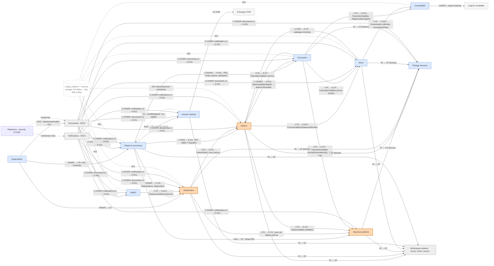

# Context map

Notation : `U` amont, `D` aval ; `OHS/PL` côté amont, `ACL`/`CF` côté aval ; `SK` shared kernel. Intégration cible : **événements asynchrones** (outbox, in-process dans le monolithe modulaire) pour les faits ; **requêtes synchrones** via port uniquement pour des lectures de référence ; **aucune base partagée** en cible (un schéma par contexte, ADR 0008).

## Tableau des relations

| # | Amont (U) | Aval (D) | Pattern | Style | Contenu | Signal / remarque |
|---|---|---|---|---|---|---|
| R1 | Organisation | tous | OHS + PL / Conformist + **Shared Kernel minimal** (`CenterId`, `SocieteId`) | requête + événement `CentreTransféré` | identité de centre, salles, créneaux | hub `CenterId` 321 importeurs ; ADR 0010 |
| R2 | Patient & couverture | Planification | Customer–Supplier | événements | `PatientAdmis`, `PatientSorti` → libération de place | remplace `Patient.java:126` + cron 04:00 ; ADR 0005 |
| R3 | Patient & couverture | Séance | Customer–Supplier (OHS) | requête synchrone | « PEC valide à cette date ? » | `PecDomainService.java:72` (`canCreateSession`) |
| R4 | Patient & couverture | Facturation | Customer–Supplier, **ACL** côté Facturation | événements + requête | PEC effective/demandée, forfait, payeur, attestation | traduction PEC → payeur/ligne |
| R5 | Patient & couverture | Absences patients | Conformist | requête | forfait PEC HT pour valorisation | RG-ABS-030 |
| R6 | Planification | Séance | Customer–Supplier (PL) | événements | séances programmées (`PatientPlacé`, jours) | création de séance programmée ; dérogation hors planning reste en Séance |
| R7 | Planification | Absences patients | Customer–Supplier (PL) | événements / requête | jours de dialyse prévus | base de la détection RG-ABS-040 |
| R8 | GMAO | Planification | Customer–Supplier, ACL côté Planification | événements | `ÉquipementMisHorsService` → générateur indisponible | « équipement » ≠ « générateur » ; impact à valider (ES #70) |
| R9 | Séance | Facturation | **OHS + PL / ACL** | événements | `SéanceValidée`, `SéanceSignée`, `ForfaitDeSéanceSurchargé` → projection « séance facturable » | supprime `SeanceFacturationJdbcAdapter` (SQL direct) ; ADR 0002 |
| R10 | Facturation | Séance | Published Language / Conformist | événement | `FacturationValidée` → verrou de la séance | réciprocité R9/R10 = couplage fort à surveiller (Partnership de fait entre équipes) |
| R11 | Séance | Absences patients | Customer–Supplier (PL) | événement | `SéanceValidée` ferme la détection | RG-ABS-012 |
| R12 | Facturation | Absences patients | Published Language / Conformist | événements | `FacturationValidée`, `PériodeDeFacturationClôturée`, taux TVA | RG-ABS-024 ; « facture clôt les absences » |
| R13 | Séance | Stock | Customer–Supplier, ACL côté Stock | événement | `ConsommablesDeSéanceDéclarés` (à la validation) → sortie FEFO | remplace l'appel direct `bc-seance → bc-stock` (4 arêtes, 45 co-change) |
| R14 | Stock | Séance | OHS / Conformist | requête | catalogue d'articles (consommables) | `bc-seance → bc-article` 3 arêtes ; ADR 0006 |
| R15 | Facturation | Stock | Published Language / Conformist | événement | `FacturationValidée` → sorties non annulables | RG-SEA-002 |
| R16 | Facturation | Comptabilité | Customer–Supplier, **ACL** côté Comptabilité | événements | ventes, règlements | existe déjà (`FacturationValideeEvent`, `FactureReglementRecordedEvent`) |
| R17 | Stock | Comptabilité | Customer–Supplier, ACL | événements | réceptions, sorties, inventaires valorisés au PMP | remplace la lecture du stock par `ComptabiliteStockService` + cron 03:15 |
| R18 | Patient & couverture | Dossier médical | Conformist | requête | identité patient | 0 arête aujourd'hui |
| R19 | Dossier médical | Patient & couverture | Published Language | événement | `GreffeRéalisée` → proposition de sortie | **à valider** (H7) |
| R20 | Séance, Planif., Absences, Stock, Facturation | Pilotage direction | Published Language / Conformist | événements → projections | indicateurs, instantané mensuel | CQRS, aucune écriture amont |
| R21 | tous | Génériques restants (Identité & accès, Audit, Licence) | PL / Conformist | événements | audit ; *(les notifications passent à R28, ADR 0140)* | — |
| R22 | Comptabilité | Logiciel comptable | OHS + PL (format d'export) | fichier | écritures exportées | RG-CPT-004 |
| R23 | Dossier médical | Échanges FHIR | Published Language (FHIR) | export | — | — |
| R24 *(proposed, ADR 0140)* | Organisation | Documents | Customer–Supplier, OHS ; **ACL** côté Documents | requête | `IdentiteImprimable` : nom, adresse, logo, pied de la société/centre | remplace la lecture JPA de `societes` par `SocieteLogoService` |
| R25 | Documents | Séance (cahier de dialyse), GMAO (bon d'intervention), Stock (inventaire, feuille de comptage), Facturation (synthèse mensuelle), Pilotage (rapport PDF Direction), Dossier médical (greffe, statistiques PDF), Planification (présence, calendrier de proposition) | **OHS + PL** (`documents.v1`) / **ACL** côté consommateur | requête synchrone | `RenduDeDocument`, `PapierEnTeteDuCentre` | PL5-PL9 ; chaque contexte garde mise en page et données |
| R26 | chaque contexte producteur | Documents | Published Language (`TypeDeDocumentDeclare`) / Conformist côté Documents | déclaration au démarrage | type, libellé, gabarit par défaut, paramètres attendus | Documents ne dépend d'aucun contexte ; contrat de paramètres versionné |
| R27 | plateforme (sécurité, rôles, audit) | Documents, Notifications | Conformist | session | rôle ADMIN/SUPERADMIN sur les écritures de modèles ; garde de centre | A1-A3 restent plateforme |
| R28 | Notifications | Patient & couverture, Dossier médical, Séance, Planification, Absences patients, Stock, GMAO | **OHS + PL** (`notifications.v1`) / **ACL** côté émetteur | appel synchrone, après commit | `DemandeDeNotification` (centre, type, contenu, audience) | remplace R21 pour les notifications ; retire les ACL `*Legacy` (PL13) |
| R29 | plateforme (transport STOMP) | Notifications | ACL (port `DiffusionEnTempsReel`) | appel | diffusion temps réel aux connectés du centre | A6 reste plateforme |
| — | Pilotage direction | Notifications | Separate Ways (à confirmer, Q11) | — | alertes de direction ≠ notifications | — |
| — | Dossier médical | Facturation, Stock, GMAO… | Separate Ways | — | — | aucun besoin identifié |
| — | GMAO | Stock | Separate Ways (à valider) | — | — | 0 arête gmao↔stock ; pièces détachées ? |

## Flux d'événements inter-contextes (chaîne de valeur)

`PatientAdmis` → Planif. place → `PatientPlacé` → Séance créée → `SéanceValidée` → { Stock : sortie FEFO ; Absences : jour couvert ; Facturation : séance facturable } → `FacturationValidée` → { Séance : verrou ; Stock : verrou sorties ; Absences : période figée ; Comptabilité : écriture de ventes } → `RèglementEnregistré` → Comptabilité : écriture de trésorerie.
Clôtures mensuelles (ADR 0009) : Absences (`MoisDAbsencesClôturé`), Facturation (`PériodeDeFacturationClôturée`), Stock (`InventaireClôturé`), Comptabilité (`PériodeComptableClôturée`) — ordre proposé : absences → facturation → stock → comptable.
Crons métier : chacun devient une **politique** dans son contexte propriétaire (ex. détection d'absence dans Absences, libération de place dans Planification) ; l'ordre implicite 02:30 → 04:00 (H9) est remplacé par des événements.

## Frontière Strangler (ADR 0008)

| Contexte | Situation | Legacy concerné | Ordre d'extraction proposé (à arbitrer au gate `plan`) |
|---|---|---|---|
| GMAO | **extrait** (G1-G6) | `bc-gmao` retiré | 1 (isolé, risque bas) — livré |
| Comptabilité | **extrait** (C1-C7) | `bc-comptabilite` retiré | 2 — livré |
| Facturation | **extrait** (F1-F7) | `bc-facturation`, `bc-reglement` retirés | 3 — livré |
| Absences patients | **extrait** (A1-A6) | `bc-seance/domain/absence` retiré | 4 — livré |
| Stock | **extrait** (S1-S8) | `bc-stock`, `bc-article` retirés | 5 — livré |
| Planification | **extrait** (P1-P8) | `bc-seance/domain/{planning,infirmier}`, Timefold retirés | 6 — livré |
| Patient & couverture | **extrait** (`contexts/patient-couverture`) | `bc-*` patient retirés | livré |
| Séance | **extrait** (`contexts/seance`, SE1-SE7f, ADR 0090-0100) | `bc-seance/domain/seance` retiré | livré |
| Dossier médical | **extrait** (`contexts/dossier-medical`, DM, ADR 0101) | `bc-medical` retiré | livré |
| Organisation | **extrait** (`contexts/organisation`, O1-O4, ADR 0107-0109) | `bc-referential` retiré | livré |
| Pilotage direction | **extrait** (`contexts/pilotage-direction`, PD1-PD6, PL10, ADR 0102-0106, 0152) | tableaux de bord de `platform` retirés | livré |
| Documents *(ADR 0140)* | **extrait** (`contexts/documents` + `documents-api`, DOC2-DOC5j, ADR 0162-0167, 0198-0202) : moteur de rendu, modèles, versions, types, papier en-tête | `reporting/*` retirés | livré ; aucun SQL embarqué (ADR 0202) |
| Notifications *(ADR 0140)* | **extrait** (`contexts/notifications`, NOT1-NOT2, PL13a-d) | `application/notification` retiré | livré |
| **Extraits** | **13** contextes dans `backend/contexts` (+ `shared-kernel`, `documents-api`) : GMAO, Comptabilité, Facturation, Absences patients, Stock, Planification, Patient & couverture, Séance, Dossier médical, Organisation, Pilotage direction, Documents, Notifications | — | tous livrés |

État de `backend/platform` (décommissionnement ADR 0162-0206, revue globale du 2026-11-15) : il ne garde que le **noyau** (identité, licence, audit, supervision, transport STOMP et ses relais, façade ADR 0161, outil de reprise, Flyway V1-V59 centralisé, ADR 0205) et **10 ACL** (`organisation/{Creneaux,Medecins,Salles,Referentiels}`, `patientcouverture/{Transporteurs,Forfaits,Payeurs,Referentiels}`, `reprise/AppariementParLesContextes`, `gmao/GenerateursDeRepriseGmao`), conservées à cause du cycle Maven (`platform -> contexts-*`, ADR 0192) ; retrait avec la façade ADR 0161 et l'outil de reprise (événement « fin de la reprise de production » ET retrait de la façade ADR 0161, sans date : ADR 0204, 0207). Flyway désormais V1-V60 (V60 archive 4 tables mortes en `archive_*`, ADR 0207).

Relations ajoutées depuis la carte initiale :
| Relation | Contextes | Type |
|---|---|---|
| R-DOC5 | Documents ⇐ jeux de données (`LIGNES`) fournis par Patient & couverture, Stock, GMAO, Dossier médical, Planification, Séance, Facturation, via le port publié de `documents-api` ; Documents ne lit plus aucune table (ADR 0202) | Customer-Supplier / Published Language |
| R-STK-PIL | Pilotage direction ⇐ Stock (valorisation) ; le cache est vidé par un écouteur du Pilotage sur le langage publié de Stock (ADR 0203) | Conformist + événement publié |
| R-ORG-AVAL | Organisation ⇒ lit le langage publié de Stock et GMAO (pom organisation -> stock, gmao) (ADR 0206) | Conformist |
| R-REPRISE | Outil de reprise (platform) ⇒ ports `RepriseDes*` de Patient & couverture ; aucune table d'un contexte (ADR 0173, 0204) | Open Host Service / ACL |

La règle de transition legacy est soldée : plus aucun contexte n'est dans le legacy ; la plateforme parle aux contextes uniquement par leur langage publié ou ses ACL conservées. Détail par contexte : `backend/contexts/README.md` et les glossaires `.ddd/strategic/glossaries/`.

## Questions ouvertes
1. Un générateur mis hors service doit-il déplacer automatiquement les patients placés dessus (R8) ? Hypothèse : alerte + proposition de replacement, pas de déplacement automatique.
2. Ordre des clôtures mensuelles : la clôture comptable exige-t-elle facturation et stock clos ? Hypothèse : oui (absences → facturation → stock → comptable).
3. La GMAO consomme-t-elle des pièces détachées du stock ? Hypothèse : non (Separate Ways).
4. Ordre d'extraction : la direction préfère-t-elle sécuriser l'argent d'abord (comptabilité/facturation) plutôt que GMAO ? Hypothèse : GMAO d'abord pour roder le pipeline, puis comptabilité.
5. Voir `bounded-contexts.md` § Questions ouvertes — amendement 2026-11-12 (Q5-Q12, ADR 0140 `proposed`) : audience des notifications, gabarits standards, SQL dans les gabarits, Excel, logo, purge, alertes de direction, envoi après commit.
