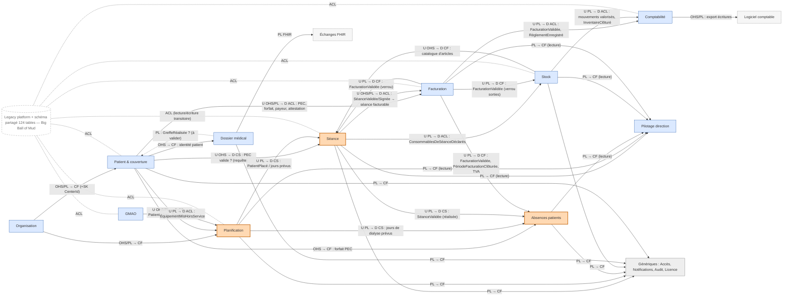

# Context map

Notation : `U` amont, `D` aval ; `OHS/PL` côté amont, `ACL`/`CF` côté aval ; `SK` shared kernel. Intégration cible : **événements asynchrones** (outbox, in-process dans le monolithe modulaire) pour les faits ; **requêtes synchrones** via port uniquement pour des lectures de référence ; **aucune base partagée** en cible (un schéma par contexte, ADR 0008).

## Tableau des relations

| # | Amont (U) | Aval (D) | Pattern | Style | Contenu | Signal / remarque |
|---|---|---|---|---|---|---|
| R1 | Organisation | tous | OHS + PL / Conformist + **Shared Kernel minimal** (`CenterId`, `SocieteId`) | requête + événement `CentreTransféré` | identité de centre, salles, créneaux | hub `CenterId` 321 importeurs ; ADR 0010 |
| R2 | Patient & couverture | Planification | Customer–Supplier | événements | `PatientAdmis`, `PatientSorti` → libération de place | remplace `Patient.java:126` + cron 04:00 ; ADR 0005 |
| R3 | Patient & couverture | Séance | Customer–Supplier (OHS) | requête synchrone | « PEC valide à cette date ? » | `PecDomainService.java:72` (`canCreateSession`) |
| R4 | Patient & couverture | Facturation | Customer–Supplier, **ACL** côté Facturation | événements + requête | PEC effective/demandée, forfait, payeur, attestation | traduction PEC → payeur/ligne |
| R5 | Patient & couverture | Absences patients | Conformist | requête | forfait PEC HT pour valorisation | RG-ABS-030 |
| R6 | Planification | Séance | Customer–Supplier (PL) | événements | séances programmées (`PatientPlacé`, jours) | création de séance programmée ; dérogation hors planning reste en Séance |
| R7 | Planification | Absences patients | Customer–Supplier (PL) | événements / requête | jours de dialyse prévus | base de la détection RG-ABS-040 |
| R8 | GMAO | Planification | Customer–Supplier, ACL côté Planification | événements | `ÉquipementMisHorsService` → générateur indisponible | « équipement » ≠ « générateur » ; impact à valider (ES #70) |
| R9 | Séance | Facturation | **OHS + PL / ACL** | événements | `SéanceValidée`, `SéanceSignée`, `ForfaitDeSéanceSurchargé` → projection « séance facturable » | supprime `SeanceFacturationJdbcAdapter` (SQL direct) ; ADR 0002 |
| R10 | Facturation | Séance | Published Language / Conformist | événement | `FacturationValidée` → verrou de la séance | réciprocité R9/R10 = couplage fort à surveiller (Partnership de fait entre équipes) |
| R11 | Séance | Absences patients | Customer–Supplier (PL) | événement | `SéanceValidée` ferme la détection | RG-ABS-012 |
| R12 | Facturation | Absences patients | Published Language / Conformist | événements | `FacturationValidée`, `PériodeDeFacturationClôturée`, taux TVA | RG-ABS-024 ; « facture clôt les absences » |
| R13 | Séance | Stock | Customer–Supplier, ACL côté Stock | événement | `ConsommablesDeSéanceDéclarés` (à la validation) → sortie FEFO | remplace l'appel direct `bc-seance → bc-stock` (4 arêtes, 45 co-change) |
| R14 | Stock | Séance | OHS / Conformist | requête | catalogue d'articles (consommables) | `bc-seance → bc-article` 3 arêtes ; ADR 0006 |
| R15 | Facturation | Stock | Published Language / Conformist | événement | `FacturationValidée` → sorties non annulables | RG-SEA-002 |
| R16 | Facturation | Comptabilité | Customer–Supplier, **ACL** côté Comptabilité | événements | ventes, règlements | existe déjà (`FacturationValideeEvent`, `FactureReglementRecordedEvent`) |
| R17 | Stock | Comptabilité | Customer–Supplier, ACL | événements | réceptions, sorties, inventaires valorisés au PMP | remplace la lecture du stock par `ComptabiliteStockService` + cron 03:15 |
| R18 | Patient & couverture | Dossier médical | Conformist | requête | identité patient | 0 arête aujourd'hui |
| R19 | Dossier médical | Patient & couverture | Published Language | événement | `GreffeRéalisée` → proposition de sortie | **à valider** (H7) |
| R20 | Séance, Planif., Absences, Stock, Facturation | Pilotage direction | Published Language / Conformist | événements → projections | indicateurs, instantané mensuel | CQRS, aucune écriture amont |
| R21 | tous | Génériques | PL / Conformist | événements | notifications, audit | — |
| R22 | Comptabilité | Logiciel comptable | OHS + PL (format d'export) | fichier | écritures exportées | RG-CPT-004 |
| R23 | Dossier médical | Échanges FHIR | Published Language (FHIR) | export | — | — |
| — | Dossier médical | Facturation, Stock, GMAO… | Separate Ways | — | — | aucun besoin identifié |
| — | GMAO | Stock | Separate Ways (à valider) | — | — | 0 arête gmao↔stock ; pièces détachées ? |

## Flux d'événements inter-contextes (chaîne de valeur)

`PatientAdmis` → Planif. place → `PatientPlacé` → Séance créée → `SéanceValidée` → { Stock : sortie FEFO ; Absences : jour couvert ; Facturation : séance facturable } → `FacturationValidée` → { Séance : verrou ; Stock : verrou sorties ; Absences : période figée ; Comptabilité : écriture de ventes } → `RèglementEnregistré` → Comptabilité : écriture de trésorerie.
Clôtures mensuelles (ADR 0009) : Absences (`MoisDAbsencesClôturé`), Facturation (`PériodeDeFacturationClôturée`), Stock (`InventaireClôturé`), Comptabilité (`PériodeComptableClôturée`) — ordre proposé : absences → facturation → stock → comptable.
Crons métier : chacun devient une **politique** dans son contexte propriétaire (ex. détection d'absence dans Absences, libération de place dans Planification) ; l'ordre implicite 02:30 → 04:00 (H9) est remplacé par des événements.

## Frontière Strangler (ADR 0008)

| Contexte | Situation | Legacy concerné | Ordre d'extraction proposé (à arbitrer au gate `plan`) |
|---|---|---|---|
| GMAO | **restant** — candidat n°1 | `bc-gmao` + adapters `platform` | 1 (isolé, risque bas) |
| Comptabilité | restant | `bc-comptabilite`, listeners, cron 03:15 | 2 (déjà événementiel ; filet de caractérisation d'abord, 0 test) |
| Facturation | restant | `bc-facturation`, `bc-reglement`, `SeanceFacturationJdbcAdapter` | 3 (ACL de lecture des séances legacy le temps de la migration) |
| Absences patients | restant | `bc-seance/domain/absence`, cron 02:30 | 4 |
| Stock | restant | `bc-stock`, `bc-article` | 5 |
| Planification | restant | `bc-seance/domain/{planning,infirmier}`, Timefold | 6 |
| Patient & couverture | restant | 4 `bc-*` | 7 |
| Séance | restant | `bc-seance/domain/seance`, `SeanceRestController` (1209 l.) | 8 (cœur, le plus couplé : en dernier, quand ses voisins consomment ses événements) |
| Dossier médical, Organisation, Direction, Génériques | restant | `bc-medical`, `bc-referential`, `platform` | à planifier |
| **Extraits** | **aucun** (`backend/contexts` n'existe pas encore) | — | — |

Règle de transition : tant qu'un contexte est dans le legacy, les contextes extraits lui parlent **uniquement via une ACL** (adapter qui traduit le modèle legacy — ex. `SeanceStatus.ABSENT` → « exclue de facturation ») ; le legacy lit les données extraites via la façade de routage, jamais par leurs tables.

## Questions ouvertes
1. Un générateur mis hors service doit-il déplacer automatiquement les patients placés dessus (R8) ? Hypothèse : alerte + proposition de replacement, pas de déplacement automatique.
2. Ordre des clôtures mensuelles : la clôture comptable exige-t-elle facturation et stock clos ? Hypothèse : oui (absences → facturation → stock → comptable).
3. La GMAO consomme-t-elle des pièces détachées du stock ? Hypothèse : non (Separate Ways).
4. Ordre d'extraction : la direction préfère-t-elle sécuriser l'argent d'abord (comptabilité/facturation) plutôt que GMAO ? Hypothèse : GMAO d'abord pour roder le pipeline, puis comptabilité.
