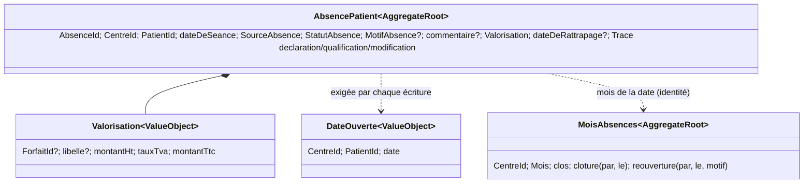

# Modèle tactique — Absences patients

> **Proposition à valider au gate tactique.** Refactoring sur place (ADR 0024) : nouveau module
> `backend/contexts/absences-patients`, **même table** `absence_patient`, **mêmes URLs** `/api/v1/absences-patients/**`,
> filet de caractérisation (golden) avant tout code, livraison en une fois par slice, aucune façade ni routage.
> Le legacy est déjà assez riche (`AbsencePatient` porte le cycle de vie) : on le **déplace et on le resserre**, on ne le
> réinvente pas. Seule nouveauté : la **clôture mensuelle des absences** (ADR 0009), à faire en dernier.
> Homonymie (H1) : *absence de patient* (ici) ≠ *absence d'infirmier* (Planification) ≠ statut de séance `ABSENT`
> (= « exclue de facturation », Facturation).

## 1. Process-level event storming (filtré Absences)

| Acteur / déclencheur | Commande | Agrégat | Événement de domaine | Read model |
|---|---|---|---|---|
| Cron 02:30 (chaque centre) | ControlerLesAbsences (7 derniers jours, hors aujourd'hui) | AbsencePatient × N | `AbsenceAnnulee` (réconciliation), `AbsenceDetectee` | synthèse → notification `ABSENCES_A_QUALIFIER` |
| Démarrage du serveur | ControlerLesAbsences (31 jours, sans notification) | AbsencePatient × N | idem | — |
| ADMIN | DetecterUnePeriodePassee(du, au) | AbsencePatient × N | idem | nombre créées / annulées |
| ADMIN / SECRETAIRE / INFIRMIER | DeclarerUneAbsence(patient, date, motif?, commentaire?) | AbsencePatient | `AbsenceDeclaree` (+ `AbsenceQualifiee` si motif) | liste, semaine du planning |
| Facturation (exclusion d'une séance) | DeclarerUneAbsence via `DeclarationDesAbsences` | AbsencePatient | `AbsenceDeclaree` + `AbsenceQualifiee` | — |
| Facturation (réinclusion) | RetirerLAbsenceDeLExclusion via `DeclarationDesAbsences.retirer` | AbsencePatient | (suppression physique, ADR 0031) | — |
| ADMIN / SECRETAIRE / MEDECIN / INFIRMIER (correction : ADMIN / MEDECIN) | QualifierUneAbsence(motif, commentaire) | AbsencePatient | `AbsenceQualifiee` | liste |
| idem | RattraperUneAbsence(dateDeRattrapage) | AbsencePatient | `AbsenceRattrapee` | liste des séances de rattrapage |
| idem (correction : ADMIN / MEDECIN) | AnnulerUneAbsence(commentaire) | AbsencePatient | `AbsenceAnnulee` | liste |
| ADMIN *(nouveau)* | CloturerLeMoisDAbsences(mois) | MoisAbsences | `MoisDAbsencesCloture` | état des mois |
| ADMIN *(nouveau)* | RouvrirLeMoisDAbsences(mois, motif) | MoisAbsences | `MoisDAbsencesRouvert` | état des mois |
| DIRECTION | (lecture) part Absences du pilotage | — | — | volumes, motifs, valorisation HT/TTC, taux |

## 2. Règles & invariants (classement)

| # | Règle (RG) | Nature | Porteur cible | Équivalent legacy |
|---|---|---|---|---|
| A1 | Au plus **une absence par patient et par jour**, même annulée (RG-ABS-001, 042) | invariant d'ensemble | contrainte unique `(center_id, patient_id, date_seance)` + `AbsencesRepository.existe` | `AbsencePatientService.java:101`, V13 `UNIQUE` |
| A2 | Cycle : `A_QUALIFIER → JUSTIFIEE/NON_JUSTIFIEE → RATTRAPEE` ; `ANNULEE` à tout moment ; rattrapée ou annulée = **plus modifiable** ; annulation définitive (RG-ABS-003) | invariant | `AbsencePatient` | `AbsencePatient.java:113-181` |
| A3 | Motif obligatoire pour qualifier ; `NON_JUSTIFIEE` est le seul non justifiant ; `AUTRE` exige un commentaire (RG-ABS-004, 005) | invariant de valeur | VO `MotifAbsence` + `AbsencePatient.qualifier` | `MotifAbsence.java`, `AbsencePatient.java:115-119` |
| A4 | Requalifier une absence déjà qualifiée exige un commentaire **et** le droit de correction (ADMIN/MEDECIN) ; même droit pour annuler une absence déjà qualifiée (RG-ABS-020, 022) | invariant + autorisation | `AbsencePatient` (commentaire) ; `DroitDeCorrection` passé par le use case | `AbsencePatientService.java:57-62`, contrôleur `peutCorriger` :64 |
| A5 | Déclaration : date ni future ni plus ancienne que **60 jours** ; patient du centre ; pas de séance réalisée ce jour (RG-ABS-010..012) | invariant de création | fabrique `AbsencePatient.declarer` + ports | `AbsencePatient.java:87-103`, service :97-112 |
| A6 | Déclaration avec motif = qualifiée d'emblée, sans motif = « à qualifier » (RG-ABS-013) | règle de création | `AbsencePatient.declarer` | `AbsencePatient.java:101` |
| A7 | Rattrapage : date requise, **après** la séance manquée, pas future, séance réalisée ce jour-là ; **une séance ne rattrape qu'une absence** du patient (RG-ABS-021) | invariant (+ ensemble pour l'unicité) | `AbsencePatient.rattraper` + `AbsencesRepository.datesDeRattrapage` | `AbsencePatient.java:137-152`, service :122-134 |
| A8 | Toute écriture est refusée si la **date n'est pas ouverte** : période facturée pour le patient (RG-ABS-024) ou, à terme, mois d'absences clos | invariant temporel | VO `DateOuverte` exigé par chaque commande | service `exigerPeriodeOuverte` :259-264 |
| A9 | **Valorisation figée à la création** : forfait PEC applicable (HT) × (1 + taux/100), HT et TTC arrondis à 2 décimales HALF_UP ; sans forfait = 0 ; exonéré/absent = 0 % ; jamais négative ; jamais recalculée (RG-ABS-030..032) | invariant monétaire | VO `Valorisation` | `ValeurAbsence.depuisHt`, `ValorisationAbsenceService` |
| A10 | Absence comptabilisée tant que ni rattrapée ni annulée (RG-ABS-006) | règle de calcul | `StatutAbsence.comptabilisee()` | `StatutAbsence.java` |
| A11 | Absence **en retard** : « à qualifier » et séance manquée + 3 jours < aujourd'hui (RG-ABS-043) | règle de calcul | `AbsencePatient.enRetard` | `AbsencePatient.java:173`, `countEnRetard` |
| A12 | Détection : patient attendu (RG-ABS-041) sans séance réalisée, pas d'absence existante, période non facturée → absence « à qualifier », source détectée (RG-ABS-040, 042) ; idempotente ; un centre en échec n'arrête pas les autres | politique (cohérence éventuelle) | `DetectionAbsences` | service `detecter` :163-173, scheduler |
| A13 | Réconciliation : « à qualifier » + séance réalisée ce jour → annulée, commentaire « Séance réalisée à cette date », sans auteur (RG-ABS-040) | politique | `ReconciliationAbsences` | service `reconcilier` :181-199 |
| A14 | Notification `ABSENCES_A_QUALIFIER` (nombre à qualifier, nombre en retard) après le contrôle de nuit si > 0 ; jamais au démarrage (RG-ABS-044, 045) | politique | `NotificationDesAbsencesAQualifier` | scheduler :68-79, `NotificationService.notifyAbsencesAQualifier` |
| A15 | Détection d'une période passée : fin ramenée à hier, début ≤ fin, ≤ 366 jours (RG-ABS-046) | validation d'entrée | use case | service :222-237 |
| A16 | Chaque écriture trace auteur et horodatage ; déclaration et qualification ont les leurs (RG-ABS-025) | invariant | `AbsencePatient` (`Trace`) | colonnes `*_par`, `*_le` |
| A17 | Isolation par centre : aucune lecture ni écriture hors du centre courant (RG-ABS-023, 050) | autorisation | tous use cases / repositories | `centerAccessGuard`, `ABSENCE_INTROUVABLE` |
| A18 | **Mois d'absences clos** : plus de déclaration, qualification, rattrapage, annulation, détection ni réconciliation pour une date du mois ; réouverture avec motif *(nouveau, ADR 0009, détails en Q1-Q4)* | invariant temporel proposé | `MoisAbsences` | — (à créer) |

## 3. Carte du modèle

Deux agrégats, tous deux d'**une seule entité**. Aucun ne contient l'autre : le mois n'embarque pas ses absences
(collection non bornée), l'absence ne charge pas le mois (elle reçoit une `DateOuverte`).

## 4. Aggregate Design Canvas

### Absence de patient (root: `AbsencePatient`) — contexte absences-patients — type: core (à confirmer)

- **Intention** : suivre une séance prévue et non faite jusqu'à son issue (qualifiée, rattrapée ou annulée) en gardant
  sa valeur perdue.
- **Invariants** : A2, A3, A4 (commentaire), A5 (dates), A6, A7 (dates), A8 (via `DateOuverte`), A9 (valeur figée),
  A16.
- **Identité** : `AbsenceId` (UUID généré par l'application, comme aujourd'hui) ; clé métier unique
  `(CentreId, PatientId, dateDeSeance)`.
- **État** : statut, source, motif?, commentaire?, `Valorisation`, date de rattrapage?, traces. Références par identité :
  `CentreId`, `PatientId` ; la séance de rattrapage n'est connue que par sa **date** (comme le legacy).
- **Commandes → événements** :
  `detecter(...)` → `AbsenceDetectee` ; `declarer(..., motif?)` → `AbsenceDeclaree` (+ `AbsenceQualifiee`) ;
  `qualifier(motif, commentaire, auteur, droitDeCorrection, DateOuverte)` → `AbsenceQualifiee` ;
  `rattraper(date, auteur, aujourdhui, DateOuverte)` → `AbsenceRattrapee` ;
  `annuler(commentaire, auteur, droitDeCorrection, DateOuverte)` → `AbsenceAnnulee` ;
  `reconcilier(instant)` → `AbsenceAnnulee` (commentaire imposé, sans auteur).
- **Rejets (codes legacy conservés)** : `ABSENCE_DATE_FUTURE`, `ABSENCE_DELAI_DEPASSE`, `ABSENCE_MOTIF_REQUIS`,
  `ABSENCE_COMMENTAIRE_REQUIS`, `ABSENCE_CORRECTION_INTERDITE`, `ABSENCE_NON_MODIFIABLE`, `ABSENCE_DEJA_ANNULEE`,
  `ABSENCE_RATTRAPAGE_DATE_REQUISE`, `ABSENCE_RATTRAPAGE_ANTERIEUR`, `ABSENCE_PERIODE_FACTUREE` ; au niveau use case :
  `PATIENT_INTROUVABLE`, `ABSENCE_INTROUVABLE`, `ABSENCE_EXISTANTE`, `ABSENCE_SEANCE_REALISEE`,
  `ABSENCE_RATTRAPAGE_SANS_SEANCE`, `ABSENCE_RATTRAPAGE_DEJA_UTILISEE` ; à créer : `MOIS_D_ABSENCES_CLOS`.
- **Cohérence** : une transaction = une absence (le legacy n'a **aucune** transaction de service, cf. §12 B5). Les
  invariants d'ensemble A1/A7-unicité sont tenus par la base (contrainte existante pour A1, proposée pour A7, Q7).
- **Concurrence / volumétrie** : la table n'a pas de colonne `version` ; proposition simple : `UPDATE … WHERE id AND
  statut = <statut lu>` (aucune migration) pour refuser une écriture concurrente (Q8). Volume : ≤ quelques dizaines
  d'absences par centre et par jour.
- **Tests clés** : voir §9.

### Mois d'absences (root: `MoisAbsences`) — contexte absences-patients — type: core, **nouveau** (ADR 0009)

- **Intention** : arrêter le mois des absences d'un centre pour que les chiffres de perte ne bougent plus.
- **Invariants** : un mois clos refuse toute écriture d'absence datée dans ce mois (A18) ; réouverture avec motif
  obligatoire ; clore un mois clos ou rouvrir un mois ouvert est refusé.
- **Identité** : `CentreId + Mois` ; un mois sans ligne est ouvert (comme `MoisDeFacturation`, ADR 0037).
- **Commandes → événements** : `cloturer(auteur, instant, absencesAQualifierRestantes)` → `MoisDAbsencesCloture` ;
  `rouvrir(auteur, instant, motif)` → `MoisDAbsencesRouvert`.
- **Rejets proposés** : `MOIS_D_ABSENCES_DEJA_CLOS` (409), `MOIS_D_ABSENCES_NON_CLOS` (409),
  `MOTIF_DE_REOUVERTURE_OBLIGATOIRE` (400), + règle d'ordre avec la Facturation à trancher (Q3).
- **Cohérence / concurrence** : même mécanisme que F7, déjà prouvé : verrou de la ligne du mois (`SELECT … FOR UPDATE`,
  ligne créée ouverte si absente) pris par la clôture **et** par chaque écriture d'absence du mois. Journal append-only.
- **Tables (migration additive)** : `mois_absences` + `mois_absences_journal` (noms à confirmer à la slice).

## 5. Value Objects (immuables, validés à la construction)

| VO | Règle | Nom legacy |
|---|---|---|
| `AbsenceId`, `PatientId`, `ForfaitId` | identifiants typés | `UUID` |
| `CentreId` | noyau partagé minimal (ADR 0010), copie locale comme dans `gmao`/`comptabilite`/`facturation` | `UUID center_id` |
| `MotifAbsence` | 9 valeurs ; `justifiante()` faux seulement pour `NON_JUSTIFIEE` ; `commentaireRequis()` pour `AUTRE` | `MotifAbsence` (identique) |
| `StatutAbsence` | 5 valeurs ; `comptabilisee()` ; `modifiable()` (ni `RATTRAPEE` ni `ANNULEE`) | `StatutAbsence` |
| `SourceAbsence` | `AUTOMATIQUE` (détectée) / `DECLAREE` ; valeur stockée et renvoyée inchangée | `SourceAbsence` |
| `Valorisation` | `depuisHt(forfait?, prixHt, taux)` : HT = prixHt arrondi 2 déc. HALF_UP ; TTC = HT × (1 + taux/100) arrondi 2 déc. HALF_UP ; aucun montant ni taux négatif ; `nulle(taux)` sans forfait | `ValeurAbsence` (colonnes `prix_ttc`, `taux_tva`, `montant_ht`) |
| `Commentaire` | rogné ; vide = absent ; ≤ 1000 caractères (colonne) | `nettoyer()` |
| `DateOuverte` | preuve construite par le use case : date non facturée pour le patient **et** mois d'absences ouvert ; exigée par chaque écriture | `exigerPeriodeOuverte` |
| `Mois` | `YearMonth` | — |
| `PeriodeDeDetection` | du ≤ au, au ≤ hier, ≤ 366 jours | `rattraperPeriode` |
| `SyntheseDesAbsences` | (à qualifier, en retard) | `Synthese` |

## 6. Services de domaine & politiques

| Élément | Type | Rôle | Ports |
|---|---|---|---|
| `ValorisationDUneAbsence` | service de domaine (sans état) | forfait applicable + taux → `Valorisation` | `ForfaitsDesPatients`, `TauxDeTva` |
| `DetectionAbsences` | politique (use case planifié) | pour chaque jour de la fenêtre et chaque patient attendu sans séance réalisée, sans absence existante, date ouverte → `AbsencePatient.detecter` ; une absence = une transaction | `PatientsAttendus`, `AbsencesRepository`, `FacturationDuPatient`, `MoisAbsencesRepository` |
| `ReconciliationAbsences` | politique | « à qualifier » de la fenêtre dont la séance est réalisée → `reconcilier` | `SeancesRealisees`, `AbsencesRepository` |
| `NotificationDesAbsencesAQualifier` | politique | après le contrôle de nuit, si à qualifier > 0 → notification (rien au démarrage) | `NotificationsDuCentre` |
| Délai de qualification (3 j) | règle du domaine | `enRetard` ; constante, pas de paramétrage par centre (aujourd'hui) | `Horloge` |
| `DroitDeCorrection` | politique d'autorisation | ADMIN ou MEDECIN ; calculé à l'interface, passé à l'agrégat | — |

Pas de saga : aucun flux long entre contextes. La seule écriture « croisée » (exclusion de séance par la Facturation) reste
**synchrone dans la transaction de la Facturation** via le port qu'elle publie (`DeclarationDesAbsences`, ADR 0031).

## 7. Catalogue d'événements

### 7.1 Événements de domaine (internes, non publiés)

`AbsenceDetectee`, `AbsenceDeclaree`, `AbsenceQualifiee`, `AbsenceRattrapee`, `AbsenceAnnulee` (porteurs : `AbsenceId`,
`CentreId`, `PatientId`, date de séance, auteur, instant). **Aucun consommateur aujourd'hui** : on ne les publie pas
(pas de consommateur inventé). Ils servent seulement aux tests du domaine et, plus tard, au pilotage s'il passe aux
événements.

### 7.2 Événements publiés (Outbox Spring Modulith, ADR 0013) — seulement avec la clôture

| Événement v1 | Producteur → consommateurs | Payload | Garanties |
|---|---|---|---|
| `MoisDAbsencesCloture` | Absences → *aucun aujourd'hui* (Facturation/Pilotage plus tard) | `centre`, `mois`, `cloturePar`, `cloture` (instant), `absencesAQualifierRestantes` | publié dans la transaction de la clôture ; idempotence future par (centre, mois, instant) |
| `MoisDAbsencesRouvert` | idem | `centre`, `mois`, `rouvertPar`, `rouvert`, `motif` | idem |

Comme pour F7 : sans écouteur, le registre ne garde aucune publication en attente.

### 7.3 Ce qui existe déjà (état actuel → cible simple)

| Lien | Aujourd'hui | Cible (sans nouveau mécanisme) |
|---|---|---|
| Notification `ABSENCES_A_QUALIFIER` | appel direct `NotificationService.notifyAbsencesAQualifier` depuis le scheduler | port `NotificationsDuCentre` (adaptateur vers le même service) |
| Rafraîchissement temps réel `saisie("ABSENCE")` | appel du contrôleur à `SaisieInfirmierNotifier` après chaque écriture | même appel, depuis le contrôleur du nouveau module |
| Facturation → Absences : déclaration à l'exclusion, retrait à la réinclusion | `DeclarationDesAbsences` (publié par Facturation) implémenté par l'ACL `platform/.../acl/facturation/AbsencesDesPatientsLegacy` → `AbsencePatientService.declarer` / `DELETE` SQL | l'ACL appelle le use case `DeclarerUneAbsence` du contexte Absences et un use case `RetirerLAbsenceDeLExclusion` (même `DELETE`) ; contrat inchangé |
| Absences → Facturation : période facturée | `FacturationDuPatient.periodeFacturee` (port publié Facturation, déjà utilisé par `AbsenceDonneesJdbcAdapter:91`) | même port, adaptateur ACL dans le contexte |
| Absences → Comptabilité : taux de TVA | `ParametrageFiscal.regleApplicable(centre, "HEMODIALYSE", date)` (C7) | même port publié |
| `FacturationValidée` / `PeriodeDeFacturationCloturee` (context map R12) | **non consommés** : la période facturée est relue à la demande | rien à ajouter (lecture suffisante) |
| `SéanceValidée` (R11), jours prévus (R7) | **non consommés** : SQL direct sur `seances` et `patients` | ports `SeancesRealisees` / `PatientsAttendus` en ACL SQL (mêmes requêtes) |

## 8. Use cases ↔ agrégats ↔ ports (routes legacy exactes, préfixe `/api/v1/absences-patients`)

`ACCES` = `ADMIN, SECRETAIRE, MEDECIN, INFIRMIER` ; `DECLARATION` = `ADMIN, SECRETAIRE, INFIRMIER`. Centre : paramètre
`centerId` facultatif contrôlé par `centerAccessGuard`.

| Use case | Route / déclencheur | Rôles | Agrégat / lecture | Ports sortants |
|---|---|---|---|---|
| `ListerLesAbsences` (filtres statut, motif, patient, du/au, page, taille 20) | `GET /` | ACCES | lecture | `LectureDesAbsences` (nom du patient, `enRetard`) |
| `SuivreLaSemaine` (dimanche → samedi) | `GET /semaine?date=` | ACCES | lecture | `LectureDesAbsences`, `SeancesRealisees` |
| `ObtenirLaSynthese` | `GET /synthese` | ACCES | lecture | `LectureDesAbsences`, `Horloge` |
| `DetecterUnePeriodePassee` | `POST /rattrapage-detection` `{from,to}` | ADMIN | AbsencePatient × N | comme le contrôle de nuit |
| `DeclarerUneAbsence` | `POST /` `{patientId,dateSeance,motif?,commentaire?}` ; port `DeclarationDesAbsences.declarer` | DECLARATION | AbsencePatient | `Patients` (existence), `AbsencesRepository`, `SeancesRealisees`, `FacturationDuPatient`, `MoisAbsencesRepository`, `ForfaitsDesPatients`, `TauxDeTva`, `Horloge`, `GenerateurIdentifiants` |
| `QualifierUneAbsence` | `PUT /{id}/qualification` `{motif,commentaire?}` | ACCES (correction ADMIN/MEDECIN) | AbsencePatient | `AbsencesRepository`, `FacturationDuPatient`, `MoisAbsencesRepository`, `Horloge` |
| `ListerLesSeancesDeRattrapage` | `GET /{id}/seances-rattrapage` | ACCES | lecture | `SeancesRealisees`, `AbsencesRepository` |
| `RattraperUneAbsence` | `PUT /{id}/rattrapage` `{dateRattrapage}` | ACCES | AbsencePatient | + `SeancesRealisees` |
| `AnnulerUneAbsence` | `PUT /{id}/annulation` `{commentaire}` | ACCES (correction ADMIN/MEDECIN) | AbsencePatient | comme Qualifier |
| `ControlerLesAbsences` | cron `0 30 2 * * *` (7 j) + `ApplicationReadyEvent` (31 j, `app.absences.startup-catchup`) | système | AbsencePatient × N | `Centres`, `PatientsAttendus`, `SeancesRealisees`, `FacturationDuPatient`, `NotificationsDuCentre`, + création |
| `RetirerLAbsenceDeLExclusion` | port `DeclarationDesAbsences.retirer` (Facturation) | — | AbsencePatient | `AbsencesRepository.supprimer` |
| `ConsulterLesMoisDAbsences` *(nouveau)* | `GET /mois?annee=` (proposé, calqué sur F7) | ACCES | lecture | `MoisAbsencesRepository` |
| `CloturerLeMoisDAbsences` *(nouveau)* | `POST /mois/{YYYY-MM}/cloturer` | ADMIN | MoisAbsences | `MoisAbsencesRepository` (verrou), `LectureDesAbsences` (restantes), `Horloge`, `Outbox` |
| `RouvrirLeMoisDAbsences` *(nouveau)* | `POST /mois/{YYYY-MM}/rouvrir` `{motif}` | ADMIN | MoisAbsences | idem (+ `MoisDeFacturation` publié si Q3 = oui) |
| Lecture publiée pour le pilotage | `GET /api/v1/direction/absences` (DIRECTION, `DirectionAbsencesQueryService`) ; dashboard Séance `GET /api/v1/seances/dashboard[/details|/export]`, `/calendar?kind=absence` | — | lecture | port publié `AbsencesDuPilotage` (comptes et valorisation par centre, statut, motif) |

### Ports sortants

`AbsencesRepository` (table `absence_patient`), `MoisAbsencesRepository` (nouveau), `LectureDesAbsences` (read model),
`PatientsAttendus` (ACL SQL `patients`, `center_holiday`, `center_closure_day` — Planification / Patient & couverture /
Organisation, pas encore des contextes), `SeancesRealisees` (ACL SQL `seances`, statuts `VALIDEE/SIGNEE/FACTUREE` —
Séance), `Patients` (existence et nom, SQL `patients`), `ForfaitsDesPatients` (ACL SQL `prise_en_charge` + `forfait` —
Patient & couverture), `TauxDeTva` (→ `ParametrageFiscal`, Comptabilité), `FacturationDuPatient` (publié Facturation),
`NotificationsDuCentre` (→ `NotificationService`), `Centres`, `Horloge`, `GenerateurIdentifiants`, `Outbox`.

### Dépendances avec les autres contextes (état actuel)

| Contexte | Sens | Moyen | Note |
|---|---|---|---|
| Facturation | Absences lit | `FacturationDuPatient.periodeFacturee` | publié (F6) |
| Facturation | Facturation écrit chez Absences | `DeclarationDesAbsences` → ACL platform | l'interface appartient à Facturation (besoin du client) ; Absences la **fournit** |
| Facturation | Facturation lit `absence_patient` ? | non ; le pilotage Direction combine CA HT (Facturation `SyntheseFinanciereDesCentres`) et valorisation (SQL `absence_patient`) | — |
| Comptabilité | Absences lit | `ParametrageFiscal` | KB-CPT-19 : exonéré lu 0 % ici, 19 % en Facturation |
| Séance | Absences lit | SQL `seances` | Séance lit aussi `absence_patient` en SQL (`SeanceRestController:794,974`) |
| Planification / Patient & couverture / Organisation | Absences lit | SQL `patients`, `prise_en_charge`, `forfait`, `center_holiday`, `center_closure_day` | pas d'événements tant que ces contextes ne sont pas extraits |
| Pilotage direction | Direction lit | SQL `absence_patient` dans `DirectionAbsencesQueryService:113,155` | à faire passer par `AbsencesDuPilotage` |
| Notifications (platform) | Absences appelle | `NotificationService`, `SaisieInfirmierNotifier` | — |
| Stock | — | aucun lien | — |

Frontend : `features/absences` (écran de suivi), `features/planning` (semaine, déclaration), `features/infirmier`
(mon planning, lecture semaine), `features/direction` (section Absences) via `core/api/absence-patient-api.service.ts`
et `direction-api.service.ts`. Aucune URL ne change.

## 9. Matrice invariant → test (pilote le TDD)

| Règle | Tests domaine / application (nouveaux) | Caractérisation legacy (golden à écrire ou existants) |
|---|---|---|
| A1 unicité | 2ᵉ déclaration même jour → `ABSENCE_EXISTANTE` ; jour d'une absence annulée → refusé ; détection n'en recrée pas | `AbsencePatientIntegrationTest` ; golden « déclaration concurrente » (B5) |
| A2 cycle | qualifier/rattraper une absence rattrapée ou annulée → `ABSENCE_NON_MODIFIABLE` ; annuler deux fois → `ABSENCE_DEJA_ANNULEE` ; **annuler une rattrapée** (B1) selon décision | `AbsencePatientTest` (24 cas) |
| A3 motif | motif nul → `ABSENCE_MOTIF_REQUIS` ; `AUTRE` sans commentaire refusé ; `NON_JUSTIFIEE` → statut `NON_JUSTIFIEE`, autres → `JUSTIFIEE` ; motif inconnu (B6) | `AbsencePatientTest` ; golden motif inconnu |
| A4 correction | requalification sans commentaire refusée ; SECRETAIRE/INFIRMIER sur absence qualifiée → `ABSENCE_CORRECTION_INTERDITE` (qualifier et annuler) ; MEDECIN autorisé | `AbsencePatientRestControllerTest`, golden par rôle |
| A5 déclaration | J+1 → `ABSENCE_DATE_FUTURE` ; J-60 accepté, J-61 → `ABSENCE_DELAI_DEPASSE` ; patient d'un autre centre → `PATIENT_INTROUVABLE` ; séance VALIDEE/SIGNEE/FACTUREE → `ABSENCE_SEANCE_REALISEE`, séance `ABSENT` ou `CREE` → acceptée ; MEDECIN → 403 | `AbsenceDeclarationAccessIntegrationTest`, `AbsencePatientIntegrationTest` |
| A6 | avec motif → qualifiée (traces de qualification = déclarant) ; sans → à qualifier | `AbsencePatientTest` |
| A7 rattrapage | date nulle / égale / antérieure / future refusées ; pas de séance réalisée → `ABSENCE_RATTRAPAGE_SANS_SEANCE` ; date déjà utilisée → `ABSENCE_RATTRAPAGE_DEJA_UTILISEE` ; rattrapage depuis « à qualifier » (B7) ; liste des séances proposées (après la séance manquée, ≤ aujourd'hui, non utilisées, triées) | golden `seances-rattrapage` |
| A8 date ouverte | chaque écriture sur jour facturé → `ABSENCE_PERIODE_FACTUREE` ; détection ignore ; bornes de la facture incluses ; autre patient non bloqué | `PeriodeFactureeAbsencesCharacterizationIntegrationTest` + goldens `retrait/absences/*` |
| A9 valorisation | voir §11 : HT 0/forfait, taux 0/19/exonéré, arrondis (ex. 4 500,005), sans forfait = 0, montants figés après changement du forfait ou du taux | `ValorisationAbsenceServiceTest` ; golden valeurs JSON (`prixTtc`, `tauxTva`, `montantHt`) |
| A10/A11 | `comptabilisee` par statut ; en retard à J+3 = non, J+4 = oui ; synthèse (à qualifier, en retard) | golden `/synthese` |
| A12 détection | patient attendu (jour coché, sommeil, admission, sorties transfert/guérison/décès/greffe/séjour, férié, fermeture) ; idempotence ; centre en erreur n'arrête pas les autres ; fenêtre 7 j hors aujourd'hui ; démarrage 31 j sans notification | `AbsencePatientSchedulerTest` (8) + golden « nuit » sur jeu de données figé |
| A13 réconciliation | « à qualifier » + séance réalisée → annulée, commentaire exact, auteur nul ; qualifiée non touchée ; déclarée sans motif (B2) | golden réconciliation |
| A14 notification | > 0 → une notification (payload `nbAQualifier`, `nbEnRetard`, rôles) ; 0 → aucune ; démarrage → aucune | `AbsencePatientSchedulerTest` |
| A15 | fin > hier ramenée ; début > fin → `ABSENCE_PERIODE_INVALIDE` ; 367 j → `ABSENCE_PERIODE_TROP_LONGUE` ; réponse `{creees, annulees}` ; non-ADMIN → 403 | golden `/rattrapage-detection` |
| A16 traces | déclaration, qualification, modification : auteur + instant | golden JSON |
| A17 centre | id d'un autre centre → `ABSENCE_INTROUVABLE` ; listes limitées au centre | goldens `autre_patient_autre_centre` |
| A18 clôture *(nouveau)* | mois clos : 5 écritures + détection + réconciliation refusées / ignorées ; mois voisin et autre centre libres ; clore 2× → 409 ; rouvrir sans motif → 400 ; ordre clôture/écriture sérialisé (contrat de concurrence H2 + PostgreSQL comme F7) ; exclusion Facturation d'une séance d'un mois d'absences clos → refusée (422) | aucun golden (nouveauté) ; tests écrits avant le code |
| Facturation (ADR 0031) | exclusion déclare avec le motif et l'auteur ; refus Absences annule l'exclusion ; réinclusion supprime la ligne | `AbsencesDesPatientsLegacyTest`, golden `reinclusion_absence_reelle_nouveau_code` |
| Pilotage | volumes, motifs (« non qualifié »), HT/TTC, rattrapées comptées mais non valorisées, part du CA | goldens `lectures-direction/absences_*` |

## 10. Slices de migration proposées (refactoring sur place, ADR 0024)

Chaque slice : golden vert sur le legacy → code dans `contexts/absences-patients` → même golden vert → retrait du code
legacy de la slice. Les slices non faites continuent d'utiliser le legacy sur la même table.

| Slice | Remplace | Agrégats / lectures introduits | Tables écrites | Lectures SQL d'autres contextes | Taille | Risque |
|---|---|---|---|---|---|---|
| **A1 Consultation** | `GET /`, `/semaine`, `/synthese`, `/{id}/seances-rattrapage` | read model `LectureDesAbsences` | — | `patients` (nom), `seances` (réalisées) | S | **faible** |
| **A2 Cycle de vie et valorisation** | `POST /`, `PUT /{id}/qualification`, `/rattrapage`, `/annulation` ; ACL `AbsencesDesPatientsLegacy` re-pointée (déclarer / retirer) | `AbsencePatient`, `Valorisation`, `DateOuverte` | `absence_patient` | `patients`, `seances`, `prise_en_charge`, `forfait` ; ports publiés `FacturationDuPatient`, `ParametrageFiscal` | M | **moyen-élevé** (argent figé, rôles, exclusion de la Facturation dans sa transaction) |
| **A3 Détection de nuit** | cron 02:30, rattrapage au démarrage, `POST /rattrapage-detection`, notification | politiques `DetectionAbsences`, `ReconciliationAbsences`, `NotificationDesAbsencesAQualifier` | `absence_patient` | `patients`, `center_holiday`, `center_closure_day`, `centers`, `seances` | M | **moyen-élevé** (requête « patient attendu » longue, écritures de masse, idempotence) |
| **A4 Lectures publiées** | SQL `absence_patient` de `DirectionAbsencesQueryService` et `SeanceRestController` (dashboard, calendrier) | port publié `AbsencesDuPilotage` | — | — | S | faible |
| **A5 Retrait du legacy** | `bc-seance/domain/absence/**`, `platform/application/absence`, adaptateurs `persistence/adapter/absence`, scheduler, contrôleur, ACL platform ; garde-fou `FrontieresDesContextesTest` étendu | — | — | — | S | faible |
| **A6 Clôture mensuelle des absences** *(nouveau)* | `GET /mois`, `POST /mois/{mois}/cloturer`, `/rouvrir` + garde sur A2/A3 | `MoisAbsences`, événements `MoisDAbsencesCloture` / `Rouvert` | `mois_absences`, `mois_absences_journal` (migration additive) | `MoisDeFacturation` publié si Q3 | M | moyen (nouveauté, concurrence ; touche l'exclusion de la Facturation) |

Ordre proposé : **A1 → A2 → A3 → A4 → A5 → A6** (du plus simple au plus risqué, puis la nouveauté sur un code propre).
A2 et A3 partagent l'agrégat : A3 ne commence qu'après A2. A6 peut passer avant A5 si l'utilisateur veut la clôture vite
(elle ne dépend que d'A2/A3).

## 11. Points d'argent (à verrouiller par golden avant tout code)

1. **Formule actuelle** : forfait **HT** → TTC = HT × (1 + taux/100) (`ValeurAbsence.depuisHt`) ; HT arrondi à 2
   décimales HALF_UP **avant** la multiplication, TTC arrondi HALF_UP. Conforme à RG-ABS-030 et au glossaire, et
   **cohérent avec la Facturation** (prix du forfait HT). ⚠ La mémoire projet (« forfait traité comme TTC, HT =
   TTC/(1+TVA) ») décrit l'ancienne formule : elle a été changée (commit `9b15f73b`). Les absences **créées avant** ce
   changement gardent les anciennes valeurs (figées) → Q5.
2. **Taux** : `ParametrageFiscal`, type `HEMODIALYSE` exact (KB-CPT-18), règle **exonérée → 0 %** alors que la
   Facturation applique le taux (KB-CPT-19) ; taux > 100 lu sans erreur ici (KB-CPT-17).
3. **Forfait applicable** : PEC dont la période effective **ou** demandée couvre la date, préférant celle qui a un forfait
   effectif puis la plus récemment **créée** (`created_at`) ; à défaut, dernier forfait connu sans condition de date
   (`ForfaitAbsenceJdbcAdapter:24-56`). Différent de la règle de la Facturation (RG-FAC-021 : surcharge de séance,
   PEC la plus récente) : une absence déclarée par **exclusion** est valorisée au forfait de la PEC, pas au forfait
   surchargé de la séance (B9).
4. **Figée** : ni requalification, ni rattrapage, ni changement de PEC/TVA ne recalculent ; la rattrapée garde sa valeur
   mais n'est plus comptabilisée.
5. **Pilotage** : sommes `montant_ht` et `prix_ttc` ; rattrapées comptées en volume mais non valorisées
   (`DirectionAbsencesQueryService:124`) ; part du CA HT = valorisation HT / CA HT facturé (Facturation publiée).
6. **Colonnes** : `prix_ttc` contient le **montant TTC** (pas un prix unitaire) ; JSON `prixTtc` idem. On garde les noms
   (même table, même contrat).

## 12. Bugs et comportements suspects (à confirmer par caractérisation, `known-bugs.md` sous `KB-ABS-xx`)

| # | Constat | Où | Proposition |
|---|---|---|---|
| B1 | **Une absence rattrapée peut être annulée** : `annuler` ne vérifie pas « modifiable » (RG-ABS-003 dit non) | `AbsencePatient.java:157-168` | reproduire puis décider (Q6) |
| B2 | La réconciliation annule **toute** absence « à qualifier », y compris **déclarée** sans motif (RG-ABS-040 parle des détectées) | `AbsencePatientService.java:186-193` | décider (Q6) |
| B3 | La réconciliation ne vérifie pas la période facturée (seule écriture qui contourne RG-ABS-024) | idem :190 | reproduire |
| B4 | L'annulation et la requalification **écrasent** le commentaire précédent (trace perdue) | `AbsencePatient.java:126,166` | reproduire |
| B5 | Aucune transaction ni verrou : deux écritures simultanées → la dernière gagne ; déclaration simultanée à la détection → violation de la contrainte unique (erreur technique, pas `ABSENCE_EXISTANTE`) ; double usage d'une même séance de rattrapage possible | service sans `@Transactional`, `datesRattrapage` | corriger à la slice (transaction par absence ; Q7/Q8) |
| B6 | Motif inconnu → `MotifAbsence.valueOf` → exception non métier (code HTTP à caractériser) | contrôleur :134,148 | reproduire |
| B7 | Rattrapage accepté depuis « à qualifier » et **par tous les rôles** même sur absence qualifiée (pas de droit de correction) | service :122-134 | à confirmer (Q6) |
| B8 | Dates en **UTC** (`Clock.systemUTC`, `LocalDate.now(UTC)` pour `enRetard`) : entre minuit et 1 h (heure d'Algérie) « aujourd'hui » = veille → une déclaration du jour est refusée `ABSENCE_DATE_FUTURE` | service :46, contrôleur `AbsenceResponse` | à confirmer |
| B9 | Absence issue d'une exclusion : valorisée au forfait de la PEC, pas au forfait surchargé de la séance | `ValorisationAbsenceService` | à confirmer (§11.3) |
| B10 | `centresActifs` = **tous** les centres (`SELECT id FROM centers`) | `AbsenceDonneesJdbcAdapter:104` | reproduire |
| B11 | La réinclusion (Facturation) **supprime** l'absence même si elle a été requalifiée, rattrapée ou annulée entre-temps | `AbsencesDesPatientsLegacy:47` | voulu par ADR 0031 ; à confirmer pour les cas modifiés |
| B12 | Dashboard Séance : absences = `statut <> 'ANNULEE'` (rattrapées **comptées**) ; Direction RG-DIR-070 : « comptabilisées » = ni rattrapées ni annulées → deux taux d'absentéisme différents | `SeanceRestController:794,974`, `DirectionAbsencesQueryService:115` | à confirmer |
| B13 | Documentation contradictoire : RG notifications « 3 jours rétro-contrôlés » vs code et RG-ABS-040 : **7 jours** | `15-notifications-alertes.md:127` | corriger la doc |

## Décisions de l'utilisateur (2026-10-21)
Principe général : refactoring sur place (ADR 0024), mêmes tables et mêmes URLs, filet de caractérisation d'abord, livraison en une fois ; défaut = reproduire, corriger dans la livraison suivante ; les écarts ci-dessous sont les écarts DÉCIDÉS (goldens `*_nouveau_code`, KB dédiés).
1. **Clôture mensuelle et cron de nuit** : un mois d'absences clos est ignoré par la détection et la réconciliation de nuit (le cron saute les jours d'un mois clos et le journalise). Une absence manquante se rattrape en rouvrant le mois.
2. **Clôture** : sans condition, avec un avertissement chiffré (nombre d'absences restant à qualifier), comme la clôture de facturation (F7). Réouverture avec motif obligatoire, journalisée.
3. **Ordre avec la Facturation (ADR 0009)** : la réouverture d'un mois d'absences est refusée si le mois de facturation correspondant est clos ; l'exclusion d'une séance (qui crée une absence) est refusée dans un mois d'absences clos.
4. **Valorisations déjà enregistrées** : elles restent figées (celles d'avant le commit 9b15f73b gardent l'ancien calcul, forfait pris comme TTC) ; aucun recalcul.
5. **Cycle de vie : CORRIGER les trois comportements** : (a) l'annulation d'une absence rattrapée est refusée ; (b) la réconciliation de nuit n'annule que les absences détectées automatiquement (pas les déclarées par un utilisateur) ; (c) le rattrapage exige le droit de correction. Écarts de comportement à valider avec les utilisateurs (goldens `_nouveau_code`, KB dédiés).
6. **Concurrence** : transaction et verrou par absence et par mois ; 409 sur écriture concurrente ; unicité du rattrapage par contrainte en base APRÈS vérification en production qu'il n'y a pas de doublon (requête SELECT à fournir dans verifications-production.md).
7. **Fuseau** : la date du jour est celle du fuseau du centre (valeur par défaut si le centre n'en a pas), pas UTC ; corrige le refus d'une déclaration du jour entre minuit et 1 h.
8. **Taux d'absentéisme** : aligné sur la Direction (les absences rattrapées ne sont pas comptées) ; le tableau de bord de la Séance cesse de compter les rattrapées. Écart sur un chiffre affiché, à valider avec la direction.
9. **Hypothèses retenues faute d'instruction contraire** : les autres comportements suspects sont reproduits ; l'écart de valorisation de la règle de TVA exonérée (0 % ici, taux plein en Facturation, KB-CPT-19) reste à trancher avec la Facturation ; la formule actuelle (forfait HT, TTC = HT × (1 + taux/100), arrondis HALF_UP) fait foi.

## Questions ouvertes (courtes, pour l'utilisateur)

1. **Clôture des absences — effet** : un mois clos bloque déclaration, qualification, rattrapage, annulation **et** la
   détection/réconciliation de nuit pour ce mois. D'accord ? (La nuit du 1ᵉʳ au 7, la détection relit des jours du mois
   précédent.)
2. **Clôture — précondition** : clôturer sans condition avec un avertissement chiffré (« N absences encore à
   qualifier »), comme la Facturation ? ou refuser tant qu'il reste des absences à qualifier ?
3. **Ordre avec la Facturation** (ADR 0009 : absences → facturation) : faut-il refuser de rouvrir un mois d'absences si
   le mois de facturation est clos ? Et refuser de clore la facturation si les absences ne le sont pas ? (F7 n'impose
   aucun ordre aujourd'hui.)
4. **Exclusion de séance dans un mois d'absences clos** : la Facturation doit-elle être refusée (proposition) ?
5. **Anciennes valorisations** : les absences créées avant le passage « forfait HT » gardent l'ancien calcul (forfait
   pris comme TTC). On les laisse figées (proposition) ou on les recalcule une fois, par script validé ?
6. **Comportements à trancher** : annuler une absence rattrapée (B1) ; réconciliation des absences déclarées sans motif
   (B2) ; rattrapage sans qualification et sans droit de correction (B7). Reproduire tel quel ou corriger ?
7. **Unicité du rattrapage** : ajouter une contrainte unique `(centre, patient, date_rattrapage)` (migration additive,
   à vérifier d'abord sur la production) ?
8. **Écritures concurrentes** : refuser la seconde écriture (409) plutôt que « la dernière gagne » ?
9. **Fuseau horaire** (B8) : la date du jour doit-elle être celle du centre (Algérie) plutôt qu'UTC ?
10. **Taux d'absentéisme** (B12) : une absence rattrapée compte-t-elle comme absence dans le dashboard des séances ?
11. **Termes ajoutés au glossaire (proposed)** : source de l'absence, annulation, réconciliation, absence en retard,
    absence comptabilisée, patient attendu, séance réalisée, période facturée, date ouverte, détection d'une période
    passée (au lieu de « rattrapage » de détection), mois d'absences, réouverture. À valider.
12. **Core ou supporting** (SD3) : toujours « à confirmer » ; le modèle reste léger dans les deux cas.
