# Modèle tactique — Comptabilité

> **Contexte supporting : modèle léger assumé.** 7 agrégats petits, 4 services de domaine purs (calculs d'écritures), 3
> politiques (ventes, règlements, stock). Pas de saga.
> **Approche : refactoring sur place (ADR 0024).** Nouveau module `backend/contexts/comptabilite` (domaine pur, cas
> d'usage, ports), adaptateurs sur les **mêmes tables**, contrôleurs aux **mêmes URLs**, filet de caractérisation
> (golden
> master) comme preuve d'équivalence, livraison en une fois par slice. Les écarts de comportement sont décidés par
> l'utilisateur (ADR 0019).
> Le legacy est déjà découpé en ports et cas d'usage (`bc-comptabilite`) mais la logique vit dans des **services
procéduraux** (`ComptabiliteService`, `ComptabiliteStockService`, `PiecesComptablesService`) ; l'agrégat
> `EcritureComptable` ne protège que l'équilibre. La cible remet les règles dans les agrégats et les objets-valeur.
> Termes absents du glossaire : ajoutés à `glossaries/comptabilite.md` en `proposed` (2026-10-14), liste en Q15.
> Abréviations de chemins : `B/` = `backend/bc-comptabilite/src/main/java/com/hemodialyse/backend/domain/comptabilite/`,
> `P/` = `backend/platform/src/main/java/com/hemodialyse/backend/`.

## 1. Process-level event storming (filtré Comptabilité)

| Acteur                         | Commande / déclencheur                               | Agrégat                                               | Événement de domaine                                                                   | Politique                        | Read model                  |
|--------------------------------|------------------------------------------------------|-------------------------------------------------------|----------------------------------------------------------------------------------------|----------------------------------|-----------------------------|
| Système (Facturation validée)  | GénérerÉcritureDeVentes                              | Écriture comptable                                    | `ÉcritureDeVentesGénérée`                                                              | **P1 Ventes**                    | Écritures (liste)           |
| Système (Règlement enregistré) | GénérerÉcritureDeRèglement                           | Écriture comptable                                    | `ÉcritureDeRèglementGénérée`                                                           | **P2 Règlements**                | Écritures                   |
| ADMIN                          | ReconstruireLesÉcritures(du, au)                     | Écriture comptable (×n, une transaction par écriture) | idem P1/P2                                                                             | —                                | compteurs traités           |
| Système 03:15 / ADMIN          | ComptabiliserLeStock(du, au)                         | Écriture comptable (×n)                               | `StockComptabilisé` (résumé : réceptions, sorties, inventaires, compléments, ignorées) | **P3 Comptabilisation du stock** | résultat de synchronisation |
| ADMIN, SECRETAIRE              | SaisirUnePièce(modèle, date, libellé, montants)      | Écriture comptable                                    | `PièceComptableSaisie`                                                                 | —                                | Écritures                   |
| ADMIN                          | ExtournerUnePièce                                    | Écriture comptable (nouvelle)                         | `ÉcritureExtournée`                                                                    | —                                | Écritures                   |
| ADMIN                          | ValiderUneÉcriture                                   | Écriture comptable                                    | `ÉcritureValidée`                                                                      | —                                | Écritures                   |
| ADMIN                          | ExporterLesÉcritures(journal, du, au)                | Écriture comptable (×n)                               | `ÉcrituresExportées`                                                                   | —                                | fichier CSV Sage 100        |
| ADMIN                          | ClôturerLaPériode(mois)                              | Période comptable                                     | `PériodeComptableClôturée`                                                             | —                                | —                           |
| ADMIN                          | EnregistrerUnCompte / SupprimerUnCompte              | Compte comptable                                      | — (paramétrage)                                                                        | —                                | Plan comptable (paginé)     |
| ADMIN                          | EnregistrerUnJournal / SupprimerUnJournal            | Journal                                               | —                                                                                      | —                                | Journaux (paginé)           |
| ADMIN                          | ModifierLeMapping                                    | Mapping comptable                                     | —                                                                                      | —                                | Mapping                     |
| ADMIN                          | AffecterUnCompteClientAuPayeur                       | Compte client du payeur                               | —                                                                                      | —                                | Payeurs (paginé)            |
| ADMIN                          | CréerUnModèle / ModifierUnModèle / SupprimerUnModèle | Modèle de pièce                                       | —                                                                                      | —                                | Modèles (paginé)            |
| ADMIN                          | EnregistrerUneRègleDeTVA                             | Règle de TVA comptable                                | —                                                                                      | —                                | Règles TVA                  |

Le paramétrage n'émet pas d'événement : rien ne s'y abonne et le journal d'audit est déjà alimenté par le filtre
transverse de `platform`.

## 2. Règles & invariants (classement)

| #   | Règle (RG)                                                                                                                                                                                                                                                                                                                                                                                                                 | Nature                                                   | Porteur                                                                                                                                     |
|-----|----------------------------------------------------------------------------------------------------------------------------------------------------------------------------------------------------------------------------------------------------------------------------------------------------------------------------------------------------------------------------------------------------------------------------|----------------------------------------------------------|---------------------------------------------------------------------------------------------------------------------------------------------|
| R1  | Une écriture a au moins 2 lignes (RG-CPT-003)                                                                                                                                                                                                                                                                                                                                                                              | **invariant**                                            | Écriture comptable                                                                                                                          |
| R2  | Équilibre : total débit = total crédit, chacun arrondi au centime HALF_UP (`ECRITURE_DESEQUILIBREE`, RG-CPT-003)                                                                                                                                                                                                                                                                                                           | **invariant (argent)**                                   | Écriture comptable                                                                                                                          |
| R3  | Ligne : compte requis, débit ≥ 0, crédit ≥ 0, arrondis au centime HALF_UP (RG-CPT-003)                                                                                                                                                                                                                                                                                                                                     | invariant de valeur                                      | VO `LigneEcriture`, `Montant`                                                                                                               |
| R4  | Cycle `BROUILLON → VALIDEE → EXPORTEE` ; valider une exportée refusé (`ECRITURE_EXPORTEE_IMMUABLE`) ; seules les validées s'exportent (`EXPORT_ECRITURE_NON_VALIDEE`) ; une exportée ne change plus jamais (RG-CPT-004)                                                                                                                                                                                                    | **invariant**                                            | Écriture comptable                                                                                                                          |
| R5  | Numéro de pièce `<JOURNAL>-<année>-<n° sur 6 chiffres>`, par centre, journal et année de la date d'écriture, suivant le plus grand existant (RG-CPT-010)                                                                                                                                                                                                                                                                   | invariant de valeur + règle d'ensemble                   | VO `NumeroDePiece` + port `NumerotationDesPieces` (sous verrou, Q3)                                                                         |
| R6  | Une seule écriture par source (facture, règlement, bon de réception, inventaire, journée de sorties + rang, extourne), **quel que soit le journal** (RG-CPT-001/002/012/014/022)                                                                                                                                                                                                                                           | règle d'ensemble (idempotence)                           | cas d'usage + `EcritureComptableRepository.parSource` ; aucune contrainte en base aujourd'hui (Q3)                                          |
| R7  | Aucune écriture générée ou saisie dans une période clôturée (`PERIODE_CLOTUREE`, RG-CPT-005)                                                                                                                                                                                                                                                                                                                               | **invariant multi-agrégats**                             | l'écriture reçoit l'état de la `PeriodeComptable` à sa création (`exigerOuverte`) ; course clôture/génération acceptée comme au legacy (Q4) |
| R8  | Clôture : une seule fois (`PERIODE_DEJA_CLOTUREE`), sans réouverture, ADMIN (RG-CPT-005)                                                                                                                                                                                                                                                                                                                                   | invariant                                                | Période comptable                                                                                                                           |
| R9  | Extourne : seulement une pièce saisie (`PIECE_NON_SAISIE`) ; une seule fois et jamais d'une extourne (`PIECE_DEJA_EXTOURNEE`) ; lignes inversées ; datée du jour ; même journal ; période du jour ouverte (RG-CPT-022)                                                                                                                                                                                                     | invariant                                                | Écriture comptable (fabrique `extourner`) + R6                                                                                              |
| R10 | Saisie : modèle actif (`MODELE_INACTIF`) ; un montant ≥ 0 par ligne ; lignes à zéro omises ; ≥ 2 lignes restantes (`PIECE_MONTANTS_INVALIDES`) ; équilibrée ; comptes actifs du plan (`COMPTE_INCONNU`) ; journal actif (`JOURNAL_INCONNU`) ; statut `VALIDEE` (RG-CPT-021)                                                                                                                                                | invariant                                                | Modèle de pièce (`composerLaPièce(montants)`) + Écriture comptable                                                                          |
| R11 | Modèle : code 1-20 `[A-Z0-9_-]` unique dans le centre (`MODELE_CODE_EXISTANT`) ; 2 à 20 lignes dont ≥ 1 débit et ≥ 1 crédit (`MODELE_LIGNES_INVALIDES`) ; journal actif ; comptes du plan (RG-CPT-020)                                                                                                                                                                                                                     | invariant + règle d'ensemble (unicité, comptes, journal) | Modèle de pièce + cas d'usage (contrainte unique en base `uq_modele_piece_centre_code`)                                                     |
| R12 | Compte : numéro 1-20 lettres/chiffres, libellé ≤ 150 ; **utilisé** (mapping, payeur, modèle) ni désactivé ni supprimé (`COMPTE_UTILISE`) ; **avec écritures** désactivable mais pas supprimable (`COMPTE_AVEC_ECRITURES`) ; inconnu (`COMPTE_INTROUVABLE`) (RG-CPT-018)                                                                                                                                                    | invariant + règle d'ensemble                             | Compte comptable + service `UsageDesComptes`                                                                                                |
| R13 | Plan de départ SCF (complété des comptes déjà utilisés) tant que le centre n'a rien enregistré ; enregistré comme le sien à la 1re modification (RG-CPT-018)                                                                                                                                                                                                                                                               | règle de processus                                       | Policy `PlanComptableDeDepart`                                                                                                              |
| R14 | Journal : code 1-10 `[A-Z0-9]`, libellé ≤ 100 ; choisi pour une opération ou un modèle → ni désactivé ni supprimé (`JOURNAL_UTILISE`) ; avec écritures → pas supprimé (`JOURNAL_AVEC_ECRITURES`) ; inconnu (`JOURNAL_INTROUVABLE`) ; journaux par défaut VE, BQ, CA, AC, ST enregistrés à la 1re modification (RG-CPT-009)                                                                                                 | invariant + règle d'ensemble                             | Journal + service `UsageDesJournaux` + Policy `JournauxDeDepart`                                                                            |
| R15 | Mapping : comptes ventes, client patient, client par défaut, banque, caisse et comptes du stock requis ; TVA collectée facultative (!, cf. B5) ; chaque journal choisi existe et est actif (`JOURNAL_INCONNU`) ; chaque compte est actif dans le plan (`COMPTE_INCONNU`) ; ne réimpute jamais le passé (RG-CPT-006/010/011)                                                                                                | invariant + règle d'ensemble                             | Mapping comptable + cas d'usage                                                                                                             |
| R16 | Compte client du payeur : payeur du centre (`PAYEUR_INTROUVABLE`) ; compte du plan (`COMPTE_INCONNU`) ; vider → retour au compte par défaut (RG-CPT-019)                                                                                                                                                                                                                                                                   | invariant                                                | Compte client du payeur                                                                                                                     |
| R17 | Écriture de ventes : débit compte client = TTC ; crédit ventes = HT ; crédit TVA collectée si TVA > 0 (TVA = TTC − HT si la TVA de la facture est ≤ 0) ; date = fin de la période facturée ; axe analytique centre ; `VALIDEE` (RG-CPT-001)                                                                                                                                                                                | calcul (argent)                                          | Service `RedactionDesEcritures.ventes`                                                                                                      |
| R18 | Compte client d'une facture : celui du payeur, sinon le compte par défaut du centre ; sans payeur : compte client patient (RG-CPT-008/019)                                                                                                                                                                                                                                                                                 | calcul                                                   | Service `ResolutionDuCompteClient`                                                                                                          |
| R19 | Écriture de règlement : journal banque ou caisse selon le mode (banque par défaut) ; débit trésorerie =                                                                                                                                                                                                                                                                                                                    | montant                                                  | ; crédit du compte client **débité par l'écriture de la facture** (sinon compte actuel) (RG-CPT-002/008)                                    | calcul (argent) | Service `RedactionDesEcritures.reglement` + `ResolutionDuCompteClient` |
| R20 | Réception validée : débit stock (compte de l'article sinon du centre) / crédit factures non parvenues, HT quantité × prix ; une par bon ; période close → « ignorée » (RG-CPT-012/015)                                                                                                                                                                                                                                     | calcul + règle de processus                              | Service `ComptabilisationStock`                                                                                                             |
| R21 | Sorties d'un jour : une écriture par centre et par jour, débit consommation / crédit stock au PMP de la sortie, une ligne par compte ; seule la **différence** est écrite ; l'écriture du jour est **révisée** tant qu'elle n'est ni exportée ni dans une période close, sinon **écriture de complément** datée du jour d'origine (ou du jour du traitement si ce mois est clos) ; 50 compléments au plus (RG-CPT-013/015) | calcul + **invariant** (révision)                        | Service `ComptabilisationStock` + `EcritureComptable.reviserLesSorties`                                                                     |
| R22 | Inventaire clôturé : excédent = débit stock / crédit boni ; manquant = débit mali / crédit stock ; au PMP de la ligne ; ligne non comptée → rien (RG-CPT-014)                                                                                                                                                                                                                                                              | calcul                                                   | Service `ComptabilisationStock`                                                                                                             |
| R23 | Comptabilisation : chaque nuit 03:15 sur 35 jours ; à la demande sur 1 à 366 jours ; un centre jamais dans un autre (RG-CPT-015)                                                                                                                                                                                                                                                                                           | règle de processus + validation d'entrée                 | Politique P3 + cas d'usage                                                                                                                  |
| R24 | Règle de TVA : type de prestation requis, taux ≥ 0, début de validité requis (RG-CPT-006)                                                                                                                                                                                                                                                                                                                                  | invariant de valeur                                      | Règle de TVA comptable                                                                                                                      |
| R25 | Isolement par centre : tout appel est confronté au centre de la session (403) (RG-CPT-016)                                                                                                                                                                                                                                                                                                                                 | autorisation                                             | interface (garde de centre)                                                                                                                 |
| R26 | Droits : consultation ADMIN/SECRETAIRE ; saisie ADMIN/SECRETAIRE ; le reste ADMIN (RG-CPT-007/021)                                                                                                                                                                                                                                                                                                                         | autorisation                                             | interface (`@PreAuthorize`, inchangé)                                                                                                       |

## 3. Carte du modèle

```mermaid
classDiagram
  class EcritureComptable {<<AggregateRoot>> EcritureId; CentreId; CodeJournal; NumeroDePiece; dateEcriture; datePiece; libelle; StatutEcriture; SourceId?; ModeleDePieceId?; OrigineDeLEcriture}
  class LigneEcriture {<<ValueObject>> NumeroDeCompte; libelle; Montant debit; Montant credit; PayeurId?; AxeAnalytique[]}
  class PeriodeComptable {<<AggregateRoot>> CentreId + Mois; cloturee; clotureeLe; clotureePar}
  class Journal {<<AggregateRoot>> CentreId + CodeJournal; libelle; actif}
  class CompteComptable {<<AggregateRoot>> CentreId + NumeroDeCompte; libelle; actif}
  class MappingComptable {<<AggregateRoot>> CentreId; comptes ventes/clients/banque/caisse/TVA; ComptesDuStock; journal par OperationComptable}
  class CompteClientDuPayeur {<<AggregateRoot>> CentreId + PayeurId; NumeroDeCompte}
  class ModeleDePiece {<<AggregateRoot>> ModeleDePieceId; CentreId; CodeDeModele; libelle; CodeJournal; actif; LigneDeModele[2..20]}
  class RegleTva {<<AggregateRoot>> CentreId; typePrestation; Taux; exonere; debutValidite}
  EcritureComptable *-- LigneEcriture
  EcritureComptable ..> PeriodeComptable : Mois (lu à la création)
  EcritureComptable ..> Journal : CodeJournal
  EcritureComptable ..> ModeleDePiece : ModeleDePieceId
  ModeleDePiece ..> Journal : CodeJournal
  ModeleDePiece ..> CompteComptable : NumeroDeCompte
  MappingComptable ..> Journal : CodeJournal
  MappingComptable ..> CompteComptable : NumeroDeCompte
  CompteClientDuPayeur ..> CompteComptable : NumeroDeCompte
```

## 4. Aggregate Design Canvas

### Écriture comptable (root: `EcritureComptable`) — supporting, **argent**

- **Intention** : garantir qu'une écriture est équilibrée, numérotée, datée dans une période ouverte, et ne change plus
  une fois exportée.
- **Invariants** : R1, R2, R4, R7 (à la création et à la révision), R9, R21 (révision) ; R3/R5 via VO.
- **Identité** : `EcritureId` (UUID, domaine via `GenerateurIdentifiants` ; pièce saisie : `SourceId = EcritureId`,
  comme le legacy).
- **État** : `CentreId`, `CodeJournal`, `NumeroDePiece`, date d'écriture, date de pièce, libellé, `LigneEcriture[]` (2
  à ~30 ; une ligne par compte pour le stock), `StatutEcriture`, `SourceId?`, `ModeleDePieceId?`. `OrigineDeLEcriture`
  est **déduite** (sans colonne) : modèle présent et source = id → pièce saisie ; modèle présent et source ≠ id →
  extourne ; sinon système.
- **Commandes → événements** :
    - fabriques `genererVentes(...)`, `genererReglement(...)`, `genererStock(...)`, `saisir(...)` (période ouverte
      exigée) → `ÉcritureDeVentesGénérée` / `ÉcritureDeRèglementGénérée` / `PièceComptableSaisie` (le stock émet un seul
      `StockComptabilisé` par traitement, depuis le cas d'usage)
    - `extourner(aujourdhui, numéro, période du jour)` → **nouvelle** écriture inverse +
      `ÉcritureExtournée{origine, extourne}` (l'écriture d'origine n'est pas modifiée)
    - `valider()` → `ÉcritureValidée` (VALIDEE → VALIDEE accepté sans erreur, parité, cf. B11)
    - `marquerExportee()` → collecté dans `ÉcrituresExportées` par le cas d'usage
    - `reviserLesSorties(lignes, période)` *(proposed)* : réservé à l'origine « sorties de stock », refusé si exportée
      ou période close ; conserve id, numéro, dates, statut
- **Règles de rejet** : `EcritureDesequilibree`, `LignesInsuffisantes`, `EcritureExporteeImmuable`,
  `ExportEcritureNonValidee`, `PeriodeCloturee`, `PieceNonSaisie`, `PieceDejaExtournee` — codes d'erreur legacy
  inchangés.
- **Cohérence** : transactionnelle interne. Lit `PeriodeComptable` (sans la modifier). Le legacy écrit écriture + lignes
  dans la même transaction (`P/infrastructure/persistence/adapter/EcritureComptableJpaAdapter.java:32`).
- **Concurrence/volumétrie** : pas de colonne de version ; collections bornées. Numérotation et idempotence à protéger
  par un verrou (Q3).
- **Tests clés** : *given* débit 100,00 / crédit 99,995 *when* créer *then* équilibrée (arrondi HALF_UP des totaux) ;
  *given* exportée *when* valider *then* `ECRITURE_EXPORTEE_IMMUABLE`.

### Période comptable (root: `PeriodeComptable`) — supporting

- **Intention** : fermer un mois à toute nouvelle écriture.
- **Invariants** : R8. **Identité** : `CentreId` + `Mois` (shared kernel ADR 0010). Une période sans ligne en base est
  ouverte.
- **Commandes → événements** : `cloturer(auteur, instant)` → `PériodeComptableClôturée` ; requête `estOuverte()` /
  `exigerOuverte()`.
- **Règles de rejet** : `PeriodeDejaCloturee`. **Concurrence** : contrainte
  `uq_periode_center (center_id, annee, mois)`.
- **Tests clés** : clôturer deux fois → `PERIODE_DEJA_CLOTUREE` ; aucune commande de réouverture.

### Journal (root: `Journal`) — supporting (paramétrage, très léger)

- **Intention** : un registre d'écritures que le centre nomme et peut désactiver.
- **Invariants** : R14 (format + états). **Identité** : `CentreId` + `CodeJournal`.
- **Commandes** : `enregistrer(libellé, actif)` (création ou mise à jour), `desactiver`, `supprimer` ; les refus d'usage
  (`JOURNAL_UTILISE`, `JOURNAL_AVEC_ECRITURES`) viennent du service `UsageDesJournaux`.
- **Tests clés** : code `ve` → `VE` ? (normalisation à caractériser, Q11) ; journal choisi pour les ventes non
  désactivable.

### Compte comptable (root: `CompteComptable`) — supporting (plan comptable)

- **Intention** : un compte du plan du centre, utilisable s'il est actif.
- **Invariants** : R12. **Identité** : `CentreId` + `NumeroDeCompte` (contrainte `uq_compte_comptable_centre_numero`).
- **Commandes** : `enregistrer(libellé, actif)`, `supprimer` ; refus d'usage par `UsageDesComptes`.
- **Pourquoi pas un agrégat « Plan comptable »** : le plan peut compter des centaines de comptes et n'a pas d'invariant
  global (l'unicité est tenue par la base) ; le plan est une **lecture** (`PlanComptable`) + la policy de départ R13.

### Mapping comptable (root: `MappingComptable`) — supporting

- **Intention** : dire, pour un centre, quels comptes et quel journal chaque opération comptable utilise.
- **Invariants** : R15 (comptes requis, journal par opération complété par les valeurs par défaut). **Identité** :
  `CentreId` (une ligne `mapping_comptable` par centre ; mapping par défaut si absente).
- **Commandes** : `modifier(comptes, comptesDuStock, journaux)` ; la vérification « journaux actifs / comptes du plan »
  est faite par le cas d'usage avec les lectures `JournauxDuCentre` et `PlanComptable`.
- **Requêtes** : `journalDe(opération)`, `comptes()`.

### Compte client du payeur (root: `CompteClientDuPayeur`) — supporting

- **Intention** : rattacher un payeur à son compte client. **Invariants** : R16. **Identité** : `CentreId` + `PayeurId`.
- **Commandes** : `affecter(compte)` ; `retirer()` (compte vide → suppression de la ligne, retour au compte par défaut).

### Modèle de pièce (root: `ModeleDePiece`) — supporting

- **Intention** : décrire un type de pièce saisissable sans développement.
- **Invariants** : R11 (forme), R10 (`composerLaPiece(montants)` → lignes d'écriture : un montant par ligne, ≥ 0, zéros
  omis, ≥ 2 lignes). **Identité** : `ModeleDePieceId`.
- **Commandes** : `creer`, `modifier`, `desactiver`, `supprimer` (les pièces déjà saisies restent : la colonne
  `modele_id` n'a pas de clé étrangère, à vérifier).
- **Tests clés** : 1 seule ligne au débit → `MODELE_LIGNES_INVALIDES` ; montants `[100, 0, 100]` sur 3 lignes → 2
  lignes.

### Règle de TVA comptable (root: `RegleTva`) — supporting, **propriété à trancher (Q1)**

- **Intention** : taux de TVA d'un type de prestation à une date. **Invariants** : R24 ; `estActiveLe(date)`.
- **Stockage** : table `tva_types`, **qui est aussi celle du Type de TVA de Facturation**
  (`P/infrastructure/persistence/adapter/TypeTvaJdbcAdapter.java`) et que lit Absences
  (`P/infrastructure/persistence/adapter/absence/ForfaitAbsenceJdbcAdapter.java:4`). Deux écritures concurrentes de la
  même table par deux contextes.

## 5. Value Objects (immuables, validés à la construction)

| VO                                          | Règle portée                                                                                                    | Legacy                                                                                                        |
|---------------------------------------------|-----------------------------------------------------------------------------------------------------------------|---------------------------------------------------------------------------------------------------------------|
| `EcritureId`, `ModeleDePieceId`, `SourceId` | identifiants typés (UUID)                                                                                       | `UUID` nus                                                                                                    |
| `CentreId`, `Mois`                          | shared kernel (ADR 0010)                                                                                        | `UUID centerId`, `YearMonth`                                                                                  |
| `PayeurId`                                  | identité d'un payeur (référentiel tenu ailleurs)                                                                | `tiersPayeurId`, `centre_payeur.id`                                                                           |
| `Montant`                                   | ≥ 0 dans une ligne, arrondi au centime HALF_UP, addition ; pas de devise stockée (DZD implicite)                | `BigDecimal` + `setScale(2, HALF_UP)` `B/entity/LigneEcriture.java:39-40`                                     |
| `LigneEcriture`                             | `NumeroDeCompte`, libellé, débit, crédit ≥ 0 ; fabriques `debit`/`credit` ; `inverse()` (extourne)              | `B/entity/LigneEcriture.java:29-58`                                                                           |
| `Sens`                                      | DEBIT, CREDIT                                                                                                   | `B/valueobject/SensEcriture.java`                                                                             |
| `NumeroDeCompte`                            | 1-20 lettres ou chiffres, trim (casse : Q11)                                                                    | `B/valueobject/CompteComptable.java:15,31`                                                                    |
| `CodeJournal`                               | 1-10 lettres majuscules ou chiffres                                                                             | `B/valueobject/JournalCode.java:21-36`                                                                        |
| `NumeroDePiece`                             | `<CODE>-<AAAA>-<000000>` ; `suivant()`                                                                          | `P/infrastructure/persistence/adapter/EcritureComptableJpaAdapter.java:94-107`                                |
| `StatutEcriture`                            | BROUILLON, VALIDEE, EXPORTEE                                                                                    | `B/valueobject/StatutEcriture.java`                                                                           |
| `OrigineDeLEcriture` *(proposed)*           | SYSTEME, PIECE_SAISIE, EXTOURNE (déduite)                                                                       | `EcritureComptable.estSaisie()` `B/aggregate/EcritureComptable.java:169` + `PiecesComptablesService.java:136` |
| `OperationComptable`                        | VENTE, REGLEMENT_BANQUE, REGLEMENT_CAISSE, STOCK_RECEPTION, STOCK_SORTIE, STOCK_INVENTAIRE + journal par défaut | `B/valueobject/OperationComptable.java`                                                                       |
| `ComptesDuStock`                            | 5 comptes requis ; `stockDe(compteArticle)`, `consommationDe(compteArticle)`                                    | `B/valueobject/ComptesStock.java:13-45`                                                                       |
| `AxeAnalytique`                             | code + libellé requis ; `centre(id)`                                                                            | `B/valueobject/AxeAnalytique.java`                                                                            |
| `LigneDeModele`                             | sens, compte, libellé ≤ max                                                                                     | `B/aggregate/ModelePiece.java:64-72`                                                                          |
| `CodeDeModele`                              | 1-20 `[A-Z0-9_-]`                                                                                               | `ModelePiece.java:28`                                                                                         |
| `Taux`                                      | ≥ 0                                                                                                             | `B/valueobject/RegleTVA.java:23`                                                                              |
| `FactureAComptabiliser` *(proposed)*        | photo d'une facture lue : id, numéro, payeur?, HT, TVA, TTC, fin de période, libellé                            | `FactureRow` `P/infrastructure/listener/FacturationValideeComptabiliteListener.java:98`                       |
| `ReglementAComptabiliser` *(proposed)*      | id, facture, montant, date, mode                                                                                | `ReglementBackfillRow` (contrôleur)                                                                           |
| `Reception`, `SortiesDuJour`, `Inventaire`  | photos des opérations de stock valorisées                                                                       | `B/port/OperationsStockPort.java`                                                                             |

## 6. Services de domaine & politiques

| Élément                                            | Type                                                                                                                                          | Rôle                                                                                                    | Legacy                                                                                     |
|----------------------------------------------------|-----------------------------------------------------------------------------------------------------------------------------------------------|---------------------------------------------------------------------------------------------------------|--------------------------------------------------------------------------------------------|
| `RedactionDesEcritures` *(proposed)*               | Domain service pur                                                                                                                            | R17 (ventes, dérivation TVA, date), R19 (règlement, valeur absolue) → lignes                            | `B/service/GenerateurEcritureComptable.java:31-142`                                        |
| `ResolutionDuCompteClient`                         | Domain service pur (reçoit mapping, compte du payeur, écriture de la facture)                                                                 | R18 ; pour le règlement : compte débité par l'écriture de la facture                                    | `B/service/ComptabiliteService.java:54-57,100-104`                                         |
| `ComptabilisationStock` (glossaire)                | Domain service pur                                                                                                                            | R20-R22 : soldes cibles, soldes déjà passés, différence, décision créer / réviser / compléter / ignorer | `B/service/GenerateurEcritureStock.java`, `B/service/ComptabiliteStockService.java:70-174` |
| `UsageDesComptes`, `UsageDesJournaux` *(proposed)* | Domain services (port `UsagesDuParametrage`)                                                                                                  | R12/R14 : utilisé par mapping, payeur, modèle ; porte des écritures                                     | `B/service/PlanComptableService.java:72-110`, `B/service/JournauxService.java:44-66`       |
| `PlanComptableDeDepart`, `JournauxDeDepart`        | Policies                                                                                                                                      | R13/R14 : valeurs par défaut tant que le centre n'a rien enregistré                                     | `CompteComptable.parDefaut()`, `Journal.parDefaut()`                                       |
| **P1** Écriture de ventes                          | Politique (écouteur de `FacturationValideeEvent`)                                                                                             | lit les factures de la période, une écriture par facture, période close → avertissement journalisé      | `P/infrastructure/listener/FacturationValideeComptabiliteListener.java:41-96`              |
| **P2** Écriture de règlement                       | Politique (écouteur de `FactureReglementRecordedEvent`)                                                                                       | retrouve l'id du règlement, une écriture, période close → avertissement, le règlement reste             | `P/infrastructure/listener/ReglementEncaisseComptabiliteListener.java:37-80`               |
| **P3** Comptabilisation du stock                   | Politique planifiée (03:15, 35 jours, chaque centre ; erreur d'un centre journalisée sans arrêter les autres) + même cas d'usage à la demande | R20-R23                                                                                                 | `P/infrastructure/scheduling/ComptabiliteStockScheduler.java:37-55`                        |
| `FormatDExport` (Sage 100)                         | Port + adaptateur                                                                                                                             | CSV `;`, CRLF, date `ddMMyyyy` = **date de pièce**, lettrage = 8 premiers caractères du payeur          | `P/infrastructure/export/Sage100ExportAdapter.java`                                        |

## 7. Catalogue d'événements

### 7.1 Événements de domaine (internes)

`ÉcritureDeVentesGénérée` · `ÉcritureDeRèglementGénérée` · `StockComptabilisé` · `PièceComptableSaisie` ·
`ÉcritureExtournée` · `ÉcritureValidée` · `ÉcrituresExportées` · `PériodeComptableClôturée`.
Tous portent : `CentreId`, identité (s) d'écriture ou mois, auteur, instant. **Aucun consommateur aujourd'hui** : ils ne
sont publiés par l'outbox Spring Modulith (ADR 0013) que lorsqu'un consommateur existe (proposé : aucun en C1-C6, cf.
Q9).

### 7.2 Événements publiés vers d'autres contextes

| Événement                  | Consommateurs candidats                                                                                              | Payload minimal                             | Statut           |
|----------------------------|----------------------------------------------------------------------------------------------------------------------|---------------------------------------------|------------------|
| `PériodeComptableClôturée` | Pilotage direction (état des 4 clôtures, ADR 0009), Facturation (refus d'une facturation sur mois clos, ADR 0009 ⚠) | `centreId`, `mois`, `clôturéePar`, `le`     | **candidat, Q9** |
| `ÉcrituresExportées`       | aucun identifié                                                                                                      | `centreId`, `journal`, `du`, `au`, `nombre` | candidat         |

### 7.3 Événements consommés (état actuel → cible simple)

| Événement                                                                                       | Producteur                                                                    | Aujourd'hui                                                                                                                                                          | Cible simple                                                                                                                                                                                                                                                   |
|-------------------------------------------------------------------------------------------------|-------------------------------------------------------------------------------|----------------------------------------------------------------------------------------------------------------------------------------------------------------------|----------------------------------------------------------------------------------------------------------------------------------------------------------------------------------------------------------------------------------------------------------------|
| `FacturationValideeEvent` (`centerId`, `periodStart`, `periodEnd`, `invoicesCount`, …)          | Facturation `P/application/facturation/FacturationApplicationService.java:56` | `@EventListener` **synchrone, dans la transaction de la facturation** ; relit **toutes** les factures du centre dont la période est incluse (SQL sur `factures`)     | même événement, même moment (parité) ; écouteur dans `contexts/comptabilite/interfaces/consumers` ; lecture des factures par le port `FacturesAComptabiliser`. Passage en `@ApplicationModuleListener` (après validation, par l'outbox) = écart à décider (Q2) |
| `FactureReglementRecordedEvent` (`factureId`, `centerId`, `montant`, `dateReglement`, `userId`) | Règlement `P/application/reglement/ReglementApplicationService.java:43`       | synchrone ; l'id du règlement est **deviné** par SQL (facture, date, montant, auteur), à défaut UUID calculé ; mode toujours « BANQUE »                              | idem, port `ReglementsAComptabiliser` ; ajouter `reglementId` et `mode` à l'événement = changement côté Règlement (Q6)                                                                                                                                         |
| — Stock                                                                                         | Stock                                                                         | aucun événement : lecture SQL des tables de stock par le traitement de nuit / à la demande (choix validé le 2026-10-09 : pas de comptabilisation à chaque mouvement) | inchangé ; port `OperationsDeStock`                                                                                                                                                                                                                            |

## 8. Use cases ↔ agrégats ↔ ports (routes legacy exactes, préfixe `/api/v1/comptabilite`)

| Use case                                                              | Route legacy                                                 | Rôles             | Agrégat                 | Ports                                                                                                                                                                          |
|-----------------------------------------------------------------------|--------------------------------------------------------------|-------------------|-------------------------|--------------------------------------------------------------------------------------------------------------------------------------------------------------------------------|
| Q: ConsulterLesÉcritures (du, au, journal?, statut?, page, taille=20) | `GET /ecritures`                                             | ADMIN, SECRETAIRE | read model              | `LectureDesEcritures`                                                                                                                                                          |
| ValiderUneÉcriture                                                    | `POST /ecritures/{id}/valider`                               | ADMIN             | Écriture                | `EcritureComptableRepository`                                                                                                                                                  |
| ExporterLesÉcritures (du, au, journal=`VE`, format=`SAGE100`)         | `GET /ecritures/export`                                      | ADMIN             | Écriture (×n)           | `EcritureComptableRepository`, `FormatDExport`                                                                                                                                 |
| ClôturerLaPériode (année, mois, userId)                               | `POST /periodes/cloturer`                                    | ADMIN             | Période                 | `PeriodeComptableRepository`, `Horloge`                                                                                                                                        |
| Q: ConsulterLeMapping                                                 | `GET /mapping`                                               | ADMIN             | Mapping                 | `MappingComptableRepository`                                                                                                                                                   |
| ModifierLeMapping                                                     | `PUT /mapping`                                               | ADMIN             | Mapping                 | `MappingComptableRepository`, `JournauxDuCentre`, `PlanComptable`                                                                                                              |
| Q: ListerLesJournaux (paginé)                                         | `GET /journaux`                                              | ADMIN, SECRETAIRE | read model              | `JournalRepository`                                                                                                                                                            |
| EnregistrerUnJournal                                                  | `PUT /journaux/{code}`                                       | ADMIN             | Journal                 | `JournalRepository`, `UsagesDuParametrage`                                                                                                                                     |
| SupprimerUnJournal                                                    | `DELETE /journaux/{code}`                                    | ADMIN             | Journal                 | idem                                                                                                                                                                           |
| ComptabiliserLeStock (du, au ≤ 366 j)                                 | `POST /stock/synchroniser`                                   | ADMIN             | Écriture (×n)           | `EcritureComptableRepository`, `NumerotationDesPieces`, `PeriodeComptableRepository`, `MappingComptableRepository`, `OperationsDeStock`, `Horloge`                             |
| *Planifié* ComptabiliserLeStock (35 j, chaque centre)                 | cron `0 15 3 * * *`                                          | système           | idem                    | + `CentresActifs`                                                                                                                                                              |
| Q: ListerLesRèglesDeTVA                                               | `GET /regles-tva`                                            | ADMIN             | read model              | `RegleTvaRepository`                                                                                                                                                           |
| EnregistrerUneRègleDeTVA                                              | `POST /regles-tva`                                           | ADMIN             | Règle de TVA            | `RegleTvaRepository`                                                                                                                                                           |
| ReconstruireLesÉcritures (du, au)                                     | `POST /rebuild`                                              | ADMIN             | Écriture (×n)           | `FacturesAComptabiliser`, `ReglementsAComptabiliser`, + ports de P1/P2                                                                                                         |
| Q: ListerLesComptes (recherche, actifs, page)                         | `GET /comptes`                                               | ADMIN, SECRETAIRE | read model              | `PlanComptable`                                                                                                                                                                |
| EnregistrerUnCompte                                                   | `PUT /comptes/{numero}`                                      | ADMIN             | Compte comptable        | `CompteComptableRepository`, `UsagesDuParametrage`                                                                                                                             |
| SupprimerUnCompte                                                     | `DELETE /comptes/{numero}`                                   | ADMIN             | Compte comptable        | idem                                                                                                                                                                           |
| Q: ListerLesPayeurs (recherche, page)                                 | `GET /payeurs`                                               | ADMIN             | read model              | `PayeursDuCentre`, `CompteClientDuPayeurRepository`                                                                                                                            |
| AffecterUnCompteClientAuPayeur                                        | `PUT /payeurs/{payeurId}/compte`                             | ADMIN             | Compte client du payeur | `CompteClientDuPayeurRepository`, `PayeursDuCentre`, `PlanComptable`                                                                                                           |
| Q: ListerLesModèles                                                   | `GET /modeles`                                               | ADMIN, SECRETAIRE | read model              | `ModeleDePieceRepository`                                                                                                                                                      |
| CréerUnModèle / ModifierUnModèle / SupprimerUnModèle                  | `POST /modeles`, `PUT /modeles/{id}`, `DELETE /modeles/{id}` | ADMIN             | Modèle de pièce         | `ModeleDePieceRepository`, `JournauxDuCentre`, `PlanComptable`                                                                                                                 |
| SaisirUnePièce                                                        | `POST /pieces`                                               | ADMIN, SECRETAIRE | Écriture                | `ModeleDePieceRepository`, `EcritureComptableRepository`, `NumerotationDesPieces`, `PeriodeComptableRepository`, `JournauxDuCentre`, `PlanComptable`                           |
| ExtournerUnePièce                                                     | `POST /pieces/{ecritureId}/extourne`                         | ADMIN             | Écriture (nouvelle)     | `EcritureComptableRepository`, `NumerotationDesPieces`, `PeriodeComptableRepository`, `Horloge`                                                                                |
| *Écouteur* P1 GénérerLesÉcrituresDeVentes                             | — (`FacturationValideeEvent`)                                | système           | Écriture (×n)           | `FacturesAComptabiliser`, `MappingComptableRepository`, `CompteClientDuPayeurRepository`, `EcritureComptableRepository`, `NumerotationDesPieces`, `PeriodeComptableRepository` |
| *Écouteur* P2 GénérerLÉcritureDeRèglement                             | — (`FactureReglementRecordedEvent`)                          | système           | Écriture                | `ReglementsAComptabiliser` + idem                                                                                                                                              |

Tous les contrôleurs passent par la garde de centre existante (`CenterAccessGuard`) et la chaîne de filtres de
`platform` (sécurité, licence, `RoleScopeFilter` qui liste `/api/v1/comptabilite`, audit).

### Ports sortants

Un repository par racine : `EcritureComptableRepository` (+ `parSource`, `parId`), `PeriodeComptableRepository`,
`JournalRepository`, `CompteComptableRepository`, `MappingComptableRepository`, `CompteClientDuPayeurRepository`,
`ModeleDePieceRepository`, `RegleTvaRepository` · `NumerotationDesPieces` · lectures : `LectureDesEcritures`,
`PlanComptable`, `JournauxDuCentre`, `UsagesDuParametrage` · **lectures de tables d'autres contextes** (adaptateurs SQL,
seul endroit qui les connaît) : `FacturesAComptabiliser` (`factures`), `ReglementsAComptabiliser`
(`facture_reglements`), `OperationsDeStock` (`bons_reception`, `bons_reception_lignes`, `stock_movements`,
`inventaires`, `inventaire_lignes`, `articles`), `PayeursDuCentre` (`centre_payeur`), `CentresActifs` (`centers`) ·
`FormatDExport` · `Horloge` · `GenerateurIdentifiants`.

### Dépendances avec les autres contextes (état actuel)

| Contexte                            | Sens                    | Par quoi                                                                                                                                 | Remarque                                                                                                                                |
|-------------------------------------|-------------------------|------------------------------------------------------------------------------------------------------------------------------------------|-----------------------------------------------------------------------------------------------------------------------------------------|
| Facturation                         | → Comptabilité          | `FacturationValideeEvent` + lecture SQL `factures`                                                                                       | colonnes `total_ht`, `total_tva`, `total_ttc`, `centre_payeur_id_snapshot`, `period_start/end`, `date_facturation`, `patient_full_name` |
| Règlement                           | → Comptabilité          | `FactureReglementRecordedEvent` + lecture SQL `facture_reglements`                                                                       | pas d'id de règlement ni de mode dans l'événement                                                                                       |
| Stock                               | → Comptabilité          | lecture SQL (traitement de nuit / à la demande)                                                                                          | comptes propres à l'article = colonnes de `articles` (V32), non contrôlés contre le plan (RG-CPT-023)                                   |
| Patient & couverture / référentiels | → Comptabilité          | lecture SQL `centre_payeur`                                                                                                              | liste des payeurs                                                                                                                       |
| Absences                            | Comptabilité → Absences | Absences importe `ParametrageFiscalPort`/`RegleTVA` de `bc-comptabilite` (`ForfaitAbsenceJdbcAdapter.java:4-5`) pour passer du TTC au HT | à re-pointer avant de retirer `bc-comptabilite` (C7, Q1)                                                                                |
| Facturation (TVA)                   | partage d'écriture      | table `tva_types` écrite par Comptabilité (`/regles-tva`) **et** Facturation (types de TVA)                                              | Q1                                                                                                                                      |
| Logiciel comptable                  | Comptabilité →          | fichier CSV Sage 100                                                                                                                     | contrat de fichier à figer par golden                                                                                                   |

## 9. Matrice invariant → test (pilote le TDD)

| #      | Invariant               | Tests unitaires (domaine pur)                                                                                                                                                                                                                                                                                                                                                              | Équivalent legacy                                                                        |
|--------|-------------------------|--------------------------------------------------------------------------------------------------------------------------------------------------------------------------------------------------------------------------------------------------------------------------------------------------------------------------------------------------------------------------------------------|------------------------------------------------------------------------------------------|
| R1     | ≥ 2 lignes              | `should_reject_ecriture_with_one_line`                                                                                                                                                                                                                                                                                                                                                     | `B/aggregate/EcritureComptable.java:68`                                                  |
| R2     | équilibre               | `should_reject_unbalanced_ecriture_with_ECRITURE_DESEQUILIBREE` · `should_accept_balanced_after_half_up_rounding` · `should_round_each_line_before_summing`                                                                                                                                                                                                                                | `EcritureComptable.java:72-79`, `LigneEcriture.java:39-40`                               |
| R3     | ligne                   | `should_reject_negative_debit` · `should_reject_negative_credit` · `should_reject_missing_compte` · `should_round_line_amounts_to_cent_half_up`                                                                                                                                                                                                                                            | `B/entity/LigneEcriture.java:29-40`                                                      |
| R4     | statuts                 | `should_reject_validation_when_exportee` · `should_validate_brouillon` · `should_accept_validation_when_already_validee` (parité, B11) · `should_reject_export_when_not_validee` · `should_mark_exportee_only_validee` · `should_reject_revision_when_exportee`                                                                                                                            | `EcritureComptable.java:96-113`                                                          |
| R5     | numéro de pièce         | `should_format_numero_JOURNAL_year_6_digits` · `should_follow_highest_existing_number` · `should_restart_at_000001_each_year` · `should_number_by_year_of_date_ecriture` (test application, fake repository)                                                                                                                                                                               | `EcritureComptableJpaAdapter.java:94-107`                                                |
| R6     | idempotence par source  | test application : `should_not_create_second_ventes_ecriture_for_same_facture_even_if_journal_changed` · `should_not_create_second_reglement_ecriture` · `should_not_duplicate_reception_or_inventaire`                                                                                                                                                                                    | `B/service/ComptabiliteService.java:62-63,85-86`, `ComptabiliteStockService.java:106`    |
| R7     | période ouverte         | `should_reject_saisie_in_closed_period` · `should_reject_ventes_in_closed_period` · `should_reject_extourne_when_today_closed` · `should_reject_revision_when_period_closed`                                                                                                                                                                                                               | `ComptabiliteService.java:66-70,88-92`, `PiecesComptablesService.java:157-161`           |
| R8     | clôture                 | `should_close_open_period` · `should_reject_second_cloture_with_PERIODE_DEJA_CLOTUREE` · `should_emit_PeriodeComptableCloturee`                                                                                                                                                                                                                                                            | `ComptabiliteService.java:143-149`                                                       |
| R9     | extourne                | `should_swap_debit_and_credit` · `should_date_extourne_today_same_journal` · `should_keep_date_piece_of_origin` (parité, B8) · `should_reject_extourne_of_system_ecriture` · `should_reject_extourne_of_extourne` · `should_reject_second_extourne` · `should_label_Extourne_numero_libelle`                                                                                               | `PiecesComptablesService.java:128-155`                                                   |
| R10    | saisie                  | `should_reject_inactive_modele` · `should_reject_wrong_number_of_amounts` · `should_reject_negative_amount` · `should_skip_zero_lines` · `should_reject_when_less_than_two_lines_remain` · `should_use_modele_libelle_when_blank` · `should_create_validee_in_modele_journal`                                                                                                              | `PiecesComptablesService.java:86-125`                                                    |
| R11    | modèle                  | `should_reject_code_with_lowercase_or_space` · `should_reject_less_than_2_or_more_than_20_lines` · `should_require_one_debit_and_one_credit` · `should_reject_existing_code` (service + fake)                                                                                                                                                                                              | `B/aggregate/ModelePiece.java:28-72`, `PiecesComptablesService.java:66-69`               |
| R12    | compte                  | `should_reject_numero_over_20_chars` · `should_reject_libelle_over_150` · `should_refuse_deactivation_when_used_by_mapping_payeur_or_modele` · `should_allow_deactivation_but_refuse_deletion_when_has_ecritures` · `should_reject_deletion_of_unknown_compte`                                                                                                                             | `B/service/PlanComptableService.java:72-110`                                             |
| R13    | plan de départ          | `should_offer_scf_starter_plan_when_center_has_none` · `should_add_accounts_already_used_by_mapping` · `should_persist_whole_plan_on_first_change`                                                                                                                                                                                                                                         | `PlanComptableService.java:54-70`, `CompteComptable.parDefaut()`                         |
| R14    | journal                 | `should_reject_code_over_10_chars` · `should_refuse_deactivation_when_chosen_for_operation_or_modele` · `should_refuse_deletion_when_has_ecritures` · `should_reject_deletion_of_unknown_journal` · `should_offer_default_journals_VE_BQ_CA_AC_ST`                                                                                                                                         | `B/service/JournauxService.java:38-66`                                                   |
| R15    | mapping                 | `should_require_mandatory_accounts` · `should_default_missing_journal_per_operation` · `should_reject_inactive_or_unknown_journal` · `should_reject_account_outside_plan` · `should_accept_missing_tva_account` (parité, B5)                                                                                                                                                               | `B/valueobject/MappingComptable.java:36-62`, `ComptabiliteService.java:157-172`          |
| R16    | compte client du payeur | `should_reject_payeur_of_other_centre` · `should_reject_account_outside_plan` · `should_return_to_default_when_cleared`                                                                                                                                                                                                                                                                    | `B/service/ComptesPayeursService.java:41-53`                                             |
| R17    | écriture de ventes      | `should_debit_client_ttc_credit_ventes_ht_and_tva` · `should_derive_tva_from_ttc_minus_ht_when_tva_zero` · `should_omit_tva_line_when_zero` · `should_date_at_end_of_billed_period` · `should_reject_when_ttc_differs_from_ht_plus_tva` (parité : refus d'équilibre, B4)                                                                                                                   | `B/service/GenerateurEcritureComptable.java:31-91`, listener `:77`                       |
| R18    | compte client           | `should_use_payeur_account` · `should_use_default_account_when_payeur_has_none` · `should_use_patient_account_without_payeur`                                                                                                                                                                                                                                                              | `ComptabiliteService.java:54-57`                                                         |
| R19    | règlement               | `should_debit_banque_credit_client` · `should_use_caisse_journal_and_account_when_mode_caisse` · `should_use_absolute_amount_for_negative_reglement` (parité, B6) · `should_credit_account_debited_by_facture_even_if_payeur_changed`                                                                                                                                                      | `GenerateurEcritureComptable.java:98-142`, `ComptabiliteService.java:99-104`             |
| R20    | réception               | `should_debit_article_stock_account_else_centre` · `should_credit_factures_non_parvenues_ht` · `should_ignore_reception_in_closed_period`                                                                                                                                                                                                                                                  | `GenerateurEcritureStock.java:37-45`, `ComptabiliteStockService.java:104-114`            |
| R21    | sorties du jour         | `should_create_one_ecriture_per_day` · `should_write_only_difference_on_replay` · `should_revise_last_ecriture_when_modifiable_keeping_numero` · `should_create_complement_when_last_exported` · `should_date_complement_today_when_origin_month_closed` · `should_ignore_beyond_50_complements` · `should_reverse_by_complement_when_sorties_disappear` · `should_value_at_pmp_of_sortie` | `ComptabiliteStockService.java:116-174`, `GenerateurEcritureStock.java:50-106`           |
| R22    | inventaire              | `should_debit_stock_credit_boni_on_surplus` · `should_debit_mali_credit_stock_on_shortage` · `should_ignore_uncounted_line`                                                                                                                                                                                                                                                                | `GenerateurEcritureStock.java:63-76`                                                     |
| R23    | traitement              | test application : `should_process_35_days_for_each_centre` · `should_continue_other_centres_when_one_fails` · `should_reject_period_over_366_days_or_reversed`                                                                                                                                                                                                                            | `ComptabiliteStockScheduler.java:25,37-55`, `ComptabiliteRestController.java:44,221-229` |
| R24    | règle de TVA            | `should_reject_negative_taux` · `should_require_type_and_debut` · `should_be_active_from_debut`                                                                                                                                                                                                                                                                                            | `B/valueobject/RegleTVA.java:20-33`                                                      |
| R25-26 | centre et rôles         | tests d'intégration MockMvc existants (`ComptabiliteRestControllerIntegrationTest`, `ComptabiliteParametrageIntegrationTest`) rejoués sur le nouveau code                                                                                                                                                                                                                                  | `ComptabiliteRestController.java:79-81`                                                  |
| P1-P2  | politiques              | test application : `should_log_and_continue_when_period_closed` · `should_generate_one_ecriture_per_facture_of_period`                                                                                                                                                                                                                                                                     | listeners                                                                                |
| Export | fichier                 | golden : `export_sage100_csv_bytes` (en-tête, séparateur, CRLF, date, montants, lettrage)                                                                                                                                                                                                                                                                                                  | `Sage100ExportAdapter.java`                                                              |

Tests existants à conserver : `B/../test/.../GenerateurEcritureComptableTest`, `JournauxServiceTest`,
`ComptabiliteStockServiceTest`, `ParametrageSoupleTest` ; `platform` : `ComptabiliteStockIntegrationTest`,
`ComptabiliteStockSchedulerTest`, `ComptabiliteStockMigrationTest`.

## 10. Slices de migration proposées (refactoring sur place, ADR 0024)

Chaque slice : filet de caractérisation (golden) vert sur le legacy → nouveau code dans `contexts/comptabilite` → même
suite verte → retrait du code legacy de la slice. Les slices suivantes continuent d'écrire dans les mêmes tables via le
legacy tant qu'elles ne sont pas faites.

| Slice                               | Remplace (routes / déclencheurs)                                                                                            | Agrégats introduits                                                        | Tables écrites                                                                     | Lectures SQL d'autres contextes                                                                                                | Taille | Risque                                                                       |
|-------------------------------------|-----------------------------------------------------------------------------------------------------------------------------|----------------------------------------------------------------------------|------------------------------------------------------------------------------------|--------------------------------------------------------------------------------------------------------------------------------|--------|------------------------------------------------------------------------------|
| **C1 Référentiel comptable**        | `GET/PUT/DELETE /comptes[/{numero}]`, `GET/PUT/DELETE /journaux[/{code}]`, `GET /payeurs`, `PUT /payeurs/{payeurId}/compte` | Compte comptable, Journal, Compte client du payeur                         | `comptes_comptables`, `journaux_comptables`, `comptes_payeurs`                     | `centre_payeur` ; contrôles d'usage sur `mapping_comptable`, `modeles_piece_lignes`, `lignes_ecriture`, `ecritures_comptables` | S-M    | **faible** (pas d'argent)                                                    |
| **C2 Mapping et TVA**               | `GET/PUT /mapping`, `GET/POST /regles-tva`                                                                                  | Mapping comptable, Règle de TVA comptable                                  | `mapping_comptable`, `tva_types` (partagée, Q1)                                    | —                                                                                                                              | S      | faible-moyen (Absences lit la TVA)                                           |
| **C3 Écritures et périodes**        | `GET /ecritures`, `POST /ecritures/{id}/valider`, `GET /ecritures/export`, `POST /periodes/cloturer`                        | Écriture comptable (sans génération), Période comptable                    | `ecritures_comptables` (statut), `periodes_comptables`                             | —                                                                                                                              | M      | **élevé** (export = immuabilité, fichier comptable)                          |
| **C4 Modèles et pièces**            | `GET/POST/PUT/DELETE /modeles[/{id}]`, `POST /pieces`, `POST /pieces/{ecritureId}/extourne`                                 | Modèle de pièce ; fabriques `saisir`/`extourner` ; `NumerotationDesPieces` | `modeles_piece`, `modeles_piece_lignes`, `ecritures_comptables`, `lignes_ecriture` | —                                                                                                                              | M      | moyen-élevé (numérotation, extourne)                                         |
| **C5 Ventes et règlements**         | écouteurs `FacturationValideeEvent`, `FactureReglementRecordedEvent`, `POST /rebuild`                                       | `RedactionDesEcritures`, `ResolutionDuCompteClient`                        | `ecritures_comptables`, `lignes_ecriture`                                          | `factures`, `facture_reglements`                                                                                               | M      | **élevé** (argent, déclenché dans la transaction de facturation)             |
| **C6 Comptabilisation du stock**    | cron 03:15, `POST /stock/synchroniser`                                                                                      | `ComptabilisationStock`, `reviserLesSorties`                               | `ecritures_comptables`, `lignes_ecriture`                                          | `bons_reception`, `bons_reception_lignes`, `stock_movements`, `inventaires`, `inventaire_lignes`, `articles`, `centers`        | M-L    | **le plus élevé** (différentiel, révision d'écritures validées, compléments) |
| **C7 Retrait de `bc-comptabilite`** | module legacy, adaptateurs JPA/JDBC, entités, contrôleurs restants                                                          | —                                                                          | —                                                                                  | re-pointer Absences (`ForfaitAbsenceJdbcAdapter`) vers une lecture publiée de la TVA                                           | S      | faible                                                                       |

Ordre proposé : C1 → C2 → C3 → C4 → C5 → C6 → C7 (du plus simple au plus risqué, comme GMAO). Alternative si
l'utilisateur veut sécuriser l'argent d'abord : C3 → C5 → C6 puis le paramétrage (Q10).

## 11. Points d'argent à haut risque (à verrouiller par golden avant tout code)

1. **Arrondis** : chaque ligne arrondie au centime HALF_UP **avant** la somme ; TVA dérivée `TTC − HT` arrondie ;
   montants de stock = quantité × prix (PMP) arrondi par ligne puis cumulé par compte
   (`GenerateurEcritureStock.java:120`). Un écart d'un centime suffit à rendre une écriture « déséquilibrée » et donc
   **à ne pas la générer**.
2. **Équilibre** : une facture dont `TTC ≠ HT + TVA` (TVA > 0 renseignée) est refusée → aucune écriture, simple
   avertissement (B4).
3. **Clôture de période** : irréversible ; génération refusée ou « ignorée » selon le chemin (vente : avertissement ;
   stock : compteur « ignorée » ; saisie : erreur 4xx) ; date contrôlée = date d'écriture (ventes : fin de période
   facturée).
4. **Immuabilité** : seule l'écriture **exportée** est protégée ; une écriture **validée** de sorties de stock est
   réécrite en place (lignes remplacées, numéro conservé) tant que son mois est ouvert (B9).
5. **Numérotation** : plus grand numéro + 1, sans verrou ni contrainte unique → doublons possibles si la nuit et un clic
   tombent ensemble (B1).
6. **Idempotence** : par recherche de la source, sans contrainte unique en base → doublons possibles en concurrence
   (B2).
7. **Export** : marque `EXPORTEE` dans une requête `GET` ; le fichier reprend aussi les écritures **déjà exportées**
   (B7).

## 12. Bugs et comportements suspects (à confirmer par caractérisation, consigner dans `known-bugs.md` sous `KB-CPT-xx`)

| #   | Constat                                                                                                                                                                                                                      | Où                                                                                                          | Proposition par défaut                                                                                                                |
|-----|------------------------------------------------------------------------------------------------------------------------------------------------------------------------------------------------------------------------------|-------------------------------------------------------------------------------------------------------------|---------------------------------------------------------------------------------------------------------------------------------------|
| B1  | Numéro de pièce = max + 1 sans verrou ni contrainte unique : doublon possible en concurrence                                                                                                                                 | `EcritureComptableJpaAdapter.java:94-107` ; aucune contrainte sur `numero_piece` (V1)                       | corriger : verrou par centre + journal + année pendant la numérotation (verrou de transaction PostgreSQL, sans changer de table) — Q3 |
| B2  | Idempotence sans contrainte unique `(center_id, source_id)` (simple index V32)                                                                                                                                               | `V32__comptabilite_stock_journaux.sql:70`                                                                   | même verrou que B1 ; contrainte unique = migration, à décider (Q3)                                                                    |
| B3  | P1 : une erreur sur **une** facture arrête la génération des **suivantes** (un seul `try` autour de la boucle) ; erreurs non métier (compte TVA vide) aussi avalées                                                          | `FacturationValideeComptabiliteListener.java:43-95`                                                         | reproduire (parité) ou isoler chaque facture (Q5)                                                                                     |
| B4  | Facture `TTC ≠ HT + TVA` → `ECRITURE_DESEQUILIBREE` → aucune écriture, simple avertissement                                                                                                                                  | `GenerateurEcritureComptable.java:41-77`                                                                    | reproduire, signaler (Q5)                                                                                                             |
| B5  | Compte de TVA collectée facultatif dans le mapping, mais obligatoire dès qu'une facture a de la TVA (exception technique, avalée)                                                                                            | `MappingComptable.java:43-44`, `LigneEcriture.java:31`                                                      | rendre obligatoire ? (Q5)                                                                                                             |
| B6  | Règlement **négatif** (remboursement, RG-REG-001) : valeur absolue → encaissement au lieu d'un décaissement (sens inversé)                                                                                                   | `GenerateurEcritureComptable.java:116,124`                                                                  | à trancher par le métier (Q7)                                                                                                         |
| B7  | Export : toutes les écritures du journal sur la période, **y compris déjà exportées et brouillons** ; seules les validées passent à « exportée » ; `GET` qui modifie ; paramètre `format` ignoré                             | `EcritureComptableJpaAdapter.java:86-90`, `ComptabiliteService.java:128-140`                                | reproduire l'URL ; filtrer les déjà exportées ? (Q8)                                                                                  |
| B8  | Extourne : date de pièce = date de la pièce d'origine ; l'export utilise la **date de pièce** → une extourne d'aujourd'hui sort datée d'un mois éventuellement clos ; idem pour les compléments de stock                     | `PiecesComptablesService.java:150`, `ComptabiliteStockService.java:146`, `Sage100ExportAdapter.java` (date) | à trancher (Q8)                                                                                                                       |
| B9  | Révision des sorties du jour : réécrit une écriture **validée** (non exportée)                                                                                                                                               | `ComptabiliteStockService.java:129-134`                                                                     | reproduire (décision du 2026-10-09) ; confirmer (Q8)                                                                                  |
| B10 | `/rebuild` date les ventes à la **date de facturation** alors que P1 date à la **fin de période facturée** ; s'arrête au 1er mois clos (exception non rattrapée), les écritures déjà créées restent ; aucune limite de durée | `ComptabiliteRestController.java:250-330`                                                                   | aligner sur P1 ? (Q5)                                                                                                                 |
| B11 | Aucune écriture n'est jamais créée en `BROUILLON` : `POST /ecritures/{id}/valider` est sans effet en pratique (VALIDEE → VALIDEE accepté)                                                                                    | générateurs (`StatutEcriture.VALIDEE`)                                                                      | garder la route telle quelle                                                                                                          |
| B12 | Clôture : l'auteur vient du **corps de la requête** (`userId`), pas de la session                                                                                                                                            | `ComptabiliteRestController.java:146-149,394-398`                                                           | prendre l'utilisateur de la session ? (Q12)                                                                                           |
| B13 | Id du règlement deviné par SQL (facture, date, montant, auteur) ; mode toujours « BANQUE » : journal caisse jamais utilisé par l'événement                                                                                   | `ReglementEncaisseComptabiliteListener.java:47,62-79`                                                       | Q6                                                                                                                                    |
| B14 | P1 relit toutes les factures du centre dont la période est incluse dans celle validée (sans filtre de statut)                                                                                                                | listener `:46-56`                                                                                           | vérifier qu'une facture annulée n'existe pas (Q5)                                                                                     |
| B15 | « Aujourd'hui » en UTC (`LocalDate.now(ZoneOffset.UTC)`) pour le stock : entre minuit et 1 h (heure d'Algérie) le jour retenu est la veille                                                                                  | `ComptabiliteStockScheduler.java:39`, `ComptabiliteRestController.java:228`                                 | reproduire, port `Horloge`                                                                                                            |
| B16 | Code de modèle accepte `_` alors que RG-CPT-020 dit « lettres majuscules, chiffres, tirets » ; synchronisation acceptée sur 367 jours                                                                                        | `ModelePiece.java:28`, `ComptabiliteRestController.java:222`                                                | reproduire, corriger la RG                                                                                                            |
| B17 | P1/P2 synchrones dans la transaction de facturation/règlement : une erreur base (et non métier) peut rendre la transaction appelante non validable                                                                           | listeners `@EventListener`                                                                                  | à caractériser (Q2)                                                                                                                   |

## Décisions de l'utilisateur (2026-10-14)

Principe général : refactoring sur place (ADR 0024), mêmes tables et mêmes URLs, filet de caractérisation d'abord,
livraison en une fois ; défaut = reproduire, corriger dans la livraison suivante ; les écarts ci-dessous sont les écarts
DÉCIDÉS (goldens `*_nouveau_code`, KB dédiés).

1. **Numérotation et unicité par source (B1/B2)** : CORRIGER dans cette livraison par un verrou (comme le quota des
   pièces jointes de GMAO). Une contrainte d'unicité en base n'est ajoutée qu'après vérification en production qu'aucun
   doublon n'existe (requête SELECT à fournir dans `.ddd/migration/verifications-production.md`).
2. **Règlement négatif (remboursement)** : le comptabiliser comme un remboursement (écriture de sens inverse), au lieu
   de la valeur absolue qui en faisait un encaissement. Écart de comportement sur l'argent : golden `*_nouveau_code`, KB
   dédié, à valider par la comptabilité avant déploiement ; le détail des écritures (comptes, sens) est à confirmer avec
   elle.
3. **Export** : EXCLURE du fichier les écritures déjà exportées et dater l'export. Écart de comportement : à valider
   avec la personne qui importe le fichier dans le logiciel comptable.
4. **Ordre de construction** : par le paramétrage, C1 (comptes, journaux, payeurs) puis C2 (mapping, TVA), avant les
   écritures (C3 et suivantes).
5. **Hypothèses retenues faute d'instruction contraire** : propriétaire de `tva_types` tranché à la modélisation de la
   Facturation (la Comptabilité la lit seulement, l'écran `/regles-tva` reste à la même URL) ; génération des écritures
   de ventes et de règlements inchangée (synchrone dans la transaction de l'appelant) ; événements existants inchangés
   (pas d'enrichissement) ; tous les autres comportements suspects B3 à B17 reproduits par défaut.

## Questions ouvertes (courtes, pour l'utilisateur)

1. **TVA** : la table `tva_types` est écrite par la Comptabilité (`/regles-tva`) **et** par la Facturation (types de
   TVA), et lue par les Absences. Qui en est le propriétaire ? (proposé : Facturation ; la Comptabilité la lit
   seulement, l'écran `/regles-tva` reste à la même URL en attendant.)
2. **Moment de génération** : garder les écritures de ventes et de règlements **dans la même transaction** que la
   facturation (comme aujourd'hui) ou les générer **juste après** (par l'outbox, une erreur comptable ne peut plus
   bloquer la facturation) ?
3. **Doublons** : accepter un verrou sur la numérotation (B1/B2) ? Ajouter une contrainte unique en base (migration) ou
   non ?
4. **Clôture pendant une génération** : la course (une écriture passe juste au moment de la clôture) est-elle acceptable
   comme aujourd'hui ?
5. **Ventes** : en cas d'erreur sur une facture, continuer avec les autres (B3) ? Rendre obligatoire le compte de TVA
   collectée (B5) ? Aligner `/rebuild` sur la fin de période (B10) ?
6. **Règlement** : peut-on ajouter l'identifiant et le mode (banque/caisse) du règlement dans l'événement de Règlement
   (B13) ?
7. **Remboursement** (règlement négatif) : l'écriture doit-elle être inversée (crédit banque, débit client) ? (B6)
8. **Export** : exclure les écritures déjà exportées et les brouillons du fichier (B7) ? Dater l'export par la **date
   d'écriture** plutôt que la date de pièce (B8) ? La réécriture d'une écriture de sorties **validée** non exportée
   reste-t-elle permise (B9) ?
9. **Clôture de période** : faut-il prévenir la Facturation / la Direction (`PériodeComptableClôturée`) maintenant, ou
   plus tard ? Faut-il exiger que la facturation et le stock du mois soient clos avant (ADR 0009) ?
10. **Ordre des slices** : paramétrage d'abord (C1 → C7, proposé) ou argent d'abord (C3, C5, C6) ?
11. **Casse** : un numéro de compte ou un code de journal saisi en minuscules est-il le même que celui en majuscules ?
12. **Clôture** : l'auteur de la clôture doit-il être l'utilisateur connecté plutôt que le champ `userId` envoyé (B12) ?
13. **Plusieurs devises** : tout est en dinars, sans devise stockée : confirmé ?
14. **Payeur sans compte** ni compte par défaut paramétré : impossible aujourd'hui (le compte par défaut est
    obligatoire) — confirmé ?
15. **Termes proposés à valider** : ligne d'écriture, sens, montant, numéro de pièce, plan comptable, opération
    comptable, comptes du stock, payeur, compte client du payeur, modèle de pièce, origine de l'écriture, écriture de
    complément, règle de TVA comptable, reconstruction des écritures.
