# Mod�le tactique -- Dossier m�dical

> **Contexte Supporting : sp�cification clinique.** Cloisonnement d'acc�s (donn�es de sant�), un seul contexte, greffe =
> module interne (ADR 0007). Le vocabulaire clinique est propre (ordonnance, RCP, KDIGO), acteur m�decin. Z�ro ar�te
> m�dical->patient (Separate Ways).

## 1. Process-level event storming (filtr� Dossier m�dical)

| Acteur        | Commande               | Agr�gat          | �v�nement de domaine    | Politique d�clench�e                              | Read model            |
|---------------|------------------------|------------------|-------------------------|---------------------------------------------------|-----------------------|
| M�decin       | Cr��erOrdonnance       | Ordonnance       | `OrdonnanceCr��e`       |                                                   | Ordonnances actives   |
| M�decin       | SignerOrdonnance       | Ordonnance       | `OrdonnanceSign�e`      | = verrouille l'ordonnance                         | Ordonnances sign�es   |
| M�decin       | Cr��erPrescription     | Prescription     | `PrescriptionCr��e`     | li�e � une ordonnance sign�e                      | Prescriptions actives |
| M�decin       | D�clarerObservance     | Observance       | `ObservanceD�clar�e`    | retard constat� -> `RetardDObservanceConstat�`    | Observance patient    |
| M�decin       | Cr��erExamen           | Examen           | `ExamenCr��e`           |                                                   | Examens en cours      |
| M�decin       | RendreD�cisionRCP      | D�cisionRCP      | `D�cisionRCPRendue`     |                                                   | D�cisions RCP         |
| Coord. greffe | D�clarerGreffe         | Greffe           | `GreffeD�clar�e`        | proposition � la secr�taire (pas sortie auto, H7) | Parcours greffe       |
| Biologiste    | SaisirExamenBiologique | ExamenBiologique | `ExamenBiologiqueSaisi` | s�rologie, KDIGO                                  | R�sultats biologiques |

R�gles : ordonnance sign�e = verrouill�e ; transitions du bilan pr�-greffe � expliciter (H12).

## 2. R�gles & invariants (classement)

| #  | R�gle (RG)                                                | Nature         | Porteur        |
|----|-----------------------------------------------------------|----------------|----------------|
| R1 | Ordonnance sign�e = verrouill�e (plus de modification)    | invariant      | Ordonnance     |
| R2 | Transition du bilan pr�-greffe explicite                  | invariant      | BilanPreGreffe |
| R3 | Prescription li�e � une ordonnance sign�e                 | r�gle d'entr�e | Prescription   |
| R4 | Donn�es de sant� : cloisonnement d'acc�s (acteur m�decin) | autorisation   | Application    |

## 3. Carte du mod�le

```mermaid
classDiagram
  class Ordonnance {<<AggregateRoot>> OrdonnanceId; PatientId; CentreId; MedecinId; Date; StatutOrdonnance; version}
  class Prescription {<<Entity>> PrescriptionId; OrdonnanceId; Medicament; Posologie; Duree; version}
  class Examen {<<AggregateRoot>> ExamenId; PatientId; CentreId; TypeExamen; DatePrescription; DateRealisation?; StatutExamen; version}
  class Observation {<<Entity>> ObservationId; PatientId; CentreId; TypeObservance; Date; Retard?; version}
  class DecisionRCP {<<AggregateRoot>> DecisionRCPId; PatientId; CentreId; Date; Decision; version}
  class Greffe {<<AggregateRoot>> GreffeId; PatientId; CentreId; DateGreffe; TypeDonneur; StatutGreffe; version}
  class StatutOrdonnance {<<Enum>> BROUILLON, SIGNEE, VERROUILLEE}
  class StatutExamen {<<Enum>> PRESCRIT, REALISE, RENDU}
  class StatutGreffe {<<Enum>> EN_ATTENTE, EN_COURS, TERMINEE, ECHEC}
  Ordonnance *-- Prescription
  Examen *-- Observation
  Patient --> Greffe : un par patient (optional)
```

## 4. Aggregate Design Canvas

### Ordonnance (root: `Ordonnance`) -- contexte dossier-m�dical -- type: Supporting

- **Intention** : porter une ordonnance m�dicale sign�e, verrouill�e apr�s signature.
- **Invariants** : R1, R3.
- **Identit�** : `OrdonnanceId`.
- **�tat** : `PatientId`, `CentreId`, `MedecinId`, `Date`, `StatutOrdonnance`, liste de prescriptions.
- **Commandes -> �v�nements** :
    - `cr��er(...)` -> `OrdonnanceCr��e`
    - `signer(auteur, t)` -> `OrdonnanceSign�e`
    - `ajouterPrescription(...)` -> `PrescriptionCr��e` (seulement si BROUILLON)
- **R�gles de rejet** : `OrdonnanceDejaSignee`, `PrescriptionSurOrdonnanceVerrouillee`, `MedicamentInconnu`.
- **Coh�rence** : transactionnelle interne ; verrou apr�s signature.

### Examen (root: `Examen`) -- contexte dossier-m�dical -- type: Supporting

- **Intention** : suivre un examen m�dical de sa prescription �� sa r�alisation.
- **Identit�** : `ExamenId`.
- **�tat** : `PatientId`, `CentreId`, `TypeExamen`, `DatePrescription`, `DateR�alisation?`, `StatutExamen`.
- **Commandes -> �v�nements** :
    - `prescrire(...)` -> `ExamenCr��e`
    - `r�aliser(r�sultat, auteur, t)` -> `ExamenR�alis�`
- **R�gles de rejet** : `ExamenDejaRealise`, `ResultatIncoherent`.
- **Coh�rence** : entit� ind�pendante, li�e au patient par identit�.

### D�cision RCP (root: `D�cisionRCP`) -- contexte dossier-m�dical -- type: Supporting

- **Intention** : documenter une d�cision de R\u00e9union de Concertation Pluridisciplinaire.
- **Identit�** : `D�cisionRCPId`.
- **�tat** : `PatientId`, `CentreId`, `Date`, `D�cision`.
- **Commandes -> �v�nements** : `rendre(...)` -> `D�cisionRCPRendue`.

### Greffe (root: `Greffe`) -- contexte dossier-m�dical -- type: AggregateRoot satellite

- **Intention** : suivre le parcours de greffe d'un patient.
- **Identit�** : `GreffeId`.
- **�tat** : `PatientId`, `CentreId`, `DateGreffe`, `TypeDonneur`, `StatutGreffe`.
- **Commandes -> �v�nements** : `d�clarer(...)` -> `GreffeD�clar�e`.
- **R�gles de rejet** : `GreffeDejaDeclaree`.
- **Coh�rence** : li�e au patient ; d�cision de sortie vers Patient & couverture est une proposition (H7), non
  automatique.

## 5. Domain Events -- publi�s

| �v�nement                   | Produit par      | Consommateurs                                                       | Payload cl�s                                                                           | Version | Idempotence |
|-----------------------------|------------------|---------------------------------------------------------------------|----------------------------------------------------------------------------------------|---------|-------------|
| `OrdonnanceSign�e`          | Ordonnance       | Dossier m�dical (lecture uniquement), Patient & couverture (? H7)   | `eventId`, `ordonnanceId`, `patientId`, `centreId`, `medecinId`, `dateSignature`       | 1       | idem        |
| `ExamenBiologiqueSaisi`     | ExamenBiologique | Dossier m�dical (lecture), Pilotage (indicateurs s�rologie)         | `eventId`, `examenId`, `patientId`, `centreId`, `typeExamen`, `r�sultat`, `dateSaisie` | 1       | idem        |
| `D�cisionRCPRendue`         | D�cisionRCP      | Dossier m�dical (lecture), Patient & couverture (? H7)              | `eventId`, `decisionId`, `patientId`, `centreId`, `d�cision`, `date`                   | 1       | idem        |
| `GreffeD�clar�e`            | Greffe           | Patient & couverture (proposition de sortie, H7 -- non automatique) | `eventId`, `greffeId`, `patientId`, `centreId`, `dateGreffe`, `typeDonneur`            | 1       | idem        |
| `RetardDObservanceConstat�` | Observance       | Dossier m�dical (lecture), Pilotage (indicateur observance)         | `eventId`, `patientId`, `centreId`, `typeObservance`, `dateRetard`                     | 1       | idem        |

## 6. Domain Events -- consomm�s

| �v�nement              | Producteur | Usage dans Dossier m�dical | Statut |
|------------------------|------------|----------------------------|--------|
| (aucun externe requis) | --         | --                         | --     |

Dossier m�dical est source de sp�cification clinique (OHS), ne consomme aucun �v�nement externe pour la v1.

## 7. Use cases -- agr�gats -- ports

| Use case (commande/query) | Agr�gat     | Ports                                                          | Autorisation              |
|---------------------------|-------------|----------------------------------------------------------------|---------------------------|
| Cr��erOrdonnance          | Ordonnance  | OrdonnanceRepository, GenerateurIdentifiants, Horloge, Outbox  | M�DECIN centre            |
| SignerOrdonnance          | Ordonnance  | OrdonnanceRepository, Horloge, Outbox                          | M�DECIN centre            |
| Cr��erPrescription        | Ordonnance  | OrdonnanceRepository (lecture v�rification sign�e), Outbox     | M�DECIN centre            |
| Cr��erExamen              | Examen      | ExamenRepository, GenerateurIdentifiants, Horloge, Outbox      | M�DECIN centre            |
| R�aliserExamen            | Examen      | ExamenRepository, Horloge, Outbox                              | BIOLOGISTE centre         |
| RendreD�cisionRCP         | D�cisionRCP | DecisionRCPRepository, GenerateurIdentifiants, Horloge, Outbox | M�DECIN centre            |
| D�clarerGreffe            | Greffe      | GreffeRepository, GenerateurIdentifiants, Horloge, Outbox      | COORD_GREFFE centre       |
| D�clarerObservance        | Observance  | ExamenRepository (lecture examen), Outbox                      | INFIRMIER centre          |
| Q: D�tailDossierM�dical   | read model  | LectureDossierMedical (agr�gate tous les agr�gats)             | M�DECIN/INFIRMIER centre  |
| Q: OrdonnancesActives     | read model  | LectureOrdonnances                                             | M�DECIN centre            |
| Q: ExamensEnCours         | read model  | LectureExamens                                                 | M�DECIN/BIOLOGISTE centre |
| Q: D�cisionsRCP           | read model  | LectureDecisionsRCP                                            | M�DECIN centre            |
| Q: ParcoursGreffe         | read model  | LectureGreffes                                                 | COORD_GREFFE centre       |

### Ports sortants

`OrdonnanceRepository`, `ExamenRepository`, `DecisionRCPRepository`, `GreffeRepository` (un par racine) ->
`PrescriptionRepository`, `ObservationRepository` (satellites) -> `PublicateurDEvenements` (Outbox) ->
`JournalDesMessagesTrait�s` (idempotence) -> `Horloge` -> `GenerateurIdentifiants` -> `Habilitations` (Identit� & acc�s,
restreint m�decin) -> `ParametresDossierMedical` (seuils d'alerte).

## 8. Matrice invariant -> test

| #  | Invariant                           | Test unitaire (domaine pur)                                                         | �quivalent legacy                     |
|----|-------------------------------------|-------------------------------------------------------------------------------------|---------------------------------------|
| R1 | ordonnance sign�e = verrouill�e     | `should_reject_modification_when_ordonnee_signee` ; `should_emit_ordonnance_signee` | `Ordonnance.java:??`                  |
| R2 | transitions bilan pre-greffe        | `should_reject_transition_invalide_bilan_pre_greffe`                                | `BilanPreGreffe.java:??`              |
| R3 | prescription li�e ordonnance sign�e | `should_reject_prescription_sur_ordonnee_non_signee`                                | `Prescription.java:??`                |
| R4 | cloisonnement acc�s                 | (test d'int�gration s�curit�)                                                       | contr�leur (\u00e0 caract\u00e9riser) |

## 9. R�f�rentiels & caches

| Nom                       | TTL     | Cl�                      | Invalidation                |
|---------------------------|---------|--------------------------|-----------------------------|
| `ref.dossier.detail`      | `PT15M` | `centerId` + `patientId` | @CacheEvict sur cr��e/signe |
| `ref.ordonnances.actives` | `PT3M`  | `centerId`               | @CacheEvict sur cr��e/signe |

## 10. Ports d'entr�e (r�capitulatif pour `slice-implementer`)

| Port                       | M�thode    | Signature                                                        | Impl�ment� par                 |
|----------------------------|------------|------------------------------------------------------------------|--------------------------------|
| `CreerOrdonnanceUseCase`   | `creer`    | `(CreerOrdonnanceCommande) -> OrdonnanceId`                      | `CreerOrdonnanceUseCaseImpl`   |
| `SignerOrdonnanceUseCase`  | `signer`   | `(OrdonnanceId, CentreId, UtilisateurId, Instant) -> void`       | `SignerOrdonnanceUseCaseImpl`  |
| `CreerExamenUseCase`       | `creer`    | `(CreerExamenCommande) -> ExamenId`                              | `CreerExamenUseCaseImpl`       |
| `RealiserExamenUseCase`    | `realiser` | `(ExamenId, CentreId, Resultat, UtilisateurId, Instant) -> void` | `RealiserExamenUseCaseImpl`    |
| `RendreDecisionRCPUseCase` | `rendre`   | `(RendreDecisionRCPCommande) -> DecisionRCPId`                   | `RendreDecisionRCPUseCaseImpl` |
| `DeclarerGreffeUseCase`    | `declarer` | `(DeclarerGreffeCommande) -> GreffeId`                           | `DeclarerGreffeUseCaseImpl`    |

**Prochaine �tape** : `/ddd-slice dossier-medical` (premi�re slice = cr��ation d'ordonnance avec signature, traversant
interface -> application -> domaine -> persistance).