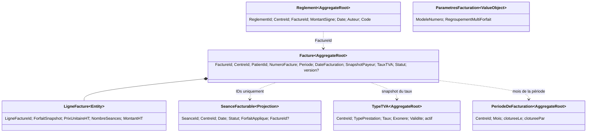

# Modèle tactique — Facturation

> **Proposition à valider au gate tactique.** Contexte supporting, avec invariants d'argent et de preuve : simulation
> sans écriture, émission atomique, snapshots immuables et rapprochement des règlements. Extraction/refactoring sur place
> selon ADR 0024 : mêmes tables et URLs durant les slices, caractérisation avant toute modification.
> Vocabulaire cible : « séance facturable » (projection Facturation) ≠ « séance » (acte de soin, Séance) ≠ « séance »
> (motif de sortie, Stock) ; `ABSENT` legacy signifie « exclue de facturation », pas absence de patient.

## 1. Process-level event storming (filtré)

| Acteur / déclencheur         | Commande                                       | Modèle porteur                     | Événement / effet                                       | Read model                                           |
|------------------------------|------------------------------------------------|------------------------------------|---------------------------------------------------------|------------------------------------------------------|
| ADMIN / MEDECIN              | SimulerFacturation(période, regroupement)      | Projection des séances facturables | `SimulationFacturationProduite` (interne, non persisté) | Aperçu des factures et totaux                        |
| ADMIN / MEDECIN              | ExclureSéanceDeFacturation(seanceId)           | Décision d'exclusion (cible)       | `SéanceExclueDeFacturation`                             | Aperçu recalculé                                     |
| ADMIN / MEDECIN              | ChangerForfaitAppliqué(seanceId, forfaitId)    | Décision de forfait (cible)        | `ForfaitDeSéanceSurchargé`                              | Aperçu recalculé                                     |
| ADMIN / MEDECIN              | ValiderFacturation(période)                    | Campagne d'émission / Facture      | `FacturationValidée` ; verrou des séances facturées     | Factures, synthèse                                   |
| ADMIN / SECRETAIRE           | EnregistrerRèglement(factureId, montant, date) | Règlement                          | `RèglementEnregistré`                                   | Situation et historique de facture                   |
| ADMIN                        | ConfigurerNumérotation / Regroupement          | Paramètres de facturation          | —                                                       | Paramètres par centre                                |
| ADMIN                        | EnregistrerTypeTVA / DésactiverTypeTVA         | Type de TVA                        | —                                                       | Types de TVA valides                                 |
| ADMIN / MEDECIN / SECRETAIRE | ConsulterDashboardFacturation(mois)            | Read model                         | —                                                       | CA HT/TTC, factures, séances, patients, ventilations |
| ADMIN                        | ClôturerPériodeDeFacturation(mois) *(nouveau)* | Période de facturation             | `PériodeDeFacturationClôturée`                          | État de clôture                                      |

Sources du legacy : `FacturationDomainService.preview/validate`, `SeanceFacturationPort`, `FactureReglementAggregate`,
`ReglementApplicationService`; règles RG-FAC-020..032 et RG-REG-001..004. Les noms d'événements de la Published Language
sont ceux de la context map ; ils ne reprennent pas nécessairement les classes legacy.

## 2. Règles et invariants

| #   | Règle                                                                                                                                                                                                                            | Nature                               | Porteur cible                                             |
|-----|----------------------------------------------------------------------------------------------------------------------------------------------------------------------------------------------------------------------------------|--------------------------------------|-----------------------------------------------------------|
| F1  | Une séance n'est éligible que si elle appartient au centre et à la période, est `VALIDEE` ou `SIGNEE`, et n'est pas déjà facturée (RG-FAC-020). La signature médicale n'est pas requise.                                         | invariant d'éligibilité              | Specification `SéanceFacturable` + ACL Séance             |
| F2  | Forfait appliqué : surcharge de séance ; sinon PEC couvrant la date, en privilégiant une PEC avec forfait effectif puis la plus récente ; dans cette PEC, forfait effectif sinon demandé ; sans forfait, prix nul (RG-FAC-021).  | règle de résolution                  | Policy `RésoudreForfaitAppliqué`                          |
| F3  | La simulation ne persiste ni facture, ni numéro, ni changement d'état de séance (RG-FAC-022).                                                                                                                                    | invariant de commande                | Use case `SimulerFacturation`                             |
| F4  | Une facture regroupe par patient, ou par patient + forfait si le regroupement est désactivé ; une ligne par forfait/prix, quantité = nombre de séances (RG-FAC-011/022).                                                         | règle de calcul                      | Policy de regroupement                                    |
| F5  | HT = somme des lignes ; TVA = HT × taux actif, TTC = HT + TVA ; arrondi à 2 décimales HALF_UP. Les valeurs et le taux appliqué sont figés à l'émission (RG-FAC-002/022/031).                                                     | invariant monétaire                  | `Facture` + VO `Montant`/`TauxTVA`                        |
| F6  | Validation recalcule l'éligibilité et échoue entièrement si une séance choisie a changé ; facture(s) et liaison séance→facture sont atomiques (RG-FAC-030). Campagne vide = 0 facture.                                           | invariant transactionnel/idempotence | Use case `ValiderFacturation` + unité de travail          |
| F7  | Une facture persistée a au moins une ligne ; période et identité centre/patient sont obligatoires (RG-FAC-031).                                                                                                                  | invariant                            | `Facture`                                                 |
| F8  | La facture conserve un snapshot probant : patient/code/nom/état/immatriculation, payeur/agence, centre, période, date d'émission, taux TVA, forfait, prix et quantités. Pas de recalcul rétroactif.                              | immutabilité                         | `Facture` et `LigneFacture`                               |
| F9  | Numéro par centre et année, modèle configurable avec jetons `{YYYY}`/`{YEAR}`, `{YY}`, `{CENTER}`, `{SEQ}`/`{SEQn}` ; compteur strictement positif (RG-FAC-010). La réservation réelle est à l'émission, jamais à la simulation. | invariant d'ensemble / concurrence   | Port `NumerotationDesFactures`                            |
| F10 | Type TVA propre au centre ; taux 0–100 %, prestation et début requis, fin après début ; actif et couvrant la date ; absence de type actif = 0 % (RG-FAC-001/002).                                                                | invariant + policy de résolution     | `TypeTVA` + repository                                    |
| F11 | Exclusion de facturation retire une séance validée/signée non facturée de l'ensemble éligible ; le statut legacy `ABSENT` ne veut pas dire absence patient (RG-FAC-023, Q1).                                                     | invariant de décision                | Modèle d'exclusion Facturation, traduction par ACL Séance |
| F12 | Règlement rattaché à une facture et au centre, montant non nul (négatif accepté comme remboursement/correction), date requise, auteur par défaut `system`; code `REG-` + 8 caractères (RG-REG-001).                              | invariant                            | `Règlement`                                               |
| F13 | Situation dérivée du total signé des règlements : non réglée, partiellement réglée, réglée ou trop-perçu ; arrondi au centime (RG-REG-002). Le trop-perçu est autorisé.                                                          | calcul/read model                    | `SituationFacture`                                        |
| F14 | Chaque émission de facture alimente l'aval Comptabilité ; un règlement enregistré déclenche aussi l'écriture de trésorerie (RG-FAC-032, RG-REG-004). Livraison au moins une fois ⇒ consommateur idempotent.                      | cohérence éventuelle                 | Published Language + Outbox (cible)                       |
| F15 | Toute donnée/commande est isolée par `CentreId` ; aucun regroupement ni lecture ne traverse deux centres (AGENTS.md §2, RG-FAC-020/030).                                                                                         | autorisation / invariant             | tous use cases et repositories                            |
| F16 | Clôture mensuelle de facturation (décision Q5 / ADR 0009) : après clôture, plus d'émission ni d'exclusion pour la période. Les préconditions, la course avec une validation et la politique de réouverture restent à confirmer.  | invariant temporel proposé           | `PériodeDeFacturation`                                    |

## 3. Carte du modèle proposé

### Facture (racine `Facture`) — supporting

- **Intention** : émettre le document probant qui fige les prestations facturées, leur prix et leur payeur.
- **Identité / état** : `FactureId`, `CentreId`, `PatientId`, numéro unique par centre/année, période, date, état
  `VALIDEE`, snapshots patient/payeur, taux TVA, lignes bornées par la campagne ; totaux dérivés.
- **Commandes → événements** : `emettre(snapshot, lignes, taux, periode, numero)` → `FactureEmise` (interne), puis
  contribution à `FacturationValidée` (intégration). Facture immuable après émission ; aucune modification/suppression
  n'est décrite par les RG actuelles.
- **Rejets** : `FactureSansLigne`, `PeriodeInvalide`, `NumeroDeFactureDejaUtilise`, `CentreIncoherent`,
  `SeanceDejaFacturee`.
- **Cohérence** : facture + rattachement des séances et événement/outbox dans une même transaction. La racine ne charge
  pas toutes les séances historiques : ne garder que leurs identifiants si nécessaire.
- **Tests** : au moins une ligne ; snapshots inchangés après mutation des référentiels ; recalcul du total depuis
  lignes ; transaction annulée si une séance du groupe devient inéligible.

### Règlement (racine `Règlement`) — supporting

- **Intention** : enregistrer un encaissement ou une correction/remboursement rattaché à une facture.
- **Identité / état** : `ReglementId`, `CentreId`, `FactureId`, montant signé non nul, date, auteur, code généré.
  Référence la facture par identité ; ne conserve pas la collection non bornée des règlements dans `Facture`.
- **Commandes → événements** : `enregistrer(...)` → `RèglementEnregistré` (Published Language, version 1).
- **Règles de rejet** : `FactureIntrouvable`, `CentreIncoherent`, `MontantDeReglementNul`, `DateDeReglementRequise`.
- **Situation** : calculée par lecture à partir du montant TTC figé et des règlements signés ; aucun statut de facture
  n'est mis à jour sur chaque paiement.
- **À confirmer** : RG-REG-002 indique un total signé et acceptation des montants négatifs, alors que l'agrégat legacy
  et la comptabilisation ont des traitements à vérifier ; ce modèle n'inverse pas ces règles silencieusement.

### Type de TVA (racine `TypeTVA`) — supporting, ownership à confirmer

- **Identité / état** : `CentreId` + identité du type, taux, exonération, prestation, début/fin de validité, actif ;
  référence légale facultative.
- **Règle** : résoudre le type actif `HEMODIALYSE` à la date de validation, sinon taux nul ; copier taux/exonération sur
  la facture.
- **Propriété** : proposition que Facturation soit seule propriétaire de `tva_types` et publie une lecture de TVA pour
  Absences/Comptabilité. La page comptable `/regles-tva` reste une façade de compatibilité le temps du retrait legacy
  (C7 Comptabilité).

### Période de facturation (racine `PériodeDeFacturation`) — proposé

- Identité `CentreId + Mois`; état ouvert/clos; `cloturer(auteur, instant)` irréversible à confirmer. La clôture refuse
  toute validation ou exclusion ultérieure du mois ; un mois sans ligne est ouvert.
- La règle proposée ne suppose pas encore un ordre de clôture avec Absences, Stock et Comptabilité.

## 4. Value Objects

| VO                                                                                       | Règle                                                                                                     | Nom legacy / source                                       |
|------------------------------------------------------------------------------------------|-----------------------------------------------------------------------------------------------------------|-----------------------------------------------------------|
| `FactureId`, `ReglementId`, `SeanceId`, `PatientId`, `CentreId`, `PayeurId`, `ForfaitId` | identifiants typés, centres toujours propagés                                                             | UUID dans `FactureAggregate`, ports et entités            |
| `PeriodeFacturation`                                                                     | soit `YearMonth`, soit intervalle inclusif `debut ≤ fin`                                                  | `FacturationPeriod`                                       |
| `Montant`                                                                                | valeur DZD implicite, arrondi HALF_UP à deux décimales ; signe négatif autorisé uniquement pour règlement | `BigDecimal`, `LigneFacture`, `FacturePayment`            |
| `TauxTVA`                                                                                | 0..100 %, deux décimales, taux nul si aucune règle active                                                 | `TypeTVA`, `RegleTVA`                                     |
| `NumeroFacture` / `ModeleNumeroFacture`                                                  | modèle validé, séquence positive, centre + année                                                          | `FactureNumberTemplate`                                   |
| `ForfaitApplique`                                                                        | forfaitId? + libellé + prix HT capturés pour la séance au moment de la campagne                           | `SeanceFacturationCandidate`, surcharge de forfait legacy |
| `SnapshotPatientFacturation`                                                             | code, nom, état, immatriculation, payeur/caisse, agence et centre                                         | champs de `FactureAggregate`                              |
| `CodeReglement`                                                                          | `REG-` + 8 caractères dérivés de l'identifiant                                                            | `FacturePayment`                                          |

## 5. Services, policies et use cases

| Use case / policy                                    | Agrégat ou lecture    | Ports sortants / effet                                                                                                                                     |
|------------------------------------------------------|-----------------------|------------------------------------------------------------------------------------------------------------------------------------------------------------|
| `SimulerFacturation`                                 | projection            | `SeancesFacturables`, `ParametresFacturation`, `TypeTvaApplicable`, `NumerotationDesFactures` (lecture seule)                                              |
| `ExclureSéanceDeFacturation`                         | décision d'exclusion  | `SeancesFacturables` ; cible: enregistrer l'exclusion dans Facturation, ACL vers le statut `ABSENT` pendant coexistence legacy                             |
| `ChangerForfaitAppliqué`                             | projection / commande | catalogue de forfaits + `SeancesFacturables` ; snapshot dans la simulation et, à terme, événement vers Séance                                              |
| `ValiderFacturation`                                 | Facture × N + période | `FactureRepository`, `SeancesFacturables`, `NumerotationDesFactures`, `TypeTvaApplicable`, `Horloge`, `GenerateurIdentifiants`, `Outbox`, `UniteDeTravail` |
| `EnregistrerRèglement`                               | Règlement             | `FactureRepository` (centre + existence), `ReglementRepository`, `Horloge`, `GenerateurIdentifiants`, `Outbox`                                             |
| `ConsulterSituationFacture` / historique / recherche | read model            | `LectureFactures`, `LectureReglements`, requêtes paginées centre-scopées                                                                                   |
| `ConfigurerFacturation`                              | paramètres            | `ParametresFacturationRepository`                                                                                                                          |
| `GérerTypesTVA`                                      | TypeTVA               | `TypeTvaRepository`, invalidation cache par centre                                                                                                         |
| `ObtenirDashboardFacturation`                        | read model            | `StatistiquesFacturation` (HT et TTC, RG-FAC-024)                                                                                                          |
| `ClôturerPériodeDeFacturation`                       | Période               | `PeriodeFacturationRepository`, `Horloge`, `Outbox` (nouveau use case)                                                                                     |

## 6. Événements d'intégration (Published Language cible)

Contrats versionnés, minimaux, `CentreId` obligatoire, transmis via Outbox (cible) et consommés idempotemment. Les
classes Spring actuelles sont synchrones et ne sont pas le contrat cible.

| Événement v1                   | Producteur → consommateurs                                                                                                            | Payload minimal proposé                                                                                                                                                             | Garanties                                                                                                             |
|--------------------------------|---------------------------------------------------------------------------------------------------------------------------------------|-------------------------------------------------------------------------------------------------------------------------------------------------------------------------------------|-----------------------------------------------------------------------------------------------------------------------|
| `FacturationValidée`           | Facturation → Comptabilité (écritures de vente), Séance (verrou), Absences (couverture/clôture), Stock (verrou des sorties), Pilotage | `eventId`, `centreId`, `periodeDebut`, `periodeFin`, `factures[]` (`factureId`, numéro, patientId, payeurId?, HT, TVA, TTC, dateFacturation), `seances[]` (`seanceId`, `factureId`) | Outbox, livraison au moins une fois, idempotence par `eventId` et/ou `factureId`; ne pas exposer les lignes cliniques |
| `RèglementEnregistré`          | Facturation → Comptabilité                                                                                                            | `eventId`, `reglementId`, `factureId`, `centreId`, `montantSigné`, `dateReglement`, `auteur`                                                                                        | Outbox, idempotence par `reglementId`                                                                                 |
| `PériodeDeFacturationClôturée` | Facturation → Absences, Pilotage, éventuellement Comptabilité                                                                         | `eventId`, `centreId`, `mois`, `clotureePar`, `clotureeLe`                                                                                                                          | candidat ADR 0009 ; consommation idempotente                                                                          |
| `SéanceExclueDeFacturation`    | Facturation → Pilotage, éventuellement Séance                                                                                         | `eventId`, `centreId`, `seanceId`, `motif?`, `acteur`, `date`                                                                                                                       | à définir avec l'owner de la décision et le statut legacy                                                             |

Compatibilité actuelle :
`FacturationValideeEvent(centerId, periodStart, periodEnd, invoicesCount, billedSeancesCount, totalTtc, occurredAt)` est
publié après validation (`platform/application/facturation/FacturationApplicationService.java`) ;
`FactureReglementRecordedEvent(factureId, centerId, montant, dateReglement, userId)` est publié dans la transaction de
Règlement. Le premier est consommé par le listener Comptabilité et le second par
`ReglementEncaisseComptabiliteListener`. Le payload actuel ne suffit pas, à lui seul, à remplacer toutes les lectures
SQL du listener ; aucune modification de contrat n'est incluse dans cette proposition.

## 7. Matrice invariant → tests

| Règle                       | Test domaine/application attendu                                                                | Caractérisation legacy                                                                                 |
|-----------------------------|-------------------------------------------------------------------------------------------------|--------------------------------------------------------------------------------------------------------|
| F1/F15 éligibilité + centre | n'accepter que VALIDEE/SIGNEE non facturée du centre ; refuser fuite inter-centre               | `SeanceEligibleForFacturationSpecificationTest`, `FacturationRestControllerIntegrationTest`            |
| F2 priorité forfait         | surcharge > PEC effective > PEC demandée > prix nul                                             | `FacturationDomainServiceTest`, `FacturationRestControllerIntegrationTest`                             |
| F3 simulation volatile      | preview et échec validation ne créent ni facture ni numéro consommé                             | `FacturationRestControllerIntegrationTest`                                                             |
| F4 regroupement             | ON: par patient; OFF: patient + forfait; quantités regroupées par prix/forfait                  | `FacturationDomainServiceTest`                                                                         |
| F5/F8 montants et snapshot  | TVA 0/positive, arrondis HALF_UP, prix/taux/patient figés malgré changements ultérieurs         | tests d'agrégat + golden `FacturationRestControllerIntegrationTest`                                    |
| F6 validation atomique      | séance devenue inéligible entre preview et validation ⇒ aucune facture ni séance marquée        | caractérisation de validation + test transaction/intégration                                           |
| F7 facture minimale         | zéro ligne ou période invalide refusée                                                          | `FactureAggregateTest`                                                                                 |
| F9 numérotation             | séquence par centre/année, modèle, séquence du preview non réservée ; concurrence à protéger    | `FactureNumberTemplateTest`, test de concurrence cible                                                 |
| F10 TVA                     | centre isolé, bornes inclusives, règles successives, taux par date, absence de règle = 0        | `TypeTvaDomainServiceTest`, characterization TVA                                                       |
| F11 exclusion               | déjà facturée/non validée refusée ; simulation recalculée ; absence patient non confondue       | tests use case + tests ACL Séance                                                                      |
| F12/F13 règlements          | montant nul refusé, négatif conservé comme remboursement, trop-perçu lisible, centimes arrondis | `FactureReglementStatusSpecificationTest`, `ComptabiliteRestControllerIntegrationTest`/tests règlement |
| F14 événements              | événement publié une fois logiquement, replay sans double écriture comptable                    | listeners Comptabilité + tests idempotence                                                             |
| F16 clôture proposée        | validation/exclusion du mois clos refusées; centres et mois indépendants                        | nouveau test avant implémentation (aucun golden actuel)                                                |

## 8. Équivalent legacy / seam d'extraction

| Cible                      | Legacy                                                                                                                                                           | Écart / traduction                                                                                                                                                   |
|----------------------------|------------------------------------------------------------------------------------------------------------------------------------------------------------------|----------------------------------------------------------------------------------------------------------------------------------------------------------------------|
| `Facture` + `LigneFacture` | `bc-facturation/domain/facturation/aggregate/FactureAggregate.java`, `entity/LigneFacture.java`                                                                  | Modèle déjà riche, mais les commandes et la validation sont centralisées dans `FacturationDomainService`; conserver les URLs/tables durant la reprise sur place.     |
| Simulation + éligibilité   | `FacturationDomainService.java:43-74`, `SeanceEligibleForFacturationSpecification.java`, `SeanceFacturationPort`                                                 | Candidate lue à travers un port mais son adapter actuel interroge le modèle partagé de Séance ; cible = ACL/projection alimentée par `SéanceValidée`/`SéanceSignée`. |
| Validation + rattachement  | `FacturationDomainService.java:101-151`, `FacturationApplicationService`                                                                                         | Recalcul nominal puis `saveAll` et `markAsBilled`; vérifier la frontière transactionnelle facture + séance et le rollback en cas de conflit.                         |
| Exclusion / forfait        | `FacturationDomainService.java:76-98`; `SeanceFacturationPort.markAsAbsent/overrideForfait`                                                                      | Le legacy modifie directement l'état/forfait de Séance ; cible Facturation propriétaire de l'exclusion, et ACL/published language pour les effets vers Séance.       |
| TVA et paramètres          | `aggregate/TypeTVA.java`, `valueobject/ParametresFacturation.java`, `TypeTvaDomainService.java`; table `tva_types`                                               | Écriture concurrente de `tva_types` par la Comptabilité ; propriété cible proposée Facturation, dépend de C2/C7.                                                     |
| Règlement                  | `backend/bc-reglement/domain/reglement/{aggregate/FactureReglementAggregate,entity/FacturePayment,service/ReglementService}.java`                                | Deuxième contexte/module legacy ; la cible réunit l'ownership métier dans Facturation, mais garde un agrégat Règlement distinct de Facture.                          |
| Publication comptable      | `platform/application/{facturation/FacturationApplicationService,reglement/ReglementApplicationService}.java`; listeners dans `platform/infrastructure/listener` | Événements Spring synchrones dans la transaction appelante ; outbox cible à introduire seulement avec contrat/consommateurs caractérisés.                            |

## Questions ouvertes

1. ~~**Propriétaire définitif de `tva_types`**~~ → **tranchée le 2026-10-19 (ADR 0030)** : la **Comptabilité** reste
   propriétaire ; `/tva-types` devient une façade vers le contexte `comptabilite` ; une seule règle de validation (union
   des contrôles). `TypeTVA` sort des agrégats de la Facturation, qui lit le taux par le langage publié de la
   Comptabilité. *(Révision du modèle : la section « Type de TVA » ci-dessus est caduque sur la propriété.)*
2. **Clôture mensuelle** : définition exacte de la période clôturée, ordre avec Absences/Stock/Comptabilité,
   comportement si une validation est déjà en cours ; clôture irréversible proposée, pas encore caractérisée.
3. **Exclusion** : motif obligatoire ou absent ? Peut-on réinclure une séance exclue ? Quelle part de l'état `ABSENT`
   legacy doit être persistée par Facturation vs traduite dans Séance ?
4. **Règlement** : confirmer l'agrégat Règlement indépendant (collection de paiements non bornée) et la règle de total
   signé pour remboursement ; le contrat comptable actuel ne transporte pas `reglementId` ni mode.
5. **TVA exonérée** : le taux nul/exonération doit-il être distingué dans la facture au-delà du taux figé ? Les règle
   RG-FAC disent taux applicable, mais snapshot d'exonération à confirmer.
6. **Numérotation concurrente** : mécanisme/contrainte unique de séquence et état des doublons existants avant
   correction ; le preview ne réserve aucun numéro.
7. **Identité/payload des événements** : le payload minimal exact et la stratégie Outbox doivent être revus avec
   Comptabilité, Séance, Absences et Stock avant changement des listeners synchrones.
8. **Terms proposed** : `SéanceFacturable`, `ExclusionDeFacturation`, `ForfaitAppliqué`, `PériodeDeFacturation`,
   `Règlement`, `SituationFacture`, `FacturationValidée` et leurs identifiants de code restent à confirmer par les
   experts métier.

