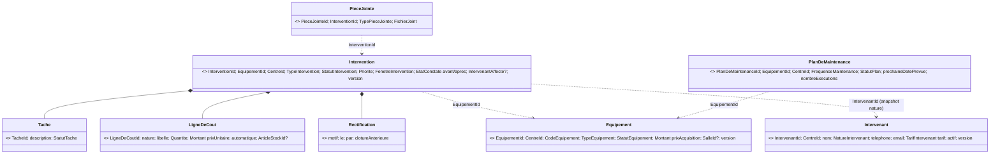

# Modèle tactique — GMAO

> **Contexte supporting : modèle léger assumé.** 4 agrégats + 1 agrégat satellite (pièces jointes), pas de saga, pas de CQRS au-delà de read models de consultation. Le legacy `bc-gmao` est déjà proche d'un modèle riche ; la cible le **découpe** (`Intervention.java` 565 l. mêle cycle de vie, coûts, tâches, chronologie, audit) et **supprime la transaction multi-agrégats** Intervention + Équipement + historique (`platform/.../application/gmao/InterventionEquipementStatutService.java:49-58`).
> Termes non présents dans `glossaries/gmao.md` : marqués *(proposed)* ici et ajoutés au glossaire avec ce statut.

## 1. Process-level event storming (filtré GMAO)

| Acteur | Commande | Agrégat | Événement de domaine | Politique déclenchée | Read model |
|---|---|---|---|---|---|
| Admin GMAO | EnregistrerÉquipement | Équipement | `ÉquipementEnregistré` | — | Parc d'équipements |
| Admin GMAO | MettreHorsService(motif) | Équipement | `ÉquipementMisHorsService` | → publication Planification | Fiche équipement |
| Admin GMAO | RemettreEnService *(proposed ; legacy `reactiver`)* | Équipement | `ÉquipementRemisEnService` | → publication Planification | Fiche équipement |
| Détenteur `GMAO_REFORME` | Réformer(motif) | Équipement | `ÉquipementRéformé` | → publication Planification / Pilotage | Fiche équipement |
| Technicien | PlanifierIntervention | Intervention | `InterventionPlanifiée` | — | Interventions en retard (RG-GMA-030) |
| Technicien | DémarrerIntervention | Intervention | `InterventionDémarrée(étatConstaté)` | **P1 Appliquer l'état constaté** → Équipement.constaterÉtat | Chronologie |
| Technicien | TerminerIntervention | Intervention | `InterventionTerminée(étatAprès, coût)` | **P1** ; **P2 Proposition de réforme** (si `A_REFORMER`) | Indicateurs d'intervention (RG-GMA-031) |
| Technicien | AnnulerIntervention(motif) | Intervention | `InterventionAnnulée` | — | |
| Détenteur `GMAO_RECTIFICATION` | RectifierIntervention(motif) | Intervention | `InterventionRectifiée` | — | Chronologie |
| Technicien | AjouterLigneDeCoût / RetirerLigneDeCoût | Intervention | `LigneDeCoûtAjoutée` / `LigneDeCoûtRetirée` | — | Coût de maintenance |
| Technicien | AjouterTâche / DémarrerTâche / AchéverTâche | Intervention | `TâcheAjoutée` / `TâcheDémarrée` / `TâcheAchevée` | — | |
| Technicien | JoindrePièce / RetirerPièceJointe | PièceJointe | `PièceJointeAjoutée` / `PièceJointeRetirée` | — | |
| Admin GMAO | EnregistrerIntervenant / DésactiverIntervenant | Intervenant | `IntervenantEnregistré` / `IntervenantDésactivé` | — | Référentiel intervenants |
| Admin GMAO | ÉtablirPlanDeMaintenance | Plan de maintenance | `PlanDeMaintenanceÉtabli` | — | Plans en retard (RG-GMA-052) |
| Technicien | EnregistrerExécution | Plan de maintenance | `MaintenancePréventiveExécutée` | — | |
| Admin GMAO | Suspendre / Reprendre le plan *(legacy `desactiver`/`reactiver`)* | Plan de maintenance | `PlanDeMaintenanceSuspendu` / `PlanDeMaintenanceRepris` | — | |

## 2. Règles & invariants (classement)

| # | Règle (RG) | Nature | Porteur |
|---|---|---|---|
| R1 | Réforme = état terminal : plus aucun changement de statut (RG-GMA-014) | **invariant** | Équipement |
| R2 | Mise hors service refusée si déjà hors service ou réformé (RG-GMA-013) | invariant | Équipement |
| R3 | Remise en service uniquement depuis `HORS_SERVICE` (RG-GMA-013) | invariant | Équipement |
| R4 | `REFORME` et `DESACTIF` jamais fixés par une intervention (RG-GMA-024) | invariant | Équipement (`constaterÉtat`) + VO `ÉtatConstaté` |
| R5 | Code, type, date d'installation immuables (RG-GMA-011) | invariant | Équipement |
| R6 | Prix d'acquisition ≥ 0 (RG-GMA-011) | invariant de valeur | VO `Montant` |
| R7 | Code unique par centre (RG-GMA-011) | règle d'ensemble (multi-agrégats) | Domain service `UnicitéDuCodeÉquipement` + contrainte d'unicité en base |
| R8 | Tout changement de statut est historisé (précédent, nouveau, motif, auteur, date) (RG-GMA-015) | invariant | Équipement (journal append-only écrit dans la **même** transaction) |
| R9 | Motif obligatoire : réforme, mise hors service, annulation, rectification (RG-GMA-013/014/024/025) | invariant de valeur | VO `Motif` |
| R10 | Cycle `PLANIFIEE → EN_COURS → TERMINEE` ; `ANNULEE` depuis planifiée/en cours ; terminée non annulable (RG-GMA-022/023/024) | invariant | Intervention |
| R11 | État constaté à la planification ∈ {EN_SERVICE, EN_MAINTENANCE, EN_ATTENTE_PIECE, HORS_SERVICE} (RG-GMA-021) | invariant de valeur | VO `ÉtatConstaté.avant(...)` |
| R12 | État après ∈ {EN_SERVICE, EN_ATTENTE_PIECE, HORS_SERVICE, A_REFORMER} (RG-GMA-023) | invariant de valeur | VO `ÉtatConstaté.après(...)` |
| R13 | Échéance ≥ date de début (RG-GMA-021) | invariant de valeur | VO `FenêtreIntervention` |
| R14 | Clôture : actions réalisées requises ; fin > début (RG-GMA-023) | invariant | Intervention + VO `PériodeIntervention` |
| R15 | Rectification uniquement d'une terminée ; rouvre en cours, conserve la clôture précédente, réinitialise fin/état après/lignes automatiques (RG-GMA-025) | invariant | Intervention |
| R16 | Ligne de coût : libellé requis, quantité > 0, prix unitaire ≥ 0 ; montant = quantité × prix (RG-GMA-026) | invariant de valeur | VO `LigneDeCoût` |
| R17 | Ajout de ligne refusé si annulée ; retrait seulement si ouverte (planifiée/en cours) (RG-GMA-026) | invariant | Intervention |
| R18 | Coût de l'intervention = Σ lignes (RG-GMA-026) | dérivé | Intervention |
| R19 | Valorisation auto du temps à la clôture : durée (h, 2 déc. HALF_UP) × tarif ; « Honoraires intervenant » (externe) / « Main d'œuvre » (interne) ; aucun double comptage (RG-GMA-027) | invariant | Intervention (reçoit un VO `TarifIntervenant`) |
| R20 | Intervenant externe : main d'œuvre manuelle refusée (RG-GMA-027) | invariant | Intervention (snapshot `IntervenantAffecté`) |
| R21 | Tâche : `A_FAIRE → EN_COURS → COMPLETEE` ; description requise (RG-GMA-029) | invariant | Intervention (entité interne `Tâche`) |
| R22 | Pièce jointe : PDF/PNG/JPEG reconnus au contenu, ≤ 5 Mo, non vide, nom nettoyé ≤ 150 car. (RG-GMA-028) | validation d'entrée + VO | VO `FichierJoint` (détection de type à l'interface) |
| R23 | ≤ 50 pièces jointes par intervention (RG-GMA-028) | quota (règle de processus) | Use case `JoindrePièce` via comptage repository |
| R24 | Intervenant : nom + nature requis, tarif ≥ 0 ; désactivé jamais supprimé (RG-GMA-040) | invariant | Intervenant |
| R25 | Plan : exécution uniquement si `ACTIF` ; prochaine date = date d'exécution + fréquence (RG-GMA-050/051) | invariant | Plan de maintenance |
| R26 | Plan : suspendre uniquement `ACTIF` ; reprendre uniquement `INACTIF` avec nouvelle date (RG-GMA-051) | invariant | Plan de maintenance |
| R27 | Intervention en retard ; plan en retard (RG-GMA-030/052) | requête (spécification) | `Intervention.estEnRetard(t)` / `PlanDeMaintenance.estEnRetard(t)` |
| R28 | Démarrage/clôture ⇒ l'équipement prend l'état constaté, sauf s'il y est déjà ou s'il est réformé (RG-GMA-022/023) | **règle de processus (éventuelle)** | Politique P1 |
| R29 | Indisponibilité = durée cumulée en EN_MAINTENANCE/EN_ATTENTE_PIECE/HORS_SERVICE, rejouée sur l'historique (RG-GMA-060) | calcul sans état | Domain service `CalculDIndisponibilité` |
| R30 | Analyse de décision : coût de possession, ratio de maintenance (4 déc.), coût/heure d'indisponibilité ; réforme recommandée si actif et (A_REFORMER ou ratio ≥ seuil) (RG-GMA-062/063) | calcul + paramètre | Domain service `AnalyseDeDécision` + Policy `SeuilDeRéforme` |
| R31 | Accès ADMIN limité au centre de la session ; habilitations `GMAO_REFORME`, `GMAO_RECTIFICATION` (RG-GMA-001) | autorisation | Application (port `Habilitations`) |
| R32 | Planification d'une intervention : équipement du centre (RG-GMA-021) | validation d'entrée | Use case (port `EquipementRepository`) |

## 3. Carte du modèle

## 4. Aggregate Design Canvas

### Équipement (root: `Equipement`) — contexte gmao — type: supporting
- **Intention** : porter le statut de disponibilité d'un équipement et son cycle de vie jusqu'à la réforme.
- **Invariants** : R1, R2, R3, R4, R5, R8 (+ R6, R9 via VO).
- **Identité** : `EquipementId` (généré par le domaine via port `GenerateurIdentifiants`).
- **État** : `CodeEquipement`, désignation, `TypeEquipement`, fabricant/modèle/numéro de série, date d'installation, `CentreId` (shared kernel, ADR 0010), `SalleId?` (identité Organisation), localisation, `Montant` prix d'acquisition, `StatutEquipement`, observations ; **journal des statuts** (`ChangementDeStatut` VO, append-only, non rechargé en mémoire — écrit par l'adapter à partir des événements dans la même transaction).
- **Commandes → événements** :
  - `enregistrer(...)` → `ÉquipementEnregistré`
  - `mettreHorsService(motif, auteur, t)` → `ÉquipementMisHorsService`
  - `remettreEnService(motif, auteur, t)` → `ÉquipementRemisEnService`
  - `constaterÉtat(étatConstaté, motif, interventionId, auteur, t)` → `ÉtatDÉquipementConstaté` *(proposed)* — idempotent : aucun événement si déjà dans l'état ; ignoré (pas d'exception) si réformé, cf. Q3
  - `réformer(motif, auteur, t)` → `ÉquipementRéformé`
  - `corrigerIdentification(désignation, fabricant, modèle, n° série, localisation, salle, prix)` *(proposed)* → `IdentificationDÉquipementCorrigée` — code/type/date d'installation hors signature (R5)
  - `consignerObservation(texte, auteur, t)` → `ObservationConsignée`
- **Règles de rejet** : `ÉquipementRéforméImmuable`, `ÉquipementDéjàHorsService`, `RemiseEnServiceImpossible`, `ÉtatNonFixableParIntervention`, `ÉquipementDéjàRéformé`, `CodeÉquipementDéjàUtilisé` (service R7).
- **Cohérence** : transactionnelle interne (statut + journal) ; éventuelle avec Intervention via P1 ; avec Planification via événements d'intégration (Outbox).
- **Concurrence/volumétrie** : version optimiste ; aucune collection chargée (journal en append).
- **Tests clés** : *given* équipement réformé *when* mettreHorsService *then* `ÉquipementRéforméImmuable` ; *given* EN_SERVICE *when* constaterÉtat(EN_SERVICE) *then* aucun événement.

### Intervention (root: `Intervention`) — contexte gmao — type: supporting
- **Intention** : suivre une opération de maintenance de sa planification à sa clôture (rectifiable) et en établir le coût.
- **Invariants** : R10, R14, R15, R17, R19, R20, R21 (+ R11, R12, R13, R16 via VO) ; dérivé R18.
- **Identité** : `InterventionId` (domaine).
- **État** : `EquipementId`, `CentreId`, `TypeIntervention`, `Priorité`, `FenêtreIntervention` (début, échéance?), `PériodeIntervention` (début, fin?), `ÉtatConstaté` avant / après, symptôme, cause, description, actions réalisées, pièce remplacée, `IntervenantAffecté?` (id + nature, snapshot), entités `Tâche` (≤ ~30), VO `LigneDeCoût` (≤ ~50), VO `Rectification` (≤ ~10), jalons (démarrée/terminée/annulée : `Jalon(auteur, instant)`).
- **Commandes → événements** :
  - `planifier(...)` → `InterventionPlanifiée`
  - `démarrer(auteur, t)` → `InterventionDémarrée{équipementId, étatConstatéAvant}`
  - `terminer(actions, étatAprès, fin, cause?, tarif: TarifIntervenant?, auteur, t)` → `InterventionTerminée{équipementId, étatAprès, coût}` (+ `LigneDeCoûtAjoutée` automatique, R19)
  - `annuler(motif, auteur, t)` → `InterventionAnnulée`
  - `rectifier(motif, nouveauDébut?, auteur, t)` → `InterventionRectifiée`
  - `ajouterLigneDeCoût(ligne)` / `retirerLigneDeCoût(id)` → `LigneDeCoûtAjoutée` / `LigneDeCoûtRetirée`
  - `ajouterTâche(desc)` / `démarrerTâche(id)` / `achéverTâche(id)` → `TâcheAjoutée` / `TâcheDémarrée` / `TâcheAchevée`
  - `affecterIntervenant(IntervenantAffecté)` → `IntervenantAffectéÀLIntervention`
  - `consignerPièceRemplacée(texte)` → `PièceRemplacéeConsignée`
  - requêtes : `coût()`, `estEnRetard(t)`, `chronologie()` (déplacée en read model, cf. §8)
- **Règles de rejet** : `DémarrageImpossible`, `ClôtureImpossible`, `ActionsRéaliséesRequises`, `FinAvantDébut`, `InterventionTerminéeNonAnnulable`, `RectificationImpossible`, `InterventionAnnuléeSansCoût`, `CoûtNonModifiableHorsIntervention ouverte`, `MainDŒuvreRefuséePourExterne`, `TransitionDeTâcheInvalide`, `LigneDeCoûtInconnue`.
- **Cohérence** : interne transactionnelle ; éventuelle vers Équipement (P1) ; lit `Intervenant` uniquement pour composer le VO `TarifIntervenant` passé en argument (pas de référence objet).
- **Concurrence/volumétrie** : version optimiste (deux techniciens sur la même intervention = conflit signalé, rare) ; collections bornées.
- **Tests clés** : *given* terminée avec ligne MAIN_OEUVRE manuelle *when* terminer avec tarif interne *then* pas de ligne automatique ; *given* terminée *when* rectifier *then* EN_COURS, lignes auto supprimées, rectification conservée.

### Intervenant (root: `Intervenant`) — contexte gmao — type: supporting (référentiel, très léger)
- **Intention** : référencer qui intervient (interne/prestataire) et son tarif horaire par défaut.
- **Invariants** : R24. **Identité** : `IntervenantId`. **État** : `CentreId`, nom, `NatureIntervenant` (INTERNE/EXTERNE), téléphone et email (`String` tels que reçus, sans validation : KB-GMAO-27 ; VO `Coordonnees` différé, il ne changerait pas le contrat), `TarifIntervenant` (VO : valeur `BigDecimal` ≥ 0, échelle conservée, sans devise ; **réalisé en G2, 2026-10-11** : pas de `Montant` en G2, `Montant` reste pour G4), actif.
- **Commandes → événements** (réalisé G2) : `enregistrer` → `IntervenantEnregistré` ; `corriger` (remplacement total, KB-GMAO-30 : fusion de `corrigerCoordonnées`/`réviserTarif`) → `CoordonneesIntervenantCorrigees` + `TarifIntervenantRevise` si le tarif change ; `désactiver` (idempotent, KB-GMAO-25) → `IntervenantDesactive`.
- **Règles de rejet** : `NomRequis`, `NatureRequise`, `NatureInconnue`, `TarifNegatif` ; `IntervenantDéjàDésactivé` **non retenu** : la désactivation est idempotente comme au legacy (KB-GMAO-25).
- **Concurrence** : version optimiste. **Tests clés** : tarif négatif refusé ; désactivation conserve l'intervenant.

### Plan de maintenance (root: `PlanMaintenance`) — contexte gmao — type: supporting
- **Intention** : garantir la périodicité de la maintenance préventive d'un équipement.
- **Invariants** : R25, R26. **Identité** : `PlanDeMaintenanceId`. **État** : `EquipementId`, `CentreId`, désignation, description, tâches à effectuer (texte), `FrequenceMaintenance`, `StatutPlan` (ACTIF/INACTIF/ARCHIVE), prochaine date prévue, dernière exécution, nombre d'exécutions.
- **Commandes → événements** : `établir` → `PlanDeMaintenanceÉtabli` ; `enregistrerExécution(t, auteur)` → `MaintenancePréventiveExécutée{prochaineDatePrévue}` ; `suspendre` → `PlanDeMaintenanceSuspendu` ; `reprendre(nouvelleDate)` → `PlanDeMaintenanceRepris` ; `archiver` (Q6).
- **Règles de rejet** : `PlanNonActif`, `PlanNonSuspendu`.
- **Concurrence** : version optimiste. **Tests clés** : exécution MENSUELLE le 31/01 → prochaine = +1 mois calendaire (parité legacy `plusMonths`) ; BIMENSUELLE → +15 j.

### Pièce jointe (root: `PieceJointe`) — satellite d'Intervention — type: supporting
- **Intention** : conserver les justificatifs (bon, facture, photo) sans alourdir l'agrégat Intervention (contenus binaires jusqu'à 5 Mo).
- **Invariants** : R22 (VO `FichierJoint` : type reconnu, taille, nom nettoyé). R23 = quota vérifié par le use case (course acceptée, cf. Q8).
- **Commandes → événements** : `joindre` → `PièceJointeAjoutée` ; `retirer` → `PièceJointeRetirée`. **Livré en G5 (2026-10-12)** : octets en base, portés par l'agrégat et son repository (le port `StockageDesPiècesJointes` n'a pas été créé : inutile tant que le stockage reste la base) ; liste par read model sans octets ; intervention hôte lue par le port `InterventionsHotes` (R23 contrôlé sous verrou, refus sur intervention annulée, terminée ou supprimée) ; R22 vérifie la structure entière du fichier et l'extension.

## 5. Value Objects (immuables, validés à la construction)

| VO | Règle portée | Legacy |
|---|---|---|
| `EquipementId`, `InterventionId`, `IntervenantId`, `PlanDeMaintenanceId`, `PieceJointeId`, `TacheId`, `LigneDeCoutId` | identifiants typés (UUID) | `UUID` nus partout |
| `CentreId`, `SalleId`, `UtilisateurId` | shared kernel (ADR 0010) / identités Organisation, Identité & accès | `UUID centreId`, `UUID parUtilisateur` |
| `ArticleStockId` | identité opaque Stock (aucun appel, Separate Ways) | `LigneCoutIntervention.java:41` |
| `CodeEquipement` | non vide, normalisé (trim, casse à confirmer Q9) | `Equipement.java:55` |
| `Montant` | ≥ 0, 2 décimales, devise unique DZD (à confirmer) ; addition | `BigDecimal` + `Money` legacy shared-kernel (hors kernel cible ADR 0010) |
| `Quantite` | > 0 | `LigneCoutIntervention.java:44` |
| `Motif` | texte non vide, trimé | `Equipement.java:222`, `Intervention.java:298` |
| `StatutEquipement` | 7 valeurs RG-GMA-012 ; `estIndisponible()` (EN_MAINTENANCE, EN_ATTENTE_PIECE, HORS_SERVICE) ; `estFinDeVie()` (DESACTIF, REFORME) | `StatutEquipement.java` |
| `EtatConstate` *(proposed)* | fabriques `avant(s)` (R11) et `après(s)` (R12) ; jamais REFORME/DESACTIF | `Intervention.java:34-43` |
| `FenetreIntervention` *(proposed)* | début requis, échéance ≥ début (R13) | `Intervention.java:94` |
| `PeriodeIntervention` | fin ≥ début ; `durée()` en heures arrondies au centième HALF_UP | `Intervention.java:223,279-281` |
| `LigneDeCout` | nature (PIECE, MAIN_OEUVRE, INTERVENANT, AUTRE), libellé, `Quantite`, `Montant` prix unitaire, `automatique`, `ArticleStockId?` ; `montant()` | `LigneCoutIntervention.java:40-75` |
| `TarifIntervenant` *(proposed)* | `NatureIntervenant` + `Montant` horaire ; `valoriser(durée)` → `LigneDeCout` auto ou rien | `Intervention.java:272-287` |
| `IntervenantAffecte` *(proposed)* | `IntervenantId` + `NatureIntervenant` (snapshot pour R20) | — (nouveau) |
| `Rectification` | motif, auteur, instant, clôture antérieure (auteur, instant) | `RectificationIntervention.java` |
| `ChangementDeStatut` *(proposed ; « historique de statuts »)* | précédent, nouveau, motif, auteur, instant | `EquipementStatutHistorique.java` |
| `FrequenceMaintenance` | `prochaineDate(depuis)` : +1 sem., +15 j, +1/3/6 mois, +1 an | `PlanMaintenance.java:131-141` |
| `FichierJoint` *(proposed)* | type (PDF/PNG/JPEG), taille 1 o..5 Mo, nom nettoyé ≤ 150 | `DocumentIntervention.java:24-37` |
| `Coordonnees` | téléphone, email optionnels mais bien formés | `Intervenant.java` |
| `TypeEquipement`, `TypeIntervention`, `Priorite`, `StatutIntervention`, `StatutTache`, `StatutPlan`, `NatureIntervenant`, `TypePieceJointe` | énumérations RG-GMA-010/020/029/040/050/028 | enums `model/` |

## 6. Services de domaine & politiques

| Élément | Type | Rôle | Legacy |
|---|---|---|---|
| `UniciteDuCodeEquipement` | Domain service (port `CodesEquipementDuCentre`) | R7 : refuse un code déjà utilisé dans le centre ; filet = contrainte unique base | contrôleur `EquipementRestController` (à caractériser) |
| `CalculDIndisponibilite` | Domain service pur | R29 : rejoue `ChangementDeStatut[]` + statut courant sur [from, to) | `service/IndisponibiliteCalculator.java:42` |
| `AnalyseDeDecision` | Domain service pur | R30 : coût de possession, ratio, coût/heure, `réformeRecommandée` | `service/AideDecisionMaintenance.java` |
| `SeuilDeReforme` | Policy injectée (paramètre `hemodialyse.gmao.reforme-seuil-ratio`, défaut 0,60, > 0) | variable par déploiement (par centre ? Q5) | `AideDecisionMaintenance.java:9-14` |
| **P1** `AppliquerLEtatConstate` | Politique (handler d'événement interne, transaction séparée) | `InterventionDémarrée`/`InterventionTerminée` → `Equipement.constaterÉtat(...)`; idempotente par `interventionId + jalon` | `InterventionEquipementStatutService.java:49-58` (même transaction aujourd'hui) |
| **P2** `PropositionDeReforme` | Politique | `ÉtatDÉquipementConstaté(A_REFORMER)` → notification aux détenteurs `GMAO_REFORME` (jamais de réforme automatique, RG-GMA-063) | via `AideDecisionMaintenance` / notifications |
| `IndicateursDIntervention` | Read model / query service (pas domaine) | RG-GMA-031 : délai de prise en charge, durée, part d'indisponibilité 12 mois plafonnée à 100 % | `service/IndicateursIntervention.java` |

## 7. Catalogue d'événements

### 7.1 Événements de domaine (internes)
`ÉquipementEnregistré` · `ÉquipementMisHorsService` · `ÉquipementRemisEnService` · `ÉtatDÉquipementConstaté` · `ÉquipementRéformé` · `IdentificationDÉquipementCorrigée` · `ObservationConsignée` · `InterventionPlanifiée` · `InterventionDémarrée` · `InterventionTerminée` · `InterventionAnnulée` · `InterventionRectifiée` · `LigneDeCoûtAjoutée` · `LigneDeCoûtRetirée` · `TâcheAjoutée` · `TâcheDémarrée` · `TâcheAchevée` · `IntervenantAffectéÀLIntervention` · `PièceRemplacéeConsignée` · `PièceJointeAjoutée` · `PièceJointeRetirée` · `IntervenantEnregistré` · `TarifIntervenantRévisé` · `IntervenantDésactivé` · `PlanDeMaintenanceÉtabli` · `MaintenancePréventiveExécutée` · `PlanDeMaintenanceSuspendu` · `PlanDeMaintenanceRepris`.
Tous portent : identité de l'agrégat, `CentreId`, auteur, instant. Consommés en interne par : P1, P2, Audit (générique), journal des statuts.

### 7.2 Événements publiés (intégration — Published Language `gmao.v1`, Outbox, at-least-once)

| Événement | Producteur (déclencheur) | Consommateurs | Payload (minimal) | Version | Garanties |
|---|---|---|---|---|---|
| `ÉquipementMisHorsService` | Équipement : passage de « disponible » (`EN_SERVICE`) à un statut indisponible, **que ce soit par mise hors service ou par état constaté** (parité `GenerateurIndisponibleService.java:38-41`, cf. Q1) | **Planification** (ACL : équipement de type générateur → générateur indisponible ; alerte patients placés), Notifications, Pilotage direction | `eventId`, `equipementId`, `centreId`, `typeEquipement`, `code`, `statut` (EN_MAINTENANCE / EN_ATTENTE_PIECE / HORS_SERVICE), `cause` (MISE_HORS_SERVICE / INTERVENTION), `depuis` | 1 | Outbox ; ordre par `equipementId` ; consommateur idempotent sur `eventId` |
| `ÉquipementRemisEnService` | Équipement : retour à `EN_SERVICE` (remise en service ou état constaté) | Planification, Pilotage direction | `eventId`, `equipementId`, `centreId`, `typeEquipement`, `depuis` | 1 | idem |
| `ÉquipementRéformé` | Équipement : réforme | Planification (exclusion de la capacité théorique RG-PLN-071 et du placement), Pilotage direction | `eventId`, `equipementId`, `centreId`, `typeEquipement`, `le` | 1 | idem ; terminal (aucun événement ultérieur pour cet id) |
| `ÉquipementEnregistré` | Équipement : création | Planification (référentiel des générateurs, remplace la lecture SQL directe), Pilotage direction | `eventId`, `equipementId`, `centreId`, `typeEquipement`, `code`, `salleId?`, `statut` | 1 | idem |
| `InterventionTerminée` | Intervention : clôture (et nouvelle clôture après rectification) | Pilotage direction (coûts, RG-GMA-064) | `eventId`, `interventionId`, `equipementId`, `centreId`, `type`, `début`, `fin`, `coût` (Montant), `numéroDeClôture` (rectifications) | 1 | idem ; le consommateur remplace la valeur précédente pour un même `interventionId` |

Règles : pas de fuite du modèle interne (ni lignes de coût ni tâches) ; « équipement » reste le terme GMAO — la traduction vers « générateur » se fait **dans l'ACL de Planification** (R8, Customer–Supplier).

### 7.3 Événements consommés

| Événement | Producteur | Usage dans GMAO | Statut |
|---|---|---|---|
| *(internes)* `InterventionDémarrée`, `InterventionTerminée` | GMAO / Intervention | P1 → `Equipement.constaterÉtat` | requis |
| *(internes)* `ÉtatDÉquipementConstaté(A_REFORMER)` | GMAO / Équipement | P2 → proposition de réforme | requis |
| `SalleFermée` | Organisation | invalider la salle de rattachement d'un équipement ? | **candidat, Q4** |
| — | Stock | aucun (Separate Ways ; `ArticleStockId` opaque) | Q7 |

Aucun événement externe n'est requis pour la v1 : GMAO est amont pur (isolé, premier candidat d'extraction, ADR 0008).

## 8. Use cases ↔ agrégats ↔ ports

| Use case (commande/query) | Agrégat | Ports | Autorisation |
|---|---|---|---|
| EnregistrerÉquipement | Équipement | EquipementRepository, CodesEquipementDuCentre, GenerateurIdentifiants, Horloge, Outbox | ADMIN centre |
| CorrigerIdentificationDÉquipement | Équipement | EquipementRepository, Outbox | ADMIN centre |
| MettreHorsService | Équipement | EquipementRepository, Horloge, Outbox | ADMIN centre |
| RemettreEnService | Équipement | EquipementRepository, Horloge, Outbox | ADMIN centre |
| Réformer | Équipement | EquipementRepository, Habilitations, Horloge, Outbox | `GMAO_REFORME` |
| ConsignerObservation | Équipement | EquipementRepository, Horloge | ADMIN centre |
| PlanifierIntervention | Intervention | InterventionRepository, EquipementRepository (lecture d'existence), GenerateurIdentifiants, Horloge | ADMIN centre |
| AffecterIntervenant | Intervention | InterventionRepository, IntervenantRepository (lecture → snapshot) | ADMIN centre |
| DémarrerIntervention | Intervention | InterventionRepository, Horloge, Outbox | ADMIN centre |
| TerminerIntervention | Intervention | InterventionRepository, IntervenantRepository (lecture → `TarifIntervenant`), Horloge, Outbox | ADMIN centre |
| AnnulerIntervention | Intervention | InterventionRepository, Horloge | ADMIN centre |
| RectifierIntervention | Intervention | InterventionRepository, Habilitations, Horloge | `GMAO_RECTIFICATION` |
| AjouterLigneDeCoût / RetirerLigneDeCoût | Intervention | InterventionRepository, GenerateurIdentifiants | ADMIN centre |
| AjouterTâche / DémarrerTâche / AchéverTâche | Intervention | InterventionRepository, Horloge | ADMIN centre |
| JoindrePièce / RetirerPièceJointe | PièceJointe | PieceJointeRepository (comptage R23), StockageDesPiècesJointes | ADMIN centre |
| EnregistrerIntervenant / RéviserTarif / DésactiverIntervenant | Intervenant | IntervenantRepository | ADMIN centre |
| ÉtablirPlan / EnregistrerExécution / SuspendrePlan / ReprendrePlan | Plan de maintenance | PlanMaintenanceRepository, Horloge | ADMIN centre |
| *Handler* AppliquerLÉtatConstaté (P1) | Équipement | EquipementRepository, JournalDesMessagesTraités (idempotence), Outbox | système |
| *Handler* PropositionDeRéforme (P2) | — | Notifications | système |
| Q: FicheÉquipement (RG-GMA-061) | read model | LectureHistoriqueStatuts, LectureCoûts, `CalculDIndisponibilité`, `AnalyseDeDécision`, SeuilDeRéforme | ADMIN centre |
| Q: IndicateursDIntervention, Chronologie, BonDIntervention | read model | LectureInterventions, LectureHistoriqueStatuts | ADMIN centre |
| Q: InterventionsEnRetard, PlansEnRetard, TableauDeBordGmao, listes paginées (RG-GMA-002) | read model | requêtes SQL dédiées | ADMIN centre |

### Ports sortants
`EquipementRepository`, `InterventionRepository`, `IntervenantRepository`, `PlanMaintenanceRepository`, `PieceJointeRepository` (un par racine) · `CodesEquipementDuCentre` · `StockageDesPiècesJointes` · `LectureHistoriqueStatuts` / `LectureCoûts` / `LectureInterventions` (read models) · `PublicateurDEvenements` (Outbox) · `JournalDesMessagesTraités` (idempotence) · `Horloge` · `GenerateurIdentifiants` · `Habilitations` (Identité & accès) · `Notifications` (générique) · `ParametresGmao` (seuil de réforme).
Alerte Planification (refactoring sur place, ADR 0024) : un écouteur dans `platform` (`GmaoEvenementsPlanificationListener`) traduit `EquipementMisHorsService`/`EquipementReforme` vers `GenerateurIndisponibleService.signaler` ; l'éviction du cache `ref.generateurs` est un `@CacheEvict` synchrone du contrôleur d'équipement.

## 9. Matrice invariant → test (pilote le TDD de `slice-implementer`)

| # | Invariant | Test unitaire (domaine pur) | Équivalent legacy |
|---|---|---|---|
| R1 | réforme terminale | `should_reject_mise_hors_service_when_equipement_reforme` · `should_reject_remise_en_service_when_reforme` · `should_ignore_etat_constate_when_reforme` (Q3) · `should_reject_second_reforme` | `Equipement.java:165,181,201,219` |
| R2 | hors service non répété | `should_reject_mise_hors_service_when_already_hors_service` · `should_emit_EquipementMisHorsService_with_motif` | `Equipement.java:168` |
| R3 | remise en service depuis HORS_SERVICE | `should_reject_remise_en_service_when_en_maintenance` · `should_remettre_en_service_from_hors_service` | `Equipement.java:184` |
| R4 | état non fixable par intervention | `should_reject_etat_constate_REFORME` · `should_reject_etat_constate_DESACTIF` · `should_not_emit_when_etat_constate_equals_current` | `Equipement.java:204-207` |
| R5 | immuables | `should_keep_code_type_installation_when_identification_corrigee` | `Equipement.java:135` |
| R6 | prix ≥ 0 | `should_reject_negative_montant` | `Equipement.java:61,148` |
| R7 | code unique/centre | `should_reject_enregistrement_when_code_exists_in_centre` · `should_accept_same_code_in_other_centre` (service + fake port) | contrôleur (à caractériser) |
| R8 | historisation | `should_emit_one_ChangementDeStatut_per_status_change` (création, HS, remise, réforme, état constaté) · `should_not_record_when_status_unchanged` | `InterventionEquipementStatutService.java:55` |
| R9 | motif requis | `should_reject_blank_motif` (réforme, HS, annulation, rectification) | `Equipement.java:222`, `Intervention.java:298` |
| R10 | cycle intervention | `should_demarrer_only_when_planifiee` · `should_terminer_only_when_en_cours` · `should_reject_annulation_when_terminee` · `should_annuler_from_planifiee_and_en_cours` · `should_reject_annulation_when_already_annulee` (Q2) | `Intervention.java:185,211,251` |
| R11 | état avant | `should_reject_planification_with_etat_avant_A_REFORMER` · `..._REFORME` · `..._DESACTIF` | `Intervention.java:98` |
| R12 | état après | `should_reject_terminer_with_etat_apres_EN_MAINTENANCE` · `should_accept_A_REFORMER_as_etat_apres` | `Intervention.java:217` |
| R13 | échéance ≥ début | `should_reject_echeance_before_debut` · `should_accept_echeance_equal_debut` | `Intervention.java:94` |
| R14 | clôture | `should_reject_terminer_without_actions` · `should_reject_fin_before_debut` · `should_reject_missing_fin` | `Intervention.java:214-225` |
| R15 | rectification | `should_rectifier_only_terminee` · `should_reopen_en_cours_and_reset_fin_etat_apres` · `should_remove_only_automatic_cost_lines` · `should_keep_previous_cloture_in_rectification` · `should_apply_nouveau_debut_when_given` | `Intervention.java:294-315` |
| R16 | ligne de coût | `should_reject_quantite_zero` · `should_reject_blank_libelle` · `should_compute_montant_quantite_x_prix` | `LigneCoutIntervention.java:42-46,73` |
| R17 | ajout/retrait de lignes | `should_reject_ligne_on_annulee` · `should_reject_retrait_on_terminee` · `should_allow_retrait_after_rectification` · `should_reject_retrait_of_unknown_ligne` | `Intervention.java:321-353` |
| R18 | coût = Σ | `should_sum_cost_lines` · `should_cost_zero_without_lines` | `Intervention.java:427` |
| R19 | valorisation auto | `should_add_main_doeuvre_for_interne` · `should_add_honoraires_for_externe` · `should_round_hours_half_up_2_decimals` · `should_skip_when_tarif_zero_or_absent` · `should_skip_when_same_nature_line_exists` · `should_skip_when_duration_zero` · `should_recompute_after_rectification` | `Intervention.java:272-287` |
| R20 | externe sans main d'œuvre manuelle | `should_reject_manual_main_doeuvre_when_intervenant_externe` | contrôleur (RG-GMA-027, à caractériser) |
| R21 | tâches (créées le 2026-10-12, KB-GMAO-55 : 30 au plus, ajout sur intervention ouverte, démarrer/achever sur intervention en cours ; tests réels dans `TachesDInterventionTest`) | `should_demarrer_tache_only_a_faire` · `should_achever_tache_only_en_cours` · `should_reject_tache_without_description` | `TacheIntervention.java:27,44,54` |
| R22 | fichier joint (G5 livré : `FormatReconnuTest`, `NomDeFichierTest`, `PieceJointeTest`) | `should_reject_empty_file` · `should_reject_over_5_mo` · `should_reject_unknown_type` · `should_sanitize_name_to_150_chars_without_path` | `DocumentIntervention.java:31-37` |
| R23 | ≤ 50 pièces (G5 livré : `CasDUsagePieceJointeTest` et test de concurrence `RegistreDEvenementsPieceJointeTest`) | test application : `should_reject_51st_piece_jointe` (fake repository) | `DocumentIntervention.java:25` |
| R24 | intervenant | `should_reject_intervenant_without_nom_or_nature` · `should_reject_negative_tarif` · `should_keep_intervenant_when_desactive` | `Intervenant.java:23-41` |
| R25 | exécution de plan | `should_reject_execution_when_plan_inactif` · `should_increment_executions_and_set_derniere` · `should_compute_prochaine_date_per_frequence` (6 cas) | `PlanMaintenance.java:115-141` |
| R26 | suspension/reprise | `should_suspend_only_actif` · `should_resume_only_inactif_with_new_date` | `PlanMaintenance.java:148-168` |
| R27 | retards | `should_flag_intervention_planifiee_with_past_debut` · `should_flag_open_intervention_with_past_echeance` · `should_not_flag_terminee` · `should_flag_plan_actif_due_today` | `Intervention.java:382-392` |
| R28 | P1 (processus) | test application : `should_apply_etat_avant_on_InterventionDemarree` · `should_apply_etat_apres_on_InterventionTerminee` · `should_be_idempotent_on_redelivery` | `InterventionRestController.java:132,161` |
| R29 | indisponibilité | `should_sum_time_in_unavailable_statuses` · `should_exclude_DESACTIF_and_REFORME` · `should_clip_to_period` · `should_include_open_interval_until_to` | `IndisponibiliteCalculator.java:42` (+ test existant) |
| R30 | analyse de décision | `should_recommend_reforme_when_ratio_reaches_seuil` · `should_recommend_when_A_REFORMER` · `should_not_recommend_when_reforme_or_desactif` · `should_leave_ratio_empty_when_prix_unknown` · `should_reject_non_positive_seuil` | `AideDecisionMaintenance.java` (+ test existant) |
| Pub | événements d'intégration | `should_publish_MisHorsService_when_generateur_leaves_EN_SERVICE_via_intervention` · `should_not_publish_when_unavailable_to_unavailable` · `should_publish_RemisEnService_on_return_to_EN_SERVICE` | `GenerateurIndisponibleService.java:38-41` |

## 10. Équivalent legacy (pour la caractérisation et l'ACL)

| Cible | Legacy | Écart / traduction ACL |
|---|---|---|
| `Equipement.mettreHorsService` | `Equipement.marquerHorsService` `Equipement.java:164` | motif stocké en concaténation d'observations → `Motif` dans `ChangementDeStatut` |
| `Equipement.remettreEnService` | `Equipement.reactiver` `Equipement.java:180` | renommage (terme proposed) |
| `Equipement.constaterÉtat` | `changerStatutIntervention` `Equipement.java:199` | appelé par politique P1, plus par le contrôleur |
| Journal des statuts | `EquipementStatutHistorique` + `historiqueRepository.save` `InterventionEquipementStatutService.java:55` | même transaction que l'Équipement (aujourd'hui même transaction que l'Intervention) |
| `Intervention.*` | `Intervention.java:71-438` (565 l.) | `now()` interne → `Horloge` ; chronologie (`:397-422`) → read model ; `restaurerSuivi`/`restaurerRectifications` → reconstitution par l'adapter |
| Transaction Intervention + Équipement | `InterventionRestController.java:122-161` | scindée : 2 transactions via P1 (cohérence éventuelle) |
| Notification générateur indisponible | `application/planning/GenerateurIndisponibleService.java:38` (importe le domaine GMAO) | remplacée par `ÉquipementMisHorsService` v1 + ACL Planification |
| Lectures SQL directes de la table équipement par d'autres contextes | `DirectionCapaciteQueryService.java:43`, `SalleVueJdbcAdapter.java:27` | à remplacer par des lectures alimentées par `ÉquipementEnregistré`/`Réformé`/`MisHorsService` |
| `CenterId` | shared-kernel | `CentreId` (ADR 0010) |

## Questions ouvertes
1. **Sémantique de `ÉquipementMisHorsService`** : le legacy alerte la Planification dès qu'un générateur quitte `EN_SERVICE` (y compris `EN_MAINTENANCE`, `EN_ATTENTE_PIECE` par intervention). Garder un seul événement d'intégration avec champ `statut`/`cause` (proposé) ou publier un événement distinct `ÉquipementDevenuIndisponible` *(proposed)* et réserver `MisHorsService` à l'acte explicite ? Impact Planification à confirmer (ES #70).
2. Annuler une intervention déjà annulée : le legacy l'accepte (`Intervention.java:250`, seule `TERMINEE` est refusée). Reproduire ou refuser ? (à consigner dans `known-bugs.md` si refus).
3. Démarrer/terminer une intervention sur un équipement **réformé** : le legacy lève une exception dans la même transaction (blocage) ; avec P1 asynchrone, la proposition est d'**ignorer** l'état constaté. Faut-il plutôt refuser la planification d'une intervention sur un équipement réformé ?
4. Salle de rattachement et capacité (RG-GMA-016 ↔ RG-PLN-061) : règle portée par Organisation/Planification, pas par GMAO ? GMAO doit-il consommer `SalleFermée` ?
5. `SeuilDeRéforme` : paramètre global serveur ou par centre ?
6. `DESACTIF` (équipement) et `ARCHIVE` (plan) : aucune commande ne les fixe dans `bc-gmao` — qui les pose ? (statuts morts ou migration ?)
7. Lignes de coût « pièce » référençant un article du stock : confirmer Separate Ways (pas de sortie de stock déclenchée) — sinon relation GMAO → Stock à créer (context-map Q3).
8. Quota de 50 pièces jointes : course acceptée (deux ajouts concurrents) ou à intégrer dans l'agrégat Intervention (métadonnées) ?
9. `CodeEquipement` : sensible à la casse / aux espaces pour l'unicité ?
10. Snapshot `IntervenantAffecté` : si la nature de l'intervenant change après affectation, l'intervention garde-t-elle l'ancienne nature ? (proposé : oui).
11. Exécution d'un plan de maintenance et intervention préventive : la clôture d'une intervention `PREVENTIVE` doit-elle enregistrer l'exécution du plan (politique) ? Aujourd'hui indépendant (`PlanMaintenanceRestController.java:155`).
12. Prochaine date prévue calculée depuis la date d'exécution (legacy `now()`) et non depuis la date prévue : dérive de planning voulue ?
13. Termes *(proposed)* à valider : remise en service, état constaté, fenêtre d'intervention, tarif intervenant, intervenant affecté, historique de statuts / changement de statut, fichier joint / pièce jointe, ligne de coût, tâche, rectification, intervenant, corriger l'identification, suspendre/reprendre un plan.
