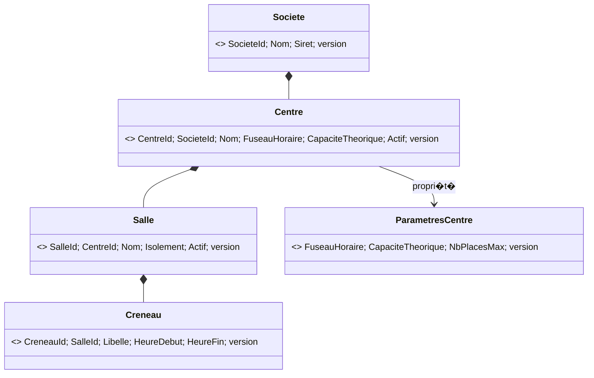

# Mod�le tactique -- Organisation

> **Contexte Supporting : OHS + Published Language (identifiant de centre).** Structure soci�t� -> centres ->
> salles/cr�neaux, transfert de centre, param�tres de centre. OHS pour les autres contextes : seul identifiant de centre
> est publi� (Published Language). �met `CentreTransf�r�`, `SalleOuverte/Ferm�e`.

## 1. Process-level event storming (filtr� Organisation)

| Acteur | Commande                  | Agr�gat | �v�nement de domaine        | Politique d�clench�e                  | Read model            |
|--------|---------------------------|---------|-----------------------------|---------------------------------------|-----------------------|
| Admin  | Cr��erCentre              | Centre  | `CentreCr��e`               |                                       | R�f�rentiel centres   |
| Admin  | ModifierParam�tresCentre  | Centre  | `Param�tresCentreModifi�s`  | fuseau, capacit� th�orique            | Param�tres centres    |
| Admin  | Transf�rerCentre          | Centre  | `CentreTransf�r�`           | migration patient vers nouveau centre | Historique transferts |
| Admin  | OuvrirSalle               | Salle   | `SalleOuverte`              |                                       | R�f�rentiel salles    |
| Admin  | FermerSalle               | Salle   | `SalleFerm�e`               | invalider salle pour GMAO (R8)        | R�f�rentiel salles    |
| Admin  | Cr��erCreneau             | Creneau | `CreneauCr��e`              |                                       | R�f�rentiel cr�neaux  |
| Admin  | ModifierCapaciteTheorique | Centre  | `CapaciteTheoriqueModifi�e` |                                       | Capacit�s centres     |

R�gles : un centre appartient � une soci�t� ; une salle appartient � un centre ; un cr�neau appartient � une salle.

## 2. R�gles & invariants (classement)

| #  | R�gle (RG)                                                                  | Nature             | Porteur                               |
|----|-----------------------------------------------------------------------------|--------------------|---------------------------------------|
| R1 | Une salle appartient � un seul centre                                       | invariant          | Salle                                 |
| R2 | Un cr�neau appartient � une seule salle                                     | invariant          | Creneau                               |
| R3 | Transfert de centre : migration des patients/placements vers nouveau centre | r�gle de processus | Use case + coordination Planification |
| R4 | Salle ferm�e : plus d'affectation possible                                  | invariant          | Salle                                 |

## 3. Carte du mod�le

## 4. Aggregate Design Canvas

### Centre (root: `Centre`) -- contexte organisation -- type: Supporting (OHS)

- **Intention** : d�finir un centre de dialyse, ses param�tres (fuseau, capacit� th�orique) et son activit�.
- **Invariants** : R3.
- **Identit�** : `CentreId` (shared kernel, ADR 0010).
- **�tat** : `SocieteId`, nom, fuseau horaire, capacit� th�orique, actif.
- **Commandes -> �v�nements** :
    - `cr��er(...)` -> `CentreCr��e`
    - `modifierParam�tres(...)` -> `Param�tresCentreModifi�s`
    - `transf�rer(nouvelleSociete, motif, auteur, t)` -> `CentreTransf�r�`
- **R�gles de rejet** : `CentreDejaActif`, `SocieteInconnue`, `TransfertCentreInconnu`.
- **Coh�rence** : transactionnelle interne ; �met `CentreTransf�r�` consomm� par Planification (migration placements).

### Salle (root: `Salle`) -- contexte organisation -- type: Supporting

- **Intention** : d�finir une salle de dialyse au sein d'un centre.
- **Identit�** : `SalleId`.
- **�tat** : `CentreId`, nom, isolement (bool�en), actif.
- **Commandes -> �v�nements** :
    - `ouvrir(...)` -> `SalleOuverte`
    - `fermer(...)` -> `SalleFerm�e`
- **R�gles de rejet** : `SalleDejaOuverte`, `SalleDejaFermee`.
- **Coh�rence** : d�pend de Centre (agr�gat parent) ; `SalleFerm�e` invalide la salle pour GMAO via ACL.

### Cr�neau (root: `Creneau`) -- contexte organisation -- type: Supporting

- **Intention** : d�finir un cr�neau horaire dans une salle.
- **Identit�** : `CreneauId`.
- **�tat** : `SalleId`, libell�, heure d�but, heure fin.
- **Commandes -> �v�nements** : `cr��er(...)` -> `CreneauCr��e`.

## 5. Domain Events -- publi�s

| �v�nement                      | Produit par | Consommateurs                                                      | Payload cl�s                                                             | Version | Idempotence |
|--------------------------------|-------------|--------------------------------------------------------------------|--------------------------------------------------------------------------|---------|-------------|
| `CentreCr��e`                  | Centre      | Planification (cr��ation places), Stock (centre actif)             | `eventId`, `centreId`, `societeId`, `nom`, `fuseauHoraire`               | 1       | idem        |
| `CentreTransf�r�`              | Centre      | Planification (migration placements), Absences (migration patient) | `eventId`, `centreId`, `ancienneSocieteId`, `nouvelleSocieteId`, `motif` | 1       | idem        |
| `SalleOuverte` / `SalleFerm�e` | Salle       | GMAO (invalider salle), Planification (cr��ation places)           | `eventId`, `salleId`, `centreId`, `nom`, `isolement`                     | 1       | idem        |
| `CreneauCr��e`                 | Creneau     | Planification (cr��ation places)                                   | `eventId`, `creneauId`, `salleId`, `libelle`, `heureDebut`, `heureFin`   | 1       | idem        |
| `Param�tresCentreModifi�s`     | Centre      | Planification (capacit� th�orique), Pilotage (capacit�s)           | `eventId`, `centreId`, `capaciteTheorique`, `fuseauHoraire`              | 1       | idem        |

## 6. Domain Events -- consomm�s

| �v�nement              | Producteur | Usage dans Organisation | Statut |
|------------------------|------------|-------------------------|--------|
| (aucun externe requis) | --         | --                      | --     |

Organisation est source de r�f�rentiel (OHS), ne consomme aucun �v�nement externe pour la v1.

## 7. Use cases -- agr�gats -- ports

| Use case (commande/query)    | Agr�gat    | Ports                                                                           | Autorisation          |
|------------------------------|------------|---------------------------------------------------------------------------------|-----------------------|
| Cr��erCentre                 | Centre     | CentreRepository, GenerateurIdentifiants, Horloge, Outbox                       | ADMIN soci�t�         |
| ModifierParam�tresCentre     | Centre     | CentreRepository, Horloge, Outbox                                               | ADMIN centre          |
| Transf�rerCentre             | Centre     | CentreRepository, PlanificationPublishedLanguage (migration placements), Outbox | ADMIN soci�t�         |
| OuvrirSalle                  | Salle      | CentreRepository (lecture centre), SalleRepository, Outbox                      | ADMIN centre          |
| FermerSalle                  | Salle      | SalleRepository, GMAOPublishedLanguage (invalider), Outbox                      | ADMIN centre          |
| Cr��erCreneau                | Creneau    | SalleRepository (lecture salle), CreneauRepository, Outbox                      | ADMIN centre          |
| Q: ListeCentres (pagination) | read model | LectureCentres                                                                  | ADMIN centre          |
| Q: ListeSalles (pagination)  | read model | LectureSalles                                                                   | ADMIN centre          |
| Q: Capacit�sCentres          | read model | LectureCapacitesCentres                                                         | ADMIN/PILOTAGE centre |

### Ports sortants

`CentreRepository`, `SalleRepository`, `CreneauRepository` (un par racine) -> `PublicateurDEvenements` (Outbox) ->
`JournalDesMessagesTrait�s` (idempotence) -> `Horloge` -> `GenerateurIdentifiants` -> `Habilitations` (Identit� &
acc�s).

## 8. Matrice invariant -> test

| #  | Invariant                               | Test unitaire (domaine pur)                 | �quivalent legacy |
|----|-----------------------------------------|---------------------------------------------|-------------------|
| R1 | salle = un centre                       | `should_reject_salle_avec_centre_inconnu`   | `Salle.java:??`   |
| R2 | cr�neau = une salle                     | `should_reject_creneau_avec_salle_inconnue` | `Creneau.java:??` |
| R3 | transfert centre = migration placements | (test d'int�gration avec Planification)     | --                |
| R4 | salle ferm�e = plus d'affectation       | `should_reject_affectation_salle_fermee`    | `Salle.java:??`   |

## 9. R�f�rentiels & caches

| Nom                     | TTL     | Cl�         | Invalidation                        |
|-------------------------|---------|-------------|-------------------------------------|
| `ref.centres.actifs`    | `PT3M`  | `societeId` | @CacheEvict sur cr��e/transfert     |
| `ref.salles.du.centre`  | `PT3M`  | `centerId`  | @CacheEvict sur ouverture/fermeture |
| `ref.parametres.centre` | `PT15M` | `centerId`  | @CacheEvict sur modification        |

## 10. Ports d'entr�e (r�capitulatif pour `slice-implementer`)

| Port                      | M�thode      | Signature                                                              | Impl�ment� par                |
|---------------------------|--------------|------------------------------------------------------------------------|-------------------------------|
| `CreerCentreUseCase`      | `creer`      | `(CreerCentreCommande) -> CentreId`                                    | `CreerCentreUseCaseImpl`      |
| `TransfererCentreUseCase` | `transférer` | `(CentreId, NouvelleSocieteId, Motif, UtilisateurId, Instant) -> void` | `TransfererCentreUseCaseImpl` |
| `OuvrirSalleUseCase`      | `ouvrir`     | `(OuvrirSalleCommande) -> SalleId`                                     | `OuvrirSalleUseCaseImpl`      |
| `FermerSalleUseCase`      | `fermer`     | `(SalleId, CentreId, UtilisateurId, Instant) -> void`                  | `FermerSalleUseCaseImpl`      |
| `CreerCreneauUseCase`     | `creer`      | `(CreerCreneauCommande) -> CreneauId`                                  | `CreerCreneauUseCaseImpl`     |

**Prochaine �tape** : `/ddd-slice organisation` (premi�re slice = cr��ation centre avec param�tres, traversant
interface -> application -> domaine -> persistance).