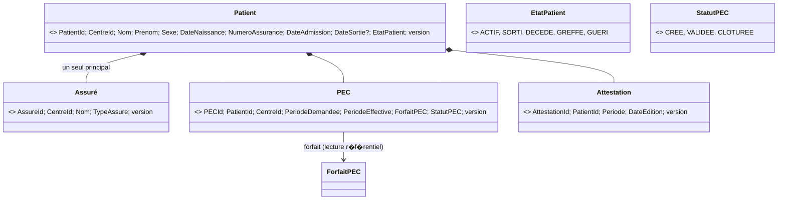

# Mod�le tactique -- Patient & couverture

> **Contexte Supporting : OHS (One-Way-Host) pour les autres contextes.** 4 micro-modules fusionn�s (ADR 0004) : Patient
> (identit� administrative), Assur�, PEC (prise en charge), Attestation de droits. Le champ "place" et "mouvement place
> lib�r�e" quittent ce contexte (vont vers Planification). Source de v�rit� administrative : un seul assur� principal,
> �tat de sortie exige une date, PEC CREE -> VALIDEE -> CLOTUREE.

## 1. Process-level event storming (filtr� Patient & couverture)

| Acteur           | Commande                | Agr�gat     | �v�nement de domaine     | Politique d�clench�e                 | Read model                       |
|------------------|-------------------------|-------------|--------------------------|--------------------------------------|----------------------------------|
| Secr�taire       | AdmettrePatient         | Patient     | `PatientAdmis`           | cr��e dossier administratif          | Fiche patient                    |
| Secr�taire       | Transf�rerPatient       | Patient     | `PatientTransf�r�`       | changement de centre (Organisation)  | Historique transfert             |
| Secr�taire       | D�clarerSortiePatient   | Patient     | `PatientSorti`           | date de sortie requise (RG-PAT-031)  | Historique sorties               |
| Secr�taire       | D�clarerGreffe          | Patient     | `GreffeD�clar�e`         |                                      | Parours greffe (Dossier m�dical) |
| Secr�taire       | AffecterAssur�Principal | Assur�      | `Assur�PrincipalAffect�` | un seul assur� principal (RG-PAT-04) | R�f�rentiel assur�s              |
| Gestionnaire PEC | ValiderPEC              | PEC         | `PECValid��e`            | PEC CREE -> VALIDEE -> CLOTUREE      | Droits du patient                |
| Gestionnaire PEC | CloturerPEC             | PEC         | `PECCl��tur�e`           |                                      | Historique PEC                   |
| Secr�taire       | EnregistrerAttestation  | Attestation | `AttestationEnregistr�e` |                                      | Attestations de droits           |

R�gles : un seul assur� principal (RG-PAT 04 l.140) ; ��tat de sortie exige une date (RG-PAT-031) ; PEC
`CREE -> VALIDEE -> CLOTUREE`.

## 2. R�gles & invariants (classement)

| #  | R�gle (RG)                                     | Nature                       | Porteur                         |
|----|------------------------------------------------|------------------------------|---------------------------------|
| R1 | Un seul assur� principal par patient           | invariant                    | Assur�                          |
| R2 | �tat de sortie exige une date de sortie        | invariant                    | Patient                         |
| R3 | PEC : CREE -> VALIDEE -> CLOTUREE, sans retour | invariant                    | PEC                             |
| R4 | Cr��ation s�ance conditionn�e par PEC valide   | r�gle d'entr�e (pour S�ance) | Use case + port `PECRepository` |
| R5 | Attestation de droits li�e à une PEC active    | invariant                    | Attestation                     |

## 3. Carte du mod�le

## 4. Aggregate Design Canvas

### Patient (root: `Patient`) -- contexte patient-couverture -- type: Supporting (OHS)

- **Intention** : tenir l'identit� administrative du patient, ses mouvements (admission, transfert, sortie, d�c�s,
  greffe, gu�rison) et son �tat.
- **Invariants** : R1 (via Assur�), R2.
- **Identit�** : `PatientId`.
- **�tat** : `CentreId`, nom, pr�nom, sexe, date de naissance, num�ro assurance, date admission, date sortie?, �tat
  patient.
- **Commandes -> �v�nements** :
    - `admettre(...)` -> `PatientAdmis`
    - `transf�rer(nouveauCentre, motif, auteur, t)` -> `PatientTransf�r�`
    - `d�clarerSortie(dateSortie, auteur, t)` -> `PatientSorti`
    - `d�clarerGreffe(date, auteur, t)` -> `GreffeD�clar�e` (proposition � la secr�taire, pas automatique -- H7)
- **R�gles de rejet** : `DateSortieRequise`, `PatientDejaSorti`, `TransfertVersMemeCentre`.
- **Coh�rence** : transactionnelle interne ; �met `PatientAdmis`/`PatientSorti` consomm�s par Planification et Absences
  patients.

### Assur� (root: `Assur�`) -- contexte patient-couverture -- type: Supporting (r�f�rentiel)

- **Intention** : r�f�rencer l'assur� d'un patient.
- **Invariants** : R1.
- **Identit�** : `AssureId`.
- **�tat** : `CentreId`, nom, type assur�.
- **Commandes -> �v�nements** : `affecterPrincipal(patientId, auteur, t)` -> `Assur�PrincipalAffect�`.
- **R�gles de rejet** : `AssureDejaPrincipal`.

### PEC (root: `PEC`) -- contexte patient-couverture -- type: Supporting

- **Intention** : porter une prise en charge (p�riode demand�e/effective, forfait).
- **Invariants** : R3.
- **Identit�** : `PECId`.
- **�tat** : `PatientId`, `CentreId`, `P�riodeDemand�e`, `P�riodeEffective`, `ForfaitPEC`, `StatutPEC`.
- **Commandes -> �v�nements** :
    - `cr��er(...)` -> `PECCr��e`
    - `valider(auteur, t)` -> `PECValid��e`
    - `cloturer(motif, auteur, t)` -> `PECCl��tur�e`
- **R�gles de rejet** : `PECDejaValidee`, `PECDejaCloturee`, `PeriodeIncoherente`.

### Attestation (entity) -- contexte patient-couverture -- type: Entity (satellite de Patient)

- **Intention** : documenter une attestation de droits.
- **Identit�** : `AttestationId`.
- **�tat** : `PatientId`, `P�riode`, `Date��dition`.
- **Commandes -> �v�nements** : `enregistrer(...)` -> `AttestationEnregistr�e`.

## 5. Domain Events -- publi�s

| �v�nement                | Produit par | Consommateurs                                                             | Payload cl�s                                                         | Version | Idempotence |
|--------------------------|-------------|---------------------------------------------------------------------------|----------------------------------------------------------------------|---------|-------------|
| `PatientAdmis`           | Patient     | Planification (jour de dialyse), S�ance (cr��ation), Absences (d�tection) | `eventId`, `patientId`, `centreId`, `dateAdmission`                  | 1       | idem        |
| `PatientSorti`           | Patient     | Planification (lib�ration place), Facturation (exclusion), S�ance (arr�t) | `eventId`, `patientId`, `centreId`, `dateSortie`                     | 1       | idem        |
| `Assur�PrincipalAffect�` | Assur�      | Facturation (payeur), Simulation                                          | `eventId`, `patientId`, `centreId`, `assureId`                       | 1       | idem        |
| `PECValid��e`            | PEC         | S�ance (cr��ation conditionn�e), Facturation (priorit�)                   | `eventId`, `patientId`, `centreId`, `pecId`, `forfaitPEC`, `tauxTVA` | 1       | idem        |
| `PECCl��tur�e`           | PEC         | Facturation (fin de validit�), Absences (r�inclusion refus�e)             | `eventId`, `patientId`, `centreId`, `pecId`, `dateCl�ture`           | 1       | idem        |
| `AttestationEnregistr�e` | Attestation | Patient & couverture (lecture uniquement)                                 | `eventId`, `patientId`, `centreId`, `periode`, `date��dition`        | 1       | idem        |

## 6. Domain Events -- consomm�s

| �v�nement              | Producteur | Usage dans Patient & couverture | Statut |
|------------------------|------------|---------------------------------|--------|
| (aucun externe requis) | --         | --                              | --     |

Patient & couverture est source de v�rit� administrative (OHS), ne consomme aucun �v�nement externe pour la v1.

## 7. Use cases -- agr�gats -- ports

| Use case (commande/query)                       | Agr�gat     | Ports                                                                    | Autorisation                        |
|-------------------------------------------------|-------------|--------------------------------------------------------------------------|-------------------------------------|
| AdmettrePatient                                 | Patient     | PatientRepository, GenerateurIdentifiants, Horloge, Outbox               | ADMIN/SECRETAIRE centre             |
| Transf�rerPatient                               | Patient     | PatientRepository, OrganisationsPublishedLanguage (lecture centre cible) | ADMIN centre                        |
| D�clarerSortiePatient                           | Patient     | PatientRepository, Horloge, Outbox                                       | ADMIN/SECRETAIRE centre             |
| D�clarerGreffe                                  | Patient     | PatientRepository, Horloge, Outbox                                       | ADMIN/SECRETAIRE centre             |
| AffecterAssur�Principal                         | Assur�      | PatientRepository (lecture patient), Assur�Repository, Outbox            | ADMIN centre                        |
| ValiderPEC                                      | PEC         | PECRepository, PatientRepository (lecture patient), Horloge, Outbox      | GESTIONNAIRE_PEC centre             |
| CloturerPEC                                     | PEC         | PECRepository, Horloge, Outbox                                           | GESTIONNAIRE_PEC centre             |
| EnregistrerAttestation                          | Attestation | PatientRepository (lecture patient), Outbox                              | ADMIN/SECRETAIRE centre             |
| Q: D�tailPatient                                | read model  | LecturePatient                                                           | ADMIN/INFIRMIER/MEDECIN centre      |
| Q: DroitsPatient (PEC active, assur� principal) | read model  | LecturePECDroits                                                         | ADMIN/SECRETAIRE/FACTURATION centre |
| Q: ListePatients (pagination)                   | read model  | LecturePatients (SQL d�di�e)                                             | ADMIN centre                        |

### Ports sortants

`PatientRepository`, `Assur�Repository`, `PECRepository` (un par racine) -> `AttestationRepository` (satellite) ->
`OrganisationsPublishedLanguage` (lecture centres, OHS Organisation) -> `PublicateurDEvenements` (Outbox) ->
`JournalDesMessagesTrait�s` (idempotence) -> `Horloge` -> `GenerateurIdentifiants`.

## 8. Matrice invariant -> test

| #  | Invariant                        | Test unitaire (domaine pur)                                                              | �quivalent legacy     |
|----|----------------------------------|------------------------------------------------------------------------------------------|-----------------------|
| R1 | un seul assur� principal         | `should_reject_deux_assures_principaux` ; `should_autoriser_changement_assure_principal` | `Assure.java:140`     |
| R2 | date de sortie requise           | `should_reject_sortie_sans_date`                                                         | `Patient.java:??`     |
| R3 | cycle PEC                        | `should_reject_pec_cloturee_validee` ; `should_reject_pec_validee_cree`                  | `PEC.java:??`         |
| R4 | PEC valide pour cr��ation s�ance | (test dans contexte S�ance)                                                              | --                    |
| R5 | attestation li�e PEC active      | `should_reject_attestation_pec_cloturee`                                                 | `Attestation.java:??` |

## 9. R�f�rentiels & caches

| Nom                  | TTL     | Cl�                      | Invalidation                           |
|----------------------|---------|--------------------------|----------------------------------------|
| `ref.patient.detail` | `PT15M` | `centerId` + `patientId` | @CacheEvict sur admission/sortie       |
| `ref.pec.active`     | `PT15M` | `centerId` + `patientId` | @CacheEvict sur validation/cl�ture PEC |
| `ref.liste.patients` | `PT3M`  | `centerId`               | @CacheEvict sur cr��ation/sortie       |

## 10. Ports d'entr�e (r�capitulatif pour `slice-implementer`)

| Port                           | M�thode          | Signature                                                           | Impl�ment� par                     |
|--------------------------------|------------------|---------------------------------------------------------------------|------------------------------------|
| `AdmettrePatientUseCase`       | `admettre`       | `(AdmettrePatientCommande) -> PatientId`                            | `AdmettrePatientUseCaseImpl`       |
| `ValiderPECUseCase`            | `valider`        | `(PECId, CentreId, UtilisateurId, Instant) -> void`                 | `ValiderPECUseCaseImpl`            |
| `CloturerPECUseCase`           | `cloturer`       | `(PECId, CentreId, Motif, UtilisateurId, Instant) -> void`          | `CloturerPECUseCaseImpl`           |
| `DeclarerSortiePatientUseCase` | `declarerSortie` | `(PatientId, CentreId, DateSortie, UtilisateurId, Instant) -> void` | `DeclarerSortiePatientUseCaseImpl` |

**Prochaine �tape** : `/ddd-slice patient-couverture` (premi�re slice = cr��ation patient avec PEC, traversant
interface -> application -> domaine -> persistance).