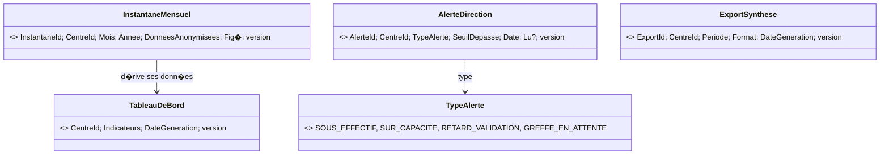

# Mod�le tactique -- Pilotage direction

> **Contexte Supporting : Conformiste en lecture.** Vue soci�t� anonymis�e multi-centres ; instantan� mensuel fig� ;
> alertes. Aucune �criture dans les autres contextes. Conforme en lecture des �v�nements publi�s (Customer-Supplier
> invers� : consomme, ne produit pas d'�criture cross-context).

## 1. Process-level event storming (filtr� Pilotage direction)

| Acteur    | Commande                  | Agr�gat           | �v�nement de domaine       | Politique d�clench�e                                | Read model                |
|-----------|---------------------------|-------------------|----------------------------|-----------------------------------------------------|---------------------------|
| (syst�me) | CapturerInstantaneMensuel | InstantaneMensuel | `InstantaneMensuelCaptur�` | fin de mois, tous les centres actifs                | Instantan�s direction     |
| (syst�me) | G�n�rerAlerteDirection    | AlerteDirection   | `AlerteDirectionG�n�r�e`   | sur d�passement seuil (sous-effectif, sur-capacit�) | Alertes direction         |
| Direction | ConsulterTableauDeBord    | TableauDeBord     | (lecture seule)            |                                                     | Tableau de bord direction |
| Direction | ExporterSynthese          | ExportSynthese    | `ExportSyntheseG��n�r�`    | PDF/HTML via ModeleDocumentPrinter                  | Export rapport            |

R�gles : lecture seule ailleurs ; aucune �criture dans les autres contextes ; instantan� fig� apr�s cl�ture.

## 2. R�gles & invariants (classement)

| #  | R�gle (RG)                                             | Nature               | Porteur           |
|----|--------------------------------------------------------|----------------------|-------------------|
| R1 | Instantan� mensuel : un par centre, fig� apr�s cl�ture | invariant            | InstantaneMensuel |
| R2 | Alerte unique par centre et jour                       | invariant            | AlerteDirection   |
| R3 | Donn�es anonymis�es multi-centres                      | invariant            | Application       |
| R4 | Pas d'�criture dans les autres contextes               | r�gle d'architecture | Application       |

## 3. Carte du mod�le

## 4. Aggregate Design Canvas

### Instantan� Mensuel (root: `Instantan�Mensuel`) -- contexte pilotage-direction -- type: Supporting

- **Intention** : capturer un instantan� mensuel fig� des indicateurs d'un centre.
- **Invariants** : R1.
- **Identit�** : `InstantaneId`.
- **�tat** : `CentreId`, `Mois`, `Annee`, `Donn�esAnonymis�es` (JSON), `Fig�` (bool�en).
- **Commandes -> �v�nements** :
    - `capturer(mois, annee, auteur, t)` -> `InstantaneMensuelCaptur�`
- **R�gles de rejet** : `InstantaneDejaExistant`, `CentreInactif`, `MoisDejaClotureFacturation` (verrou Facturation).
- **Coh�rence** : transactionnelle interne ; lect�ure seule apr�s capture.

### Alerte Direction (root: `AlerteDirection`) -- contexte pilotage-direction -- type: Supporting

- **Intention** : g�n�rer une alerte de direction (sous-effectif, sur-capacit�, retard validation, etc.).
- **Invariants** : R2.
- **Identit�** : `AlerteId`.
- **�tat** : `CentreId`, `TypeAlerte`, `SeuilDepasse`, `Date`, `Lu?`.
- **Commandes -> �v�nements** :
    - `g�n�rer(type, seuil, auteur, t)` -> `AlerteDirectionG�n�r�e`
    - `marquerLu(auteur, t)` -> `AlerteLue`
- **R�gles de rejet** : `AlerteDejaExistantePourJour`, `TypeAlerteInconnu`.
- **Coh�rence** : r�gle d'unicit� par centre et jour (R2).

### Tableau de Bord (entity) -- contexte pilotage-direction -- type: Entity (read model d�di�)

- **Intention** : vue agr�g�e des indicateurs d'un centre.
- **Identit�** : `CentreId`.
- **�tat** : `CentreId`, `Indicateurs` (JSON), `DateG��n�ration`.

### Export Synth�se (entity) -- contexte pilotage-direction -- type: Entity

- **Intention** : g�n�rer un export de synth�se (PDF/HTML) via ModeleDocumentPrinter.
- **Identit�** : `ExportId`.
- **�tat** : `CentreId`, `P�riode`, `Format`, `DateG��n�ration`.

## 5. Domain Events -- publi�s

| �v�nement                  | Produit par       | Consommateurs                                           | Payload cl�s                                                 | Version | Idempotence |
|----------------------------|-------------------|---------------------------------------------------------|--------------------------------------------------------------|---------|-------------|
| `InstantaneMensuelCaptur�` | Instantan�Mensuel | Pilotage direction (lecture uniquement), Reporting      | `eventId`, `centreId`, `mois`, `annee`, `dateCapture`        | 1       | idem        |
| `AlerteDirectionG�n�r�e`   | AlerteDirection   | Pilotage direction (lecture), Notifications (direction) | `eventId`, `centreId`, `typeAlerte`, `seuilDepasse`, `date`  | 1       | idem        |
| `ExportSyntheseG��n�r�`    | ExportSynthese    | Pilotage direction (lecture uniquement)                 | `eventId`, `centreId`, `periode`, `format`, `dateGeneration` | 1       | idem        |

## 6. Domain Events -- consomm�s

| �v�nement            | Producteur        | Usage dans Pilotage direction                      | Statut       |
|----------------------|-------------------|----------------------------------------------------|--------------|
| `FacturationValid�e` | Facturation       | d�clenche capture instantan� mensuel (fin de mois) | candidat, Q1 |
| `S�anceValid��e`     | S�ance            | alimente indicateurs activit�                      | candidat, Q1 |
| `AbsenceD�tect�e`    | Absences patients | alimente indicateurs absent\u00e9isme              | candidat, Q1 |

Pilotage direction consomme des �v�nements d'autres contextes pour alimenter ses indicateurs (Customer-Supplier
invers� : consomme, ne produit pas d'�criture cross-context).

## 7. Use cases -- agr�gats -- ports

| Use case (commande/query)           | Agr�gat           | Ports                                                                                     | Autorisation     |
|-------------------------------------|-------------------|-------------------------------------------------------------------------------------------|------------------|
| CapturerInstantaneMensuel           | Instantan�Mensuel | InstantaneRepository, FacturationPublishedLanguage (verrou mois cl�ture), Horloge, Outbox | DIRECTION centre |
| G�n�rerAlerteDirection              | AlerteDirection   | AlerteRepository, Horloge, Outbox                                                         | DIRECTION centre |
| MarquerAlerteLue                    | AlerteDirection   | AlerteRepository, Horloge                                                                 | DIRECTION centre |
| ConsulterTableauDeBord              | TableauDeBord     | LectureTableauDeBord (read model)                                                         | DIRECTION centre |
| ExporterSynthese                    | ExportSynthese    | ExportRepository, ModeleDocumentPrinter (impression)                                      | DIRECTION centre |
| Q: Instantan�sMensuels (pagination) | read model        | LectureInstantanesMensuels                                                                | DIRECTION centre |
| Q: AlertesDirection (pagination)    | read model        | LectureAlertes                                                                            | DIRECTION centre |
| Q: TableauDeBordCentre              | read model        | LectureTableauDeBord                                                                      | DIRECTION centre |

### Ports sortants

`InstantaneRepository`, `AlerteRepository`, `ExportRepository` (un par racine) -> `TableauDeBordRepository` (read model
d�di�) -> `FacturationPublishedLanguage` (verrou mois cl�ture, OHS Facturation) -> `PublicateurDEvenements` (Outbox) ->
`JournalDesMessagesTrait�s` (idempotence) -> `Horloge` -> `GenerateurIdentifiants` -> `ModeleDocumentPrinter`
(impression PDF/HTML, g�n�rique).

## 8. Matrice invariant -> test

| #  | Invariant                                  | Test unitaire (domaine pur)                                  | �quivalent legacy           |
|----|--------------------------------------------|--------------------------------------------------------------|-----------------------------|
| R1 | un instantan� par centre/mois              | `should_reject_deux_instants_meme_mois`                      | `InstantaneMensuel.java:??` |
| R2 | alerte unique par centre/jour              | `should_reject_deux_alertes_meme_jour`                       | `AlerteDirection.java:??`   |
| R3 | pas d'�criture cross-context               | (test d'architecture : aucun port d'�criture vers autres BC) | --                          |
| R4 | mois cl�tur� facturation = capture bloqu�e | `should_reject_capture_mois_cloture_facturation`             | --                          |

## 9. R�f�rentiels & caches

| Nom                  | TTL    | Cl�                           | Invalidation                       |
|----------------------|--------|-------------------------------|------------------------------------|
| `ref.instants.mois`  | `PT3M` | `centerId` + `mois` + `annee` | @CacheEvict sur capture            |
| `ref.alertes.centre` | `PT3M` | `centerId`                    | @CacheEvict sur g�n�ration/lecture |

## 10. Ports d'entr�e (r�capitulatif pour `slice-implementer`)

| Port                               | M�thode      | Signature                                              | Impl�ment� par                         |
|------------------------------------|--------------|--------------------------------------------------------|----------------------------------------|
| `CapturerInstantaneMensuelUseCase` | `capturer`   | `(CapturerInstantaneMensuelCommande) -> InstantaneId`  | `CapturerInstantaneMensuelUseCaseImpl` |
| `GenererAlerteDirectionUseCase`    | `générer`    | `(GenererAlerteDirectionCommande) -> AlerteId`         | `GenererAlerteDirectionUseCaseImpl`    |
| `MarquerAlerteLueUseCase`          | `marquerLue` | `(AlerteId, CentreId, UtilisateurId, Instant) -> void` | `MarquerAlerteLueUseCaseImpl`          |
| `ExporterSyntheseUseCase`          | `exporter`   | `(ExporterSyntheseCommande) -> ExportId`               | `ExporterSyntheseUseCaseImpl`          |

**Prochaine �tape** : `/ddd-slice pilotage-direction` (premi�re slice = capture instantan� mensuel, traversant
interface -> application -> domaine -> persistance).