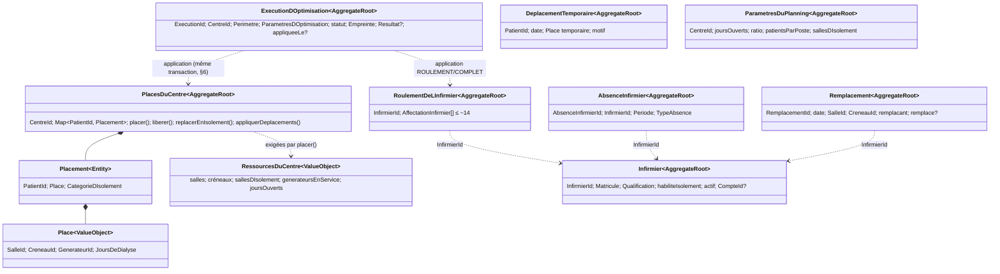

# Modèle tactique — Planification

> Refactoring sur place (ADR 0024) : nouveau module `backend/contexts/planification`, **mêmes tables** (colonnes de place
> de `patients`, `planning_parametres`, `planification_*`, `planning_preference_patient`, `infirmier*`,
> `deplacement_temporaire`), **mêmes URLs** (`/api/v1/planning/**`, `/api/v1/infirmiers/**`), filet de caractérisation
> (goldens HTTP) avant tout code, aucune façade ni routage ni projection. Événements par l'outbox Spring Modulith (ADR 0013).
> Contexte **cœur** : modèle riche là où sont les invariants (place, roulement, optimisation) ; le paramétrage reste léger.
> Le legacy est déjà assez propre (records validés, ports, Timefold derrière `OptimiseurPlanningPort`) : on le
> **déplace et on le resserre** (invariants d'ensemble sous verrou, fuseau du centre, plus d'écriture dans les tables des
> autres contextes), on ne réécrit pas le solveur.
> Homonymes : *absence d'infirmier* (ici) ≠ *absence de patient* (Absences patients) ; *générateur* (ressource de place,
> ici) ≠ *équipement* (GMAO). Termes absents du glossaire : marqués *(proposed)*, ajoutés au glossaire.
> **Aucune caractérisation HTTP de la planification n'existe** (≈ 50 tests unitaires/intégration legacy seulement) : chaque
> slice commence par son filet.

## 1. Process-level event storming (filtré Planification)

| Acteur / déclencheur | Commande | Agrégat | Événement de domaine | Read model / effet |
|---|---|---|---|---|
| SECRETAIRE / ADMIN / INFIRMIER (fiche patient, `POST/PUT /api/v1/patients`) | PlacerLePatient(place \| aucune) | PlacesDuCentre | `PatientPlace`, `PlacementModifie` | planning de la semaine |
| SECRETAIRE / ADMIN / MEDECIN / INFIRMIER | ProposerDesPlaces(demande) | — (calcul) | — | propositions notées 0-100 + raisons |
| MEDECIN (sérologie créée/modifiée) | ReaffecterEnIsolementSiRisque | PlacesDuCentre | `PatientReplaceEnIsolement` \| `IsolementImpossible` | notification |
| Cron 04:00 (chaque centre) + enregistrement d'une fiche échue (J-1) | LibererLesPlacesEchues | PlacesDuCentre | `PlaceLiberee` (× N) | mouvement `PLACE_LIBEREE` (Patient & couverture) |
| GMAO : `EquipementMisHorsService`, `EquipementReforme` | SignalerUnGenerateurIndisponible | — (politique) | — | notification `GENERATEUR_INDISPONIBLE` + patients touchés |
| ADMIN / SECRETAIRE | LancerUneOptimisation(périmètre, horizon, réglages) | ExecutionDOptimisation | `OptimisationLancee` → `OptimisationTerminee` \| `OptimisationEchouee` | historique, calendrier figé |
| ADMIN / SECRETAIRE | ArreterUneOptimisation | ExecutionDOptimisation | `OptimisationArretee` | — |
| ADMIN | AppliquerUneProposition | ExecutionDOptimisation + PlacesDuCentre + RoulementDeLInfirmier × N + Remplacement × N + DeplacementTemporaire × N | `PropositionAppliquee` | planning, roulement, remplacements |
| ADMIN | SupprimerUneExecution | ExecutionDOptimisation | `ExecutionSupprimee` | — |
| Cron 02:30 (centres ayant activé l'option) | ReplanifierLaNuit (COUVERTURE → MAINTENANCE → PATIENTS) | ExecutionDOptimisation × 3 | idem | bilan `REPLANIFICATION_NOCTURNE`, `OPTIMISATION_PROPOSITION` |
| Démarrage du serveur | ReprendreLesExecutionsInterrompues | ExecutionDOptimisation × N | `OptimisationEchouee` | — |
| ADMIN | ModifierLesParametresDuPlanning / LesReglages | ParametresDuPlanning / ReglagesDePlanification | `ParametresDuPlanningModifies` | — |
| ADMIN / SECRETAIRE | DefinirLaPreferenceDuPatient / LeProfilDeLInfirmier | PreferenceDePlanification / ProfilDePlanification | — | pris au prochain calcul |
| ADMIN | EnregistrerUnInfirmier, Modifier, Desactiver, Reactiver, LierUnCompte, CreerUnCompte, DelierLeCompte | Infirmier | `InfirmierEnregistre`, `InfirmierDesactive`, `InfirmierReactive`, `CompteLie`, `CompteDelie` | référentiel |
| ADMIN | AffecterAuRoulement, ModifierLAffectation, RetirerLAffectation | RoulementDeLInfirmier | `AffectationAjoutee/Modifiee/Retiree` | avertissement de sur-effectif |
| ADMIN / SECRETAIRE ; INFIRMIER (« Mon planning ») | DeclarerUneAbsenceDInfirmier, RetirerLAbsence | AbsenceInfirmier | `AbsenceInfirmierDeclaree`, `AbsenceInfirmierRetiree` | notification ; présence |
| ADMIN / SECRETAIRE | AffecterUnRemplacant, AnnulerLeRemplacement | Remplacement | `RemplacantAffecte`, `RemplacementAnnule` | présence |
| Cron 07:15 | ControlerLaPresence (14 j) | — (politique) | `SousEffectifDetecte`, `SurEffectifDetecte` | notifications |
| Tous rôles lecteurs | (lectures) semaine, présence, alertes, remplaçants classés, charge, capacité, salles, grille | — | — | read models |

## 2. Règles & invariants (classement)

| # | Règle (RG) | Nature | Porteur cible | Équivalent legacy |
|---|---|---|---|---|
| P1 | Une place = salle + créneau + générateur + **au moins un** jour ; placement partiel refusé `PLACEMENT_INCOMPLET` ; aucune place = acceptée (RG-PLN-050/051) | invariant de valeur | VO `Place` | `PlacementPatientService.java:50-65` |
| P2 | Un patient garde **la même salle, le même créneau et le même générateur** tous ses jours (RG-PLN-020) | invariant de valeur | VO `Place` (un seul triplet) | colonnes uniques de `patients` |
| P3 | **Un générateur ne sert qu'un patient par jour et par créneau** (RG-PLN-021) `PLACEMENT_GENERATEUR_OCCUPE` | **invariant d'ensemble** | `PlacesDuCentre` | `PlanificationAffectationService.verifier` |
| P4 | Isolement : patient à risque (RG-PLN-012) seulement en salle d'isolement ; sans risque jamais en isolement ; **un générateur ne mélange jamais** risque / sans risque, quel que soit le jour ; placé en isolement = traité à risque (RG-PLN-024, 052) `PLACEMENT_ISOLEMENT_REQUIS`, `PLACEMENT_GENERATEUR_INCOMPATIBLE` | invariant d'ensemble | `PlacesDuCentre` + VO `CategorieDIsolement` | idem |
| P5 | Salle et créneau du centre, générateur **en service** de type dialyse, rattaché à la salle ; jours = jours d'ouverture (RG-PLN-011, 023) `PLACEMENT_SALLE_INCONNUE`, `CRENEAU_INCONNU`, `GENERATEUR_INCONNU`, `JOUR_FERME` | invariant de création (référentiel passé en entrée) | `PlacesDuCentre.placer` + VO `RessourcesDuCentre` | `PlanningDonneesJdbcAdapter:147` (SQL `gmao_equipements`) |
| P6 | Placement **inchangé** = accepté sans contrôle (une anomalie héritée ne bloque pas) ; premier manquement seulement (RG-PLN-050/051) | règle de processus | `PlacesDuCentre.placer` | `PlacementPatientService.java:54-57` |
| P7 | Dernier jour d'occupation dépassé ⇒ place libérée (salle, créneau, générateur, jours effacés) + mouvement `PLACE_LIBEREE` portant la place quittée ; idempotent ; à l'enregistrement d'une fiche, échéance jugée à **J-1** (RG-PAT-032/033/034, RG-PLN-010) | politique (cohérence immédiate place ↔ mouvement aujourd'hui) | politique `LiberationDesPlaces` + `PlacesDuCentre.liberer` | `LiberationPlacesService.java:56-86`, `Patient.java:126`, cron `LiberationPlacesScheduler.java:28` |
| P8 | Patient devenu à risque : replacé en isolement (mêmes jours, créneau conservé si possible, meilleure proposition) ; sinon reste en place + alerte `isolement impossible` (RG-PLN-053) | politique | `ReaffectationEnIsolement` → `PlacesDuCentre.replacerEnIsolement` | `PlacementPatientService.java:74-96`, `SerologieRestController.java:85,97` |
| P9 | Propositions : score 0-100 (espacement 55 %, créneau +20, salle +15, charge +10, normalisé), pénalités d'espacement, schémas usuels, ≤ 2 par salle·créneau, ≤ 30, départage stable, raisons, fermetures à 90 j ; patient à risque sans salle d'isolement → `AUCUNE_SALLE_ISOLEMENT` ; jours imposés fermés → `JOURS_IMPOSES_FERMES` ; nb séances 1-7 (RG-PLN-025, 026, 030-034) | calcul pur | service `PropositionsDePlace` | `PlanificationAffectationService.java:101` |
| P10 | Paramètres du planning : ≥ 1 jour d'ouverture ; ratio 1-20 (défaut 4) ; patients par poste et par série 1-10 (défaut 3) ; salle d'isolement du centre ; semaine dimanche → samedi (RG-PLN-001..006) | invariant de valeur | `ParametresDuPlanning` | `PlanningParametres.java:22-31` |
| P11 | Réglages : vacation 1-12 h (5), temps plein 10-60 h (40), repos 0-6 j (1), replanification nocturne (non) ; préférence patient : créneau du centre, jours à choisir ⇒ nb séances 1-7 ; profil infirmier : taux 10-100 %, compétences `PEDIATRIE`/`CATHETER` (RG-PLN-093, 097, 098) | invariant de valeur | `ReglagesDePlanification`, `PreferenceDePlanification`, `ProfilDePlanification` | adaptateurs `planification_reglages`, `planning_preference_patient`, `infirmier_profil_planning` |
| P12 | Capacité théorique : secours = ⌈générateurs/8⌉ ; postes = installés hors réformés − secours ; capacité = postes × séries × patients par poste ; niveau `SANS_CAPACITE/MARGE/PROCHE/ATTEINTE` (90 %) ; consolidation (RG-PLN-070..074) | calcul pur | VO `CapaciteTheorique` | `CapaciteTheoriqueCalculator` |
| P13 | Fiche infirmier : matricule unique par centre, nom, qualification obligatoires ; désactivation ⇔ compte désactivé (dans les deux sens) ; un compte lié une seule fois, même état que la fiche, rôle infirmier ; création de compte : fiche active, identifiant 3-50 `[A-Za-z0-9._-]`, mot de passe temporaire 14 car. affiché une fois (RG-INF-001..012) | invariant (+ ensemble pour l'unicité) | `Infirmier` + contrainte `UNIQUE` existante | `Infirmier.java:22-73`, `CompteInfirmierService` |
| P14 | Affectation au roulement : salle et créneau du centre, ≥ 1 jour ; **jamais deux affectations d'un infirmier sur le même créneau un même jour** `AFFECTATION_CHEVAUCHEMENT` (RG-INF-020..022) | invariant (par infirmier) | `RoulementDeLInfirmier` | `AffectationInfirmier.java:22-44`, `AffectationInfirmierService.java:73` |
| P15 | Absence d'infirmier : type obligatoire, fin ≥ début, ≤ 366 j ; « Mon planning » : fin ≥ aujourd'hui (`ABSENCE_PASSEE`), retrait seulement si non commencée (`ABSENCE_NON_ANNULABLE`), ses propres absences seulement (`INFIRMIER_NON_LIE`) (RG-INF-030..032) | invariant + autorisation | `AbsenceInfirmier` | `AbsenceInfirmier.java:24-49`, `MonPlanningInfirmierService.java:107,120` |
| P16 | Remplacement : salle·créneau du centre ; remplaçant **éligible** (pas absent ce jour, pas déjà prévu sur ce créneau, habilité si isolement) `REMPLACEMENT_INELIGIBLE` ; jamais soi-même (RG-INF-050, 052) | invariant (preuve d'éligibilité construite au cas d'usage) | `Remplacement` + VO `RemplacantEligible` | `RemplacementInfirmier.java:19-26`, `RemplacementInfirmierService.java:50` |
| P17 | Effectif requis d'une case = ⌈patients / ratio⌉ ; effectif compté = roulement − absents + remplaçants, habilités seuls en isolement ; statut `FERME/SANS_PATIENT/COUVERT/SOUS_EFFECTIF` ; manque, sur-effectif ≥ 0 ; conflits `DOUBLE_AFFECTATION`, `NON_HABILITE` (RG-INF-040..047) | calcul pur | service `PresenceDeLaSemaine` | `Presence.java`, `PresenceInfirmierService` |
| P18 | Classement des remplaçants 0-100 (base 40, +15/+10/charge/±jour libre/+10 isolement), raisons, départage par nom (RG-INF-051) ; charge mensuelle + moyenne (RG-INF-060) | calcul pur | services `ClassementDesRemplacants`, `ChargeDesInfirmiers` | `RemplacantService`, `ChargeInfirmierService` |
| P19 | Contrôle quotidien 07:15 : sous-effectif à 14 j → `INFIRMIER_SOUS_EFFECTIF` ; sur-effectif → `INFIRMIER_SUREFFECTIF` (cases, vacations en trop, heures) ; contrôles indépendants ; un centre en erreur n'arrête pas les autres (RG-INF-046/047) | politique | `ControleDeLaPresence` | `PresenceInfirmierScheduler.java:45` |
| P20 | Exécution d'optimisation : `EN_COURS → TERMINEE \| ECHOUEE` ; **une seule en cours par centre** `OPTIMISATION_DEJA_EN_COURS` ; 20 dernières conservées ; interrompue au redémarrage → échec ; arrêt anticipé garde la meilleure solution ; suppression refusée en cours (RG-PLN-081, 090, 102) | invariant (+ ensemble « une en cours ») | `ExecutionDOptimisation` + verrou du centre | `RunOptimisation.java`, `OptimisationPlanningService.java:94-96` (verrou **en mémoire**) |
| P21 | Paramètres d'optimisation bornés (horizon 1-8 sem. ramené au dimanche, durée 2-300 s, stabilité 0-10, objectif, vacations/jour 1-3, /sem. 1-14) (RG-PLN-082) | validation de valeur | VO `ParametresDOptimisation` | `ParametresOptimisation.java` |
| P22 | Application **tout ou rien** : exécution du centre, terminée avec résultat, non déjà appliquée ; **empreinte** (SHA-256 des données lues) inchangée sinon `OPTIMISATION_PERIMEE` ; chaque nouvelle place revérifiée (P3-P5) face à l'état final `OPTIMISATION_PLACEMENT_<règle>` ; roulement : jamais deux salles même créneau même jour (P14) ; jours écrits avant la place (RG-PLN-091, 094, RG-INF-070) | invariant **multi-agrégats** (exception décidée, §6) | cas d'usage `AppliquerUneProposition` + `ExecutionDOptimisation.appliquer` | `RunOptimisation.java:75-81`, `OptimisationApplicationService.java:91-141` |
| P23 | Une proposition n'est **jamais appliquée automatiquement**, y compris la nuit (RG-PLN-080, 100) | invariant de processus | `ReplanificationNocturne` | `ReplanificationAutomatiqueService` |
| P24 | Indicateurs avant/après **recalculés par le domaine** indépendamment du solveur (RG-PLN-089) ; calendrier de la proposition figé à la fin du calcul (RG-PLN-101) | calcul pur / instantané | services `IndicateursDOptimisation`, `CalendrierDeLaProposition` | `IndicateursOptimisationService`, `CalendrierPropositionService` |
| P25 | Déplacement temporaire : un par (patient, date), remplace l'existant ; ne touche jamais la place habituelle (RG-PLN-096) | invariant (+ unicité `UNIQUE (center_id, patient_id, date_seance)` existante) | `DeplacementTemporaire` | `DeplacementTemporaireJdbcAdapter` |
| P26 | Générateur indisponible (GMAO) : alerte seulement si générateur de dialyse **passé de `EN_SERVICE` à autre chose** (KB-GMAO-37), liste des patients placés dessus ; **aucun déplacement automatique** (context-map Q1) | politique | `AlerteGenerateurIndisponible` | `GenerateurIndisponibleService.java:39-49`, `GmaoEvenementsPlanificationListener` |
| P27 | Isolation par centre : aucune lecture ni écriture hors du centre de la session ; seul le nombre de calculs parallèles est partagé (RG-PLN-062, 101) | autorisation | tous use cases / repositories | `centerAccessGuard` |

## 3. Carte du modèle

Légers (paramétrage, entité unique, sans événement publié) : `ReglagesDePlanification` (centre),
`PreferenceDePlanification` (patient), `ProfilDePlanification` (infirmier).

Pourquoi **un agrégat par centre pour les places** (et pas un par patient) : P3, P4 (mélange sur un générateur) et P22 sont
des invariants d'**ensemble** sur toutes les places du centre ; le legacy charge déjà toutes les places du centre à chaque
contrôle (`donnees.charger(centerId, patientId)`). Volume borné par la capacité (≈ 80-300 placements), écritures rares
(quelques placements par jour, une application de proposition) : la contention est négligeable et l'application d'une
proposition PATIENTS devient une transaction **d'un seul** agrégat.

## 4. Aggregate Design Canvas

### Places du centre (root: `PlacesDuCentre`) — contexte planification — type: core

- **Intention** : garantir que chaque patient placé a une place cohérente et que deux patients ne se disputent jamais un
  générateur ni ne mélangent risque infectieux et absence de risque.
- **Invariants** : P1-P5 (via `Place`, `RessourcesDuCentre`, `CategorieDIsolement`), P6, P7 (effacement), P8 (replacement),
  P22 (revérification des places face à l'état final).
- **Identité** : `CentreId` (une instance par centre). Entités internes `Placement` identifiées par `PatientId`.
- **État** : placements actuels du centre (salle, créneau, générateur, jours, catégorie d'isolement calculée). Lu et écrit
  **sur les seules colonnes de place de `patients`** (`salle_id`, `position_id`, `generateur_id`, `jour_*`) : aucune
  migration (ADR 0024). La migration des colonnes hors de `patients` prévue par ADR 0005 est **reportée** (Q1).
- **Commandes → événements** :
  `placer(patient, Place?, categorie, RessourcesDuCentre)` → `PatientPlace` | `PlacementModifie` | `PlaceRetiree` (aucune place) ;
  `liberer(patient, dernierJour, aujourdhui)` → `PlaceLiberee(placeQuittee, dateDEffet, automatique)` ;
  `replacerEnIsolement(patient, propositions)` → `PatientReplaceEnIsolement` | `IsolementImpossible` ;
  `appliquerDeplacements(liste, RessourcesDuCentre)` → `PatientPlace`/`PlacementModifie` × N (tout ou rien).
- **Rejets (codes legacy conservés)** : `PLACEMENT_INCOMPLET`, `PLACEMENT_SALLE_INCONNUE`, `PLACEMENT_CRENEAU_INCONNU`,
  `PLACEMENT_JOUR_FERME`, `PLACEMENT_ISOLEMENT_REQUIS`, `PLACEMENT_GENERATEUR_INCONNU`,
  `PLACEMENT_GENERATEUR_INCOMPATIBLE`, `PLACEMENT_GENERATEUR_OCCUPE` ; en application :
  `OPTIMISATION_PLACEMENT_<règle>`.
- **Cohérence** : transactionnelle interne. Le patient (identité, état, date d'évènement) et le risque infectieux
  (sérologies) ne sont **pas** dans l'agrégat : reçus en entrée par le cas d'usage (ports `FinsDOccupation`,
  `RisquesInfectieux`). Le mouvement `PLACE_LIBEREE` (Patient & couverture) est écrit **dans la même transaction** par le
  port `MouvementsDesPatients` (comportement actuel ; passage à l'événement `PlaceLiberee` v1 quand Patient & couverture
  sera extrait, Q2).
- **Concurrence / volumétrie** : verrou pessimiste du centre (`SELECT … FOR UPDATE` sur la ligne `planning_parametres` du
  centre, créée avec les valeurs par défaut si absente — même lecture qu'aujourd'hui) pris par **toute** écriture de
  place ; corrige B1 (deux placements simultanés sur un même générateur). Les écritures du Patient legacy ne doivent plus
  toucher les colonnes de place (B2, seam Q1). ≤ 300 placements.
- **Tests clés** : §9.

### Exécution d'optimisation (root: `ExecutionDOptimisation`) — type: core

- **Intention** : suivre un calcul de planning de son lancement à son éventuelle application, avec la preuve que le centre
  n'a pas changé entre-temps.
- **Invariants** : P20 (cycle, une seule en cours), P21 (paramètres), P22 (applicable une fois, empreinte), P23.
- **Identité** : `ExecutionId` (UUID applicatif) ; table `planification_optimisation` (+ `planification_calendrier_case`
  rattaché, purgé avec elle).
- **État** : périmètre (`PATIENTS`, `ROULEMENT`, `COUVERTURE`, `COMPLET`, `MAINTENANCE`), paramètres, statut, phase,
  meilleur score, `Empreinte`, résultat (placements, vacations, déplacements, non placés, non pourvues, indicateurs),
  lancé par, dates, appliquée le/par.
- **Commandes → événements** : `lancer(...)` → `OptimisationLancee` ; `progresser(phase, score)` (sans événement) ;
  `terminer(resultat, calendrier)` → `OptimisationTerminee` ; `echouer(motif)` → `OptimisationEchouee` ;
  `arreter()` → `OptimisationArretee` ; `appliquer(empreinteActuelle, instant, auteur)` → `PropositionAppliquee` ;
  suppression refusée en cours.
- **Rejets** : `OPTIMISATION_DEJA_EN_COURS`, `OPTIMISATION_INTROUVABLE`, `OPTIMISATION_NON_APPLICABLE`,
  `OPTIMISATION_DEJA_APPLIQUEE`, `OPTIMISATION_PERIMEE`, `OPTIMISATION_SUPPRESSION_EN_COURS`,
  `OPTIMISATION_CALENDRIER_ABSENT`.
- **Cohérence** : le solveur tourne **hors transaction** (asynchrone, port `Optimiseur`) ; chaque transition = une
  transaction. « Une seule en cours par centre » : aujourd'hui verrou **en mémoire** (B3) ; cible = même verrou du centre
  que les places, au lancement (lecture `statut = EN_COURS` sous verrou).
- **Concurrence / volumétrie** : ≤ 20 exécutions par centre (politique de purge) ; résultat de taille ≈ placements +
  vacations de l'horizon.

### Infirmier (root: `Infirmier`) — type: supporting dans le cœur (référentiel)

- **Invariants** : P13. **Identité** : `InfirmierId` ; clé métier `(CentreId, Matricule)` (contrainte `UNIQUE` existante).
- **Commandes → événements** : `enregistrer` → `InfirmierEnregistre` ; `modifier` ; `desactiver` → `InfirmierDesactive` ;
  `reactiver` → `InfirmierReactive` ; `lierCompte(CompteId, etatDuCompte)` → `CompteLie` ; `delierCompte` → `CompteDelie`.
- **Rejets** : `INFIRMIER_INTROUVABLE`, `INFIRMIER_MATRICULE_EXISTANT`, `COMPTE_INTROUVABLE`, `COMPTE_DEJA_UTILISE`,
  `COMPTE_ETAT_INCOHERENT`, `COMPTE_DEJA_LIE`, `COMPTE_IDENTIFIANT_INVALIDE`, `COMPTE_IDENTIFIANT_EXISTANT`.
- **Cohérence** : le compte utilisateur appartient à Identité & accès (générique) : création/activation par le port
  `ComptesUtilisateurs` (adaptateur sur les tables `app_user*`, comme aujourd'hui), dans la même transaction (comportement
  actuel). Synchronisation compte → fiche (RG-INF-003, sens inverse) : appel du port publié `FichesDesInfirmiers` par
  l'administration des utilisateurs (platform).
- **Réalisé en P2 (2026-10-26, ADR 0056, fiche `slices/planification-p2-infirmiers.md`)** : agrégat immuable `Infirmier`, port
  `ComptesUtilisateurs` (ACL `legacyidentite`), verrou de la ligne du centre `VerrouDuReferentielDesInfirmiers`, matricule en
  majuscules sans index, comptes bornés au centre, `COMPTE_DELIAISON_INCOHERENTE` et `COMPTE_LIE_A_UNE_FICHE_ACTIVE` ajoutés aux
  rejets, port publié `FichesDesInfirmiers` (`suivreLEtatDuCompte`, `delierAvantLaSuppressionDuCompte`). Événements de domaine non
  introduits (aucun consommateur).

### Roulement de l'infirmier (root: `RoulementDeLInfirmier`) *(proposed)* — type: core

- **Intention** : tenir les affectations hebdomadaires d'un infirmier sans jamais le mettre dans deux salles à la fois.
- **Invariants** : P14 (par infirmier : c'est la seule règle d'ensemble du roulement). **Identité** : `InfirmierId` ;
  entités `AffectationInfirmier` (`AffectationId`, salle, créneau, jours) ≤ ~14.
- **Commandes → événements** : `affecter(salle, creneau, jours)` → `AffectationAjoutee` ; `modifier(id, …)` →
  `AffectationModifiee` ; `retirer(id)` → `AffectationRetiree` ; `remplacerPar(affectations)` (application d'une
  proposition : identiques conservées, autres modifiées/créées/supprimées).
- **Rejets** : `AFFECTATION_INTROUVABLE`, `AFFECTATION_SALLE_INCONNUE`, `AFFECTATION_CRENEAU_INCONNU`,
  `AFFECTATION_CHEVAUCHEMENT`. L'avertissement de sur-effectif (RG-INF-047) est calculé **après** par le cas d'usage
  (lecture), jamais bloquant, échec ignoré.
- **Concurrence** : verrou de la ligne `infirmier` (`FOR UPDATE`) par écriture du roulement (corrige B4).

### Absence d'infirmier (root: `AbsenceInfirmier`) — type: core, entité unique

- **Invariants** : P15. **Identité** : `AbsenceInfirmierId`. **Commandes** : `declarer(infirmier, Periode, type,
  auteur, parLInfirmier, aujourdhui)` → `AbsenceInfirmierDeclaree` ; `retirer(parLInfirmier, aujourdhui)` →
  `AbsenceInfirmierRetiree` (suppression physique, comme aujourd'hui).
- **Rejets** : `ABSENCE_INTROUVABLE`, `ABSENCE_PASSEE`, `ABSENCE_NON_ANNULABLE`, `INFIRMIER_NON_LIE`, période invalide
  (400). Les chevauchements d'absences d'un même infirmier ne sont **pas** refusés aujourd'hui (B6).
- **Effets** : notification `INFIRMIER_ABSENCE_ENREGISTREE` (administration) ou `INFIRMIER_ABSENCE_DECLAREE` (« Mon
  planning ») par le port `NotificationsDuCentre`, après commit ; rafraîchissement temps réel du planning.

### Remplacement (root: `Remplacement`) — type: core, entité unique

- **Invariants** : P16 ; `RemplacantEligible` est une **preuve** construite par le cas d'usage avec `ClassementDesRemplacants`
  sur la présence du jour (même schéma que `DateOuverte` des Absences).
- **Commandes** : `affecter(date, salle, creneau, RemplacantEligible, remplace?)` → `RemplacantAffecte` ; `annuler` →
  `RemplacementAnnule`. Un remplaçant devenu absent cesse d'être compté (calcul de présence), le remplacement reste.
- **Rejets** : `REMPLACEMENT_INELIGIBLE`, `REMPLACEMENT_INTROUVABLE`, `INFIRMIER_INTROUVABLE`, salle/créneau inconnus.
- **Concurrence** : contrainte `UNIQUE` existante de `infirmier_remplacement` ; deux affectations simultanées du même
  remplaçant sur le même créneau ailleurs : à caractériser (B5).

### Déplacement temporaire (root: `DeplacementTemporaire`) — type: core, entité unique

- **Invariants** : P25. **Identité** : `(CentreId, PatientId, date)` (contrainte `UNIQUE` existante). Créé uniquement par
  l'application d'une proposition `MAINTENANCE` ; remplace l'existant du même jour. Aucune route d'écriture directe.

### Paramétrage (léger, assumé) : `ParametresDuPlanning`, `ReglagesDePlanification`, `PreferenceDePlanification`, `ProfilDePlanification`

Agrégats d'une entité, validés par VO (P10, P11), sans événement publié. `ParametresDuPlanning` : les **salles d'isolement
sont une propriété de la salle** (`salle.isolement`, table d'Organisation) — le legacy les **écrit** depuis
`PUT /planning/parametres` (`PlanningParametresRepositoryAdapter.java:72`, B8) : cible = port `SallesDuCentre.marquerIsolement`
(ACL vers Organisation), même SQL, en attendant qu'Organisation soit un contexte.

## 5. Value Objects (immuables, validés à la construction)

| VO | Règle | Nom legacy |
|---|---|---|
| `PatientId`, `InfirmierId`, `ExecutionId`, `AbsenceInfirmierId`, `RemplacementId`, `AffectationId`, `CompteId` | identifiants typés | `UUID` |
| `CentreId` | noyau partagé minimal (ADR 0010), copie locale comme dans les autres contextes | `center_id` |
| `SalleId`, `CreneauId` | références conformistes à Organisation (glossaire `SalleRef`, `CreneauRef`) | `salle_id`, `position_id` |
| `GenerateurId` | ressource de place ; même identifiant que l'équipement GMAO, **sens différent** | `generateur_id` |
| `JourDeLaSemaine` / `JoursDeDialyse` | ensemble non vide de jours, semaine dimanche → samedi ; nombre 1-7 | `JourSemaine`, colonnes `jour_*` |
| `Place` | salle + créneau + générateur + jours, tous présents (P1, P2) ; `aucune()` pour « pas de place » | `Placement` record |
| `CategorieDIsolement` *(proposed)* | `A_RISQUE` / `SANS_RISQUE` ; à risque si dernière sérologie positive d'un marqueur (RG-PLN-012) ou placé en isolement (RG-PLN-052) | booléen `aRisque` |
| `RessourcesDuCentre` *(proposed)* | instantané lu par le cas d'usage : salles (isolement ?), créneaux, générateurs **en service** par salle, jours ouverts, fermetures datées | `DonneesPlanning` |
| `DernierJourDOccupation` *(proposed)* | date ou « immédiat » (sortie sans date) ou « sans limite » ; échu si < date de jugement (RG-PAT-032) | `FinOccupation` (bc-patient) |
| `Periode` | début ≤ fin, ≤ 366 j, bornes incluses ; `couvre(date)` | `AbsenceInfirmier` |
| `TypeAbsence` | `CONGE`, `MALADIE`, `FORMATION`, `AUTRE` | `TypeAbsence` |
| `Qualification` | `INFIRMIER`, `MAJOR`, `AIDE_SOIGNANT` | `QualificationInfirmier` |
| `Matricule` | non vide, rogné | `matricule` |
| `RemplacantEligible` *(proposed)* | preuve : non absent ce jour, pas déjà prévu sur le créneau, habilité si isolement | `RemplacantService` |
| `Case` *(proposed)* | salle × créneau × date (unité de présence et de calendrier) | `Presence` |
| `EffectifRequis` | ⌈patients / ratio⌉, 0 sans patient | `Presence` |
| `RatioDeSecurite` | 1-20, défaut 4 | `patientsParInfirmier` |
| `CapaciteTheorique` | P12 | `CapaciteTheoriqueCalculator` |
| `Perimetre` | 5 valeurs (RG-PLN-080) | `PerimetreOptimisation` |
| `ParametresDOptimisation` | P21 ; `semainesJusqua(fin)` ≤ 8 | `ParametresOptimisation` |
| `Empreinte` | SHA-256 des données lues, comparée à l'application | `EmpreinteOptimisation` |
| `PropositionDePlace` | place + score 0-100 + raisons + fermetures | `Proposition` |

## 6. Services de domaine & politiques

| Élément | Type | Rôle | Ports |
|---|---|---|---|
| `PropositionsDePlace` | service de domaine (pur) | P9 ; aussi utilisé par `ReaffectationEnIsolement` (5 propositions) | — |
| `PresenceDeLaSemaine` | service de domaine (pur) | P17 : cases, statut, manque, sur-effectif, conflits | — |
| `ClassementDesRemplacants` | service de domaine (pur) | P16 (éligibilité → `RemplacantEligible`), P18 | — |
| `ChargeDesInfirmiers` | service de domaine (pur) | RG-INF-060 | — |
| `CapaciteDuCentre` | service de domaine (pur) | P12 | — |
| `IndicateursDOptimisation`, `CalendrierDeLaProposition`, `SchemasDeJours`, `VerificationDesDeplacements`, `MaintenanceDesGenerateurs` | services de domaine (purs) | P24, RG-PLN-094, 096 | — |
| `Optimiseur` | **port** (ACL vers Timefold, infrastructure) | résout `DonneesDOptimisation` → `ResultatDOptimisation` ; arrêt ; progression ; workers partagés `PLANNING_OPTIMISATION_WORKERS` | `TimefoldOptimiseurAdapter` et ses `*ConstraintProvider` déplacés tels quels dans `infrastructure/optimisation` du module |
| `LiberationDesPlaces` | politique (use case planifié, cron `0 0 4 * * *`, fuseau du centre) + port publié appelé à l'enregistrement d'une fiche (J-1) | P7 ; une transaction **par patient** (pas par centre, B7) ; centre en erreur n'arrête pas les autres | `FinsDOccupation`, `PlacesDuCentreRepository`, `MouvementsDesPatients`, `CachesDesPatients`, `Horloge` |
| `ReaffectationEnIsolement` | politique (port publié appelé par la sérologie) | P8 | `RisquesInfectieux`, `NotificationsDuCentre` |
| `AlerteGenerateurIndisponible` | politique (écouteur des événements GMAO, idempotent : une alerte de plus après redémarrage acceptée) | P26 | `NotificationsDuCentre`, lecture des places |
| `ReplanificationNocturne` | politique (cron `0 30 2 * * *`) | RG-PLN-100 : COUVERTURE (≥ 2 sem., jusqu'à la fin de la dernière absence, ≤ 8) → MAINTENANCE (2) → PATIENTS ; 30 s/phase ; `SYSTEME` ; bilan toujours envoyé ; jamais appliqué | `Optimiseur`, `NotificationsDuCentre` |
| `ControleDeLaPresence` | politique (cron `0 15 7 * * *`) | P19 | `NotificationsDuCentre` |
| `RepriseDesExecutionsInterrompues` | politique (démarrage) | P20 | — |
| `DroitsDePlanification` | politique d'autorisation | lecture / écriture par rôle (RG-PLN-005, 092 ; RG-INF-004, 031) ; médecin « seul » en lecture | — |

**Exception « une transaction = un agrégat » (à acter par ADR)** : `AppliquerUneProposition` est **tout ou rien**
(RG-PLN-091) et peut écrire `ExecutionDOptimisation` + `PlacesDuCentre` + N `RoulementDeLInfirmier` + N `Remplacement` +
N `DeplacementTemporaire`. Choix proposé : garder une transaction unique (comportement actuel, `@Transactional` à
`OptimisationApplicationService.java:91`), verrous pris dans un **ordre fixe** (centre, puis infirmiers par identifiant)
pour éviter les interblocages, empreinte revérifiée sous verrou. Alternative (saga avec compensation) rejetée : aucun
état intermédiaire acceptable pour le métier.

Pas de saga inter-contextes. Les écritures « croisées » restent **synchrones dans la transaction de l'appelant** via des
ports publiés (précédent ADR 0031) : placement saisi sur la fiche patient, libération à l'enregistrement, réaffectation
après sérologie.

## 7. Catalogue d'événements

### 7.1 Événements de domaine (internes, non publiés)

`PatientPlace`, `PlacementModifie`, `PlaceRetiree`, `PlaceLiberee`, `PatientReplaceEnIsolement`, `IsolementImpossible`,
`OptimisationLancee/Terminee/Echouee/Arretee`, `PropositionAppliquee`, `ExecutionSupprimee`, `InfirmierEnregistre`,
`InfirmierDesactive/Reactive`, `CompteLie/Delie`, `AffectationAjoutee/Modifiee/Retiree`, `AbsenceInfirmierDeclaree/Retiree`,
`RemplacantAffecte`, `RemplacementAnnule`, `SousEffectifDetecte`, `SurEffectifDetecte`. Porteurs : identifiants typés,
`CentreId`, auteur, instant. Ils servent aux tests du domaine et aux notifications (port), **pas de consommateur inventé**
(même règle que les Absences et le Stock).

### 7.2 Événements d'intégration publiés (Outbox Spring Modulith, ADR 0013) — `planification.v1`

| Événement v1 | Producteur → consommateurs | Payload | Garanties | Quand |
|---|---|---|---|---|
| `PlaceLiberee` | Planification → Patient & couverture (mouvement `PLACE_LIBEREE`), plus tard Absences/Pilotage | `centre`, `patient`, `salle`, `creneau`, `generateur`, `jours`, `dateDEffet`, `automatique`, `instant` | at-least-once ; consommateur idempotent par (patient, type, dateDEffet) | **différé** : tant que Patient & couverture est legacy, le mouvement est écrit dans la même transaction par le port `MouvementsDesPatients` (Q2) |

Context map (`PatientPlacé`, `PropositionAppliquée`, `AbsenceInfirmierDéclarée`, `RemplaçantAffecté`,
`SousEffectifDétecté`) : **non publiés** tant qu'aucun contexte ne les consomme ; Séance et Absences lisent les places par
langage publié de requête (§7.4), les alertes passent par `NotificationsDuCentre`.

### 7.3 Événements consommés

| Événement | Producteur | Effet | Aujourd'hui → cible |
|---|---|---|---|
| `EquipementMisHorsService`, `EquipementReforme` | GMAO | `AlerteGenerateurIndisponible` (P26) | écouteur `platform/.../acl/gmao/GmaoEvenementsPlanificationListener` qui **dépend des classes du domaine GMAO** (non versionnées) → écouteur dans `contexts/planification/infrastructure/acl/gmao`, sur des événements **`gmao.v1` publiés** (records JDK dans `gmao.publishedlanguage`, petite évolution de GMAO, Q4) |
| `EquipementRemisEnService` | GMAO | aucun (pas de règle aujourd'hui) | non consommé |
| `PatientAdmis`, `PatientSorti` (R2) | Patient & couverture | libération de place à la date du dernier jour | **n'existent pas** (contexte legacy) : port `FinsDOccupation` (ACL sur `patients`, règle `FinOccupation` RG-PAT-032) + cron 04:00 |
| Sérologie positive | Dossier médical (legacy) | `ReaffectationEnIsolement` | appel direct depuis `SerologieRestController` → port publié `ReaffectationEnIsolement` |

### 7.4 Langage publié de requête (`planification.publishedlanguage`) — remplace les lectures SQL des tables de la Planification

| Port publié | Pour | Remplace |
|---|---|---|
| `PlacesDesPatients` (place + jours d'un patient / du centre, à une date ; place libérée le …) | Séance (R6), Absences (R7), Patient & couverture (fiche, mouvements), Direction | `SeancePlanningJdbcAdapter`, `SeancePlaceJdbcAdapter`, `SeanceRestController` (colonnes de place), `PatientsAttendusJdbc` (Absences, partie jours/place), `MouvementPatientJdbcAdapter`, `DirectionGmaoQueryService:113` (jointure `patients.generateur_id`) |
| `PlacementDesPatients.placer(centre, patient, place?)` (commande, dans la transaction de l'appelant) | Patient & couverture (fiche) | `PlacementPatientService.verifier` + écriture des colonnes de place par le Patient legacy |
| `LiberationDesPlaces.siEchue(centre, patient)` | Patient & couverture (enregistrement) | `LiberationPlacesService.libererALEnregistrement` (`PatientApplicationService.java:107`) |
| `ReaffectationEnIsolement.siRisque(centre, patient)` | Dossier médical (sérologie) | `PlacementPatientService.reaffecterSiRisque` |
| `CapaciteDesCentres` | Pilotage direction | `DirectionCapaciteQueryService` (SQL `planning_parametres`, `infirmier`) |
| `FichesDesInfirmiers` (synchronisation compte → fiche) | Identité & accès (platform) | mises à jour croisées `infirmier` ↔ `app_user` |

### 7.5 Ports consommés d'autres contextes (ACL) — **fin des lectures SQL de `gmao_equipements`**

| Besoin | Aujourd'hui (SQL direct) | Cible |
|---|---|---|
| Générateurs en service d'une salle / du centre | `PlanningDonneesJdbcAdapter:147`, `SalleVueJdbcAdapter:68` | port publié GMAO **existant** `GenerateursDuCentre` (statut, salle) ; ajouter la **désignation** si la vue des salles la garde (Q4) |
| Indisponibilités des générateurs (interventions `PLANIFIEE/EN_COURS`) | `OptimisationDonneesJdbcAdapter:170-171` (`gmao_interventions` ⋈ `gmao_equipements`) | **nouveau** port publié GMAO `IndisponibilitesDesGenerateurs(centre, du, au)` (Q4) |
| Générateurs installés (capacité) | `GenerateursInstalles` (déjà publié) | inchangé |
| Hors Planification (listés pour la dette) | `ReferentialRepositoryAdapter:112,125`, `PatientRestController:335`, `SeanceRestController:500`, `MouvementPatientJdbcAdapter:28`, `DirectionGmaoQueryService:113`, `ReferentialAdminTables:36` | à traiter par leurs contextes (`GenerateursDuCentre`) ; la Planification n'en est plus la cause |

## 8. Use cases ↔ agrégats ↔ ports (routes legacy exactes)

`LECTURE` = `ADMIN, SECRETAIRE, MEDECIN, INFIRMIER` ; `PLANIF` = `ADMIN, SECRETAIRE`. Centre : `centerAccessGuard`.

| Use case | Route / déclencheur | Rôles | Agrégat / lecture | Ports sortants |
|---|---|---|---|---|
| `ConsulterLesParametres` / `ModifierLesParametres` | `GET/PUT /api/v1/planning/parametres` | LECTURE / ADMIN | ParametresDuPlanning | `ParametresRepository`, `SallesDuCentre` |
| `ConsulterLesReglages` / `Modifier` | `GET/PUT /api/v1/planning/preferences/reglages` | PLANIF / ADMIN | ReglagesDePlanification | `ReglagesRepository` |
| `ListerLesPreferencesDesPatients` / `DefinirLaPreference` | `GET /planning/preferences/patients`, `PUT …/{patientId}` | PLANIF | PreferenceDePlanification | `PreferencesRepository`, `Patients` (non sortis), `Creneaux` |
| `ListerLesProfilsDesInfirmiers` / `DefinirLeProfil` | `GET /planning/preferences/infirmiers`, `PUT …/{infirmierId}` | PLANIF | ProfilDePlanification | `ProfilsRepository` |
| `ProposerDesPlaces`, `ConsulterLaGrille` | `GET /api/v1/planning/affectations` (paramètres de demande) | LECTURE | lecture + `PropositionsDePlace` | `LectureDesPlaces`, `RessourcesDuCentre` (Organisation, GMAO, calendrier), `RisquesInfectieux` |
| `PlacerLePatient` | port `PlacementDesPatients` (fiche `POST/PUT /api/v1/patients`) | ADMIN, SECRETAIRE, INFIRMIER (RG-PAT-013) | PlacesDuCentre | `PlacesDuCentreRepository` (verrou), `RessourcesDuCentre`, `RisquesInfectieux` |
| `ReaffecterEnIsolementSiRisque` | port `ReaffectationEnIsolement` (`POST/PUT /patients/{id}/serologies`) | MEDECIN | PlacesDuCentre | + `NotificationsDuCentre` |
| `LibererLesPlacesEchues` | cron 04:00 ; port `LiberationDesPlaces` | système | PlacesDuCentre | `Centres`, `FinsDOccupation`, `MouvementsDesPatients`, `CachesDesPatients`, `Horloge`/`FuseauxDesCentres` |
| `ConsulterLaSemaine` | `GET /api/v1/planning/semaine?date=` | LECTURE | lecture | `LectureDesPlaces`, `DeplacementsTemporaires`, `SeancesRealisees` (Séance, place mémorisée RG-SEA-049), `AbsencesDesPatients` (lecture publiée Absences), `CalendrierDuCentre` |
| `ConsulterLesSalles` | `GET /api/v1/planning/salles` | PLANIF | lecture | `SallesDuCentre`, `GenerateursDuCentre` (GMAO) |
| `LancerUneOptimisation` | `POST /api/v1/planning/optimisations` (202) | PLANIF | ExecutionDOptimisation | `ExecutionsRepository` (verrou centre), `DonneesDOptimisation` (lectures), `Optimiseur`, `Horloge` |
| `SuivreUneExecution`, `ListerLHistorique`, `ConsulterLeCalendrier`, `Imprimer` | `GET /optimisations`, `/{id}`, `/{id}/calendrier`, `/{id}/impression` | PLANIF | lecture | `ExecutionsRepository`, `CalendriersDesPropositions`, `MoteurDeDocuments` |
| `ArreterUneOptimisation` | `POST /optimisations/{id}/arret` | PLANIF | ExecutionDOptimisation | `Optimiseur` |
| `AppliquerUneProposition` | `POST /optimisations/{id}/application` | ADMIN | ExecutionDOptimisation + PlacesDuCentre + RoulementDeLInfirmier × N + Remplacement × N + DeplacementTemporaire × N (§6) | `DonneesDOptimisation` (empreinte), repositories |
| `SupprimerUneExecution` | `DELETE /optimisations/{id}` | ADMIN | ExecutionDOptimisation | `ExecutionsRepository` |
| `ReplanifierLaNuit` | cron 02:30 | système | ExecutionDOptimisation × 3 | `Centres` (option active), `Optimiseur`, `NotificationsDuCentre` |
| Référentiel infirmiers (8 use cases) | `GET/POST /api/v1/infirmiers`, `PUT /{id}`, `/{id}/desactiver`, `/{id}/reactiver`, `/comptes-liables`, `/{id}/compte/lier`, `/{id}/compte/creer`, `DELETE /{id}/compte` | LECTURE / ADMIN | Infirmier | `InfirmiersRepository`, `ComptesUtilisateurs`, `GenerateurDeMotDePasse` |
| `AffecterAuRoulement`, `ModifierLAffectation`, `RetirerLAffectation` | `/api/v1/infirmiers/{id}/affectations[/{affectationId}]` | ADMIN | RoulementDeLInfirmier | `RoulementsRepository` (verrou infirmier), `SallesDuCentre`, `Creneaux` ; avertissement : `PresenceDeLaSemaine` |
| `ListerLesAbsences`, `DeclarerUneAbsenceDInfirmier`, `RetirerLAbsence` | `GET/POST /api/v1/infirmiers/absences`, `DELETE /{id}` | LECTURE / PLANIF | AbsenceInfirmier | `AbsencesInfirmiersRepository`, `NotificationsDuCentre` |
| `ConsulterMonPlanning`, `DeclarerMonAbsence`, `RetirerMonAbsence` | `/api/v1/infirmiers/moi/planning`, `/moi/absences[/{id}]` | INFIRMIER | lecture / AbsenceInfirmier | + `Utilisateurs` (fiche liée), `LectureDesPlaces` |
| `ConsulterLaPresence`, `ListerLesAlertes`, `ClasserLesRemplacants`, `ConsulterLaCharge`, `ImprimerLaPresence` | `/api/v1/infirmiers/presence/semaine`, `/alertes`, `/remplacants`, `/charge`, `/imprimer` | LECTURE (charge, remplaçants : PLANIF à caractériser) | lecture | `LectureDeLaPresence`, `LectureDesPlaces`, `CalendrierDuCentre` |
| `AffecterUnRemplacant`, `AnnulerLeRemplacement` | `POST /presence/remplacements`, `DELETE /presence/remplacements/{id}` | PLANIF | Remplacement | `RemplacementsRepository`, `LectureDeLaPresence` |
| `ControlerLaPresence` | cron 07:15 | système | lecture | `Centres`, `NotificationsDuCentre` |

### Ports sortants

`PlacesDuCentreRepository` (colonnes de place de `patients` + verrou `planning_parametres`), `ExecutionsRepository`
(`planification_optimisation`), `CalendriersDesPropositions` (`planification_calendrier_case`), `DeplacementsTemporaires`,
`InfirmiersRepository`, `RoulementsRepository` (`infirmier_affectation`), `AbsencesInfirmiersRepository`,
`RemplacementsRepository`, `ParametresRepository`, `ReglagesRepository`, `PreferencesRepository`, `ProfilsRepository` ;
lectures : `LectureDesPlaces`, `LectureDeLaPresence`, `DonneesDOptimisation` ; ACL : `GenerateursDuCentre` et
`IndisponibilitesDesGenerateurs` (GMAO), `SallesDuCentre`/`Creneaux`/`CalendrierDuCentre` (Organisation : `salle`,
`position_creneau`, `center_holiday`, `center_closure_day`), `RisquesInfectieux` (Dossier médical : `serologies_patient`),
`FinsDOccupation`/`Patients`/`MouvementsDesPatients`/`CachesDesPatients` (Patient & couverture), `AbordsVasculaires`
(compétence `CATHETER`), `SeancesRealisees` (Séance), `AbsencesDesPatients` (Absences, publié),
`ComptesUtilisateurs`/`Utilisateurs` (Identité & accès), `NotificationsDuCentre`, `MoteurDeDocuments`, `Optimiseur`,
`Horloge`/`FuseauxDesCentres` (V46), `GenerateurIdentifiants`, `Outbox`.

## 9. Matrice invariant → test (pilote le TDD)

| Règle | Tests domaine / application (nouveaux) | Caractérisation legacy (goldens à écrire) |
|---|---|---|
| P1/P2 place | salle/créneau/générateur/jours manquant un à un → `PLACEMENT_INCOMPLET` ; aucune place → acceptée ; 0 jour refusé | golden `PUT /patients` avec placement partiel |
| P3 générateur | 2ᵉ patient même générateur·créneau·jour → `PLACEMENT_GENERATEUR_OCCUPE` ; même générateur autre créneau / autre jour → accepté ; **concurrence** : deux placements simultanés → un seul gagne (H2 + PostgreSQL) | golden occupé ; golden « concurrent » (B1) |
| P4 isolement | à risque hors isolement → `ISOLEMENT_REQUIS` ; sans risque en isolement → refusé ; générateur servant un à risque un autre jour → `GENERATEUR_INCOMPATIBLE` ; placé en isolement = à risque ; dernière sérologie par marqueur (date de prélèvement puis saisie) | goldens par marqueur AgHBs/VHC/ARN/VIH |
| P5 ressources | salle/créneau d'un autre centre, générateur hors service / réformé / désactivé / d'une autre salle, jour fermé → codes respectifs ; premier manquement seulement | goldens `PLACEMENT_*` (8 codes) |
| P6 | placement inchangé mais devenu conflictuel → accepté ; modifié → contrôlé | golden « anomalie héritée » |
| P7 libération | transféré/guéri : libérée le lendemain de la date ; décédé/greffé : le jour même ; séjour : après la fin ; sortie sans date : immédiate ; permanent / en sommeil : jamais ; idempotent ; à l'enregistrement : J-1 ; mouvement `PLACE_LIBEREE` avec place quittée et `automatique` ; un patient en erreur n'annule pas les autres ; fuseau du centre (00:30 Alger) | golden « nuit 04:00 » sur jeu figé ; golden enregistrement d'une fiche échue ; mouvements |
| P8 réaffectation | sans risque → `AUCUN_RISQUE` ; non placé → `NON_PLACE` ; conforme → `DEJA_CONFORME` ; déplacé (jours gardés, créneau gardé si possible) + notification ; sans place → reste + alerte `A_REPLANIFIER` | goldens sérologie positive (3 issues) |
| P9 propositions | score 100 = idéal ; espacement (−30 consécutifs, −8 écart, −3 non usuels) ; ≤ 2 par salle·créneau ; ≤ 30 ; départage ; raisons ; `AUCUNE_SALLE_ISOLEMENT` ; `JOURS_IMPOSES_FERMES` ; nb séances 0/8 → 400 ; place actuelle libérée pour le calcul | golden `/planning/affectations` sur jeu figé (tests unitaires existants `PlanificationAffectationServiceTest` à reprendre) |
| P10/P11 paramétrage | 0 jour, ratio 0/21, patients par poste 0/11, salle d'un autre centre ; réglages hors bornes ; préférence créneau inconnu / patient sorti / jours à choisir sans nombre ; profil taux 9/101 ; défauts | goldens `GET/PUT` (6 routes) + 403 par rôle |
| P12 capacité | 16 gén. 2 séries → 84 ; 17 → 3 secours ; 0 → `SANS_CAPACITE` ; 90 % → `PROCHE` ; consolidation | `CapaciteTheoriqueCalculatorTest` ; golden direction capacité |
| P13 infirmier | matricule existant ; désactivation désactive le compte ; lier compte déjà utilisé / d'un autre état / non infirmier ; création de compte fiche inactive ; identifiant 2/51 car. ; mot de passe 14 car. jamais journalisé | goldens `/infirmiers/**` (11 routes) |
| P14 roulement | chevauchement même créneau même jour → `AFFECTATION_CHEVAUCHEMENT` ; même créneau autres jours → accepté ; avertissement de sur-effectif non bloquant ; concurrence (B4) | goldens affectations |
| P15 absence | fin < début ; 367 j ; type nul ; « Mon planning » : passée → `ABSENCE_PASSEE` ; retrait d'une commencée → `ABSENCE_NON_ANNULABLE` ; absence d'un autre → introuvable ; sans fiche → `INFIRMIER_NON_LIE` ; notification distincte admin / infirmier | goldens `/infirmiers/absences`, `/moi/absences` |
| P16 remplacement | absent / déjà prévu sur le créneau / non habilité en isolement → `REMPLACEMENT_INELIGIBLE` ; soi-même refusé ; annulation ; remplaçant devenu absent non compté | goldens `/presence/remplacements` |
| P17 présence | requis ⌈5/4⌉ = 2 ; isolement : non habilités non comptés ; `FERME` (3 motifs) ; manque et surplus ≥ 0 ; salle sans patient : tous en trop ; conflits | golden `/presence/semaine` sur jeu figé |
| P18 classement / charge | barème complet (chaque bonus isolé) ; départage par nom ; charge mensuelle hors absences + remplacements ; moyenne une décimale | goldens `/remplacants`, `/charge` |
| P19 contrôle 07:15 | sous-effectif → une notification (nb, 1ʳᵉ date) ; aucun → rien ; sur-effectif → notification (cases, vacations, heures) ; indépendance des deux ; centre en erreur | `PresenceInfirmierSchedulerTest` + test d'intégration |
| P20 exécution | 2ᵉ lancement en cours → `OPTIMISATION_DEJA_EN_COURS` (y compris deux requêtes simultanées) ; 21ᵉ → la plus ancienne purgée ; redémarrage → échec « calcul interrompu » ; arrêt garde la meilleure ; suppression en cours refusée ; autre centre → introuvable | goldens `/optimisations` (Optimiseur **factice** déterministe : Timefold dépend du temps, RG-PLN-090) |
| P21 | horizon 0/9, durée 1/301, stabilité 11, vacations 0/4, 0/15 → 400 ; début ramené au dimanche | goldens 400 |
| P22 application | non terminée / déjà appliquée / autre centre ; centre modifié → `OPTIMISATION_PERIMEE` ; place devenue occupée → `OPTIMISATION_PLACEMENT_GENERATEUR_OCCUPE` et **rien** n'est écrit ; ROULEMENT : identiques conservées ; COUVERTURE : remplacements ; MAINTENANCE : déplacements, place habituelle intacte ; jours écrits avant la place | golden application par périmètre (résultat figé injecté) |
| P23/RG-PLN-100 | nuit : rien appliqué ; enchaînement et bilan (4 issues) ; calcul en cours → « reportée » ; notification impossible n'interrompt pas | `ReplanificationAutomatiqueServiceTest` |
| P24 | indicateurs recalculés = indicateurs attendus pour un résultat donné ; calendrier figé ne change pas après modification du centre | goldens `/calendrier` |
| P25 | 2ᵉ déplacement même patient·date remplace le premier | golden application MAINTENANCE ×2 |
| P26 GMAO | `EN_SERVICE → HORS_SERVICE` d'un générateur de dialyse → alerte avec patients ; autre type / précédent non en service → rien ; réforme → alerte ; rejouée deux fois → deux alertes tolérées | `GmaoEvenementsPlanificationListenerTest` (existant) déplacé |
| P27 centre | toute ressource d'un autre centre → introuvable ; listes bornées | goldens `autre_centre` par route |

## 10. Slices de migration proposées (refactoring sur place, ADR 0024)

Chaque slice : golden vert sur le legacy → code dans `contexts/planification` → même golden vert → retrait du legacy de la
slice. Aucune migration de schéma prévue (sauf décision Q1/Q7).

| Slice | Remplace | Agrégats / lectures | Tables écrites | Lectures SQL d'autres contextes (via ACL) | Taille | Risque |
|---|---|---|---|---|---|---|
| **P1 Paramétrage et préférences** | `PlanningParametres*`, `PlanningPreferences*` (6 routes) | ParametresDuPlanning, ReglagesDePlanification, PreferenceDePlanification, ProfilDePlanification | `planning_parametres`, `planification_reglages`, `planning_preference_patient`, `infirmier_profil_planning` ; **`salle.isolement`** (Organisation, B8) | `salle`, `position_creneau`, `patients` (non sortis), `infirmier` | S | **faible** (crée le module) |
| **P2 Référentiel des infirmiers et comptes** | `InfirmierRestController` (11 routes), `InfirmierService`, `CompteInfirmierService` | Infirmier | `infirmier`, `app_user*` (via `ComptesUtilisateurs`) | `app_role`, `app_user_center` | M | moyen (comptes, mot de passe, synchro bidirectionnelle) |
| **P3 Roulement, absences, remplacements, Mon planning** | `/infirmiers/{id}/affectations`, `/infirmiers/absences`, `/infirmiers/moi/**`, `/presence/remplacements` | RoulementDeLInfirmier, AbsenceInfirmier, Remplacement | `infirmier_affectation`, `infirmier_absence`, `infirmier_remplacement` | `salle`, `position_creneau`, `patients` (Mon planning) | M | moyen (concurrence B4/B5) |
| **P4 Présence, alertes, charge, impression, contrôle 07:15** | `/infirmiers/presence/{semaine,alertes,remplacants,charge,imprimer}`, `PresenceInfirmierScheduler` | `PresenceDeLaSemaine`, `ClassementDesRemplacants`, `ChargeDesInfirmiers` | — | `patients` (places, via lecture interne), `center_holiday`, `center_closure_day` | M | faible-moyen (calculs purs, golden sur jeu figé) |
| **P5 Placement** | `PlacementPatientService` (contrôle + réaffectation), `/planning/affectations`, `/planning/salles`, `GenerateurIndisponibleService` + écouteur GMAO | PlacesDuCentre, `PropositionsDePlace`, `CapaciteDuCentre` ; ports publiés `PlacementDesPatients`, `ReaffectationEnIsolement` | colonnes de place de `patients` (verrou `planning_parametres`) | **`gmao_equipements` retirées** (`GenerateursDuCentre`), `serologies_patient`, `salle`, `position_creneau`, fermetures | L | **élevé** (écriture partagée avec la fiche patient legacy, seam B2/Q1, concurrence B1) |
| **P6 Planning de la semaine et lectures publiées** | `/planning/semaine`, SQL des colonnes de place chez Séance, Absences (`PatientsAttendusJdbc`), Patient, Direction (`DirectionCapaciteQueryService`, `DirectionGmaoQueryService:113`) | `PlacesDesPatients`, `CapaciteDesCentres` | — | `seances` (réalisées, place mémorisée), `absence_patient` (lecture publiée Absences), `deplacement_temporaire` | M | moyen (nombreux lecteurs, RG-PLN-045) |
| **P7 Libération des places** | `LiberationPlacesScheduler` (04:00), `LiberationPlacesService`, `Patient.libererPlacement` | politique `LiberationDesPlaces`, port publié `LiberationDesPlaces` | colonnes de place de `patients`, `mouvement_patient` (via `MouvementsDesPatients`, même transaction) | `patients` (état, date d'évènement, admission, sommeil) | M | **élevé** (ordre 02:30 → 04:00 avec la détection des absences, mouvements immuables, fuseau) |
| **P8 Optimisation** | `/planning/optimisations/**` (8 routes), `OptimisationPlanningService`, `OptimisationApplicationService`, `ReplanificationAutomatique*`, `OptimisationPlanningRecovery`, `CalendrierProposition*`, `PlanningOptimiseReportService`, adaptateur Timefold | ExecutionDOptimisation, DeplacementTemporaire, `Optimiseur` | `planification_optimisation`, `planification_calendrier_case`, `deplacement_temporaire` + application (places, roulement, remplacements) | **`gmao_interventions`/`gmao_equipements` retirées** (`IndisponibilitesDesGenerateurs`), `abords_vasculaires`, `patients` | L | **élevé** (asynchrone, transaction multi-agrégats décidée, non-déterminisme du solveur → optimiseur factice dans le filet) |
| **P9 Retrait du legacy** | `bc-seance/domain/{planning,infirmier}`, `platform/application/{planning,infirmier}`, adaptateurs, contrôleurs, schedulers, `platform/.../acl/gmao/GmaoEvenementsPlanificationListener` ; garde-fou `FrontieresDesContextesTest` étendu (pas de SQL sur les tables de la Planification hors du contexte) | — | — | — | S | faible |

Ordre proposé : **P1 → P2 → P3 → P4 → P5 → P6 → P7 → P8 → P9**. P1 crée le module ; P2-P4 (infirmiers) sont
indépendants des places et peuvent se faire en parallèle de P5 ; P5 avant P6/P7/P8 (même agrégat) ; P7 après P6
(Absences doit lire les jours par le port publié) ; P8 en dernier (dépend de tout). Jalon GMAO : après P5 et P8, plus
aucune lecture SQL de `gmao_equipements` par la Planification.

## 11. Points d'argent

**Aucun montant n'est calculé ni figé par la Planification.** Effets indirects à verrouiller par golden :
1. **Libération des places** (P7) : une place libérée trop tôt efface les jours de dialyse avant le contrôle des absences de
   02:30 → absences non détectées → **perte non valorisée** (Absences, RG-ABS-040) ; trop tard → absences fantômes.
   L'ordre 02:30 → 04:00 et la règle « J-1 à l'enregistrement » sont donc des règles d'argent.
2. **Sur-effectif** (RG-INF-047) : « heures payées sans activité utile » = vacations en trop × durée d'une vacation
   (heures, pas de montant).
3. **Capacité théorique** (P12) : chiffre de pilotage de la direction (file active maximale).

## 12. Bugs et comportements suspects (à confirmer par caractérisation, `known-bugs.md` sous `KB-PLA-xx`)

| # | Constat | Où | Proposition |
|---|---|---|---|
| B1 | **Contrôle puis écriture sans verrou** : deux placements simultanés sur le même générateur·créneau·jour passent tous les deux | `PlacementPatientService.verifier` puis sauvegarde de la fiche (`PatientRestController.java:107`) | corriger à P5 (verrou du centre) |
| B2 | La fiche patient (JPA, ligne entière) et la Planification (UPDATE des colonnes de place : réaffectation, optimisation, libération) écrivent **les mêmes colonnes** : une sauvegarde de fiche concurrente peut écraser un déplacement (dernière écriture gagne) | `PatientJpaEntity`, `PlacementPatientJdbcAdapter:42-53` | seam : la fiche cesse d'écrire les colonnes de place et appelle `PlacementDesPatients` (Q1) |
| B3 | « Un seul calcul par centre » tenu par un **verrou en mémoire** (`synchronized` sur une map) : faux avec deux instances du serveur | `OptimisationPlanningService.java:56,94` | verrou en base (P8) |
| B4 | `AFFECTATION_CHEVAUCHEMENT` : contrôle puis écriture sans verrou | `AffectationInfirmierService.java:73` | verrou de la ligne `infirmier` (P3) |
| B5 | Remplacement : éligibilité jugée puis écriture sans verrou (même remplaçant sur deux salles au même créneau en concurrence) | `RemplacementInfirmierService.java:50` | à caractériser ; contrainte existante ? |
| B6 | Absences d'un même infirmier **qui se chevauchent** acceptées | `AbsenceInfirmier` (aucune règle) | reproduire (Q6) |
| B7 | `libererCentre` : **une transaction pour tout le centre** (l'appel interne à `libererSiEchue` ignore son `@Transactional`) : un patient en erreur annule toutes les libérations du centre | `LiberationPlacesService.java:54-76` | une transaction par patient (P7) |
| B8 | La Planification **écrit dans la table `salle`** (Organisation) : `UPDATE salle SET isolement = 'NON'` pour tout le centre puis `OUI` par salle | `PlanningParametresRepositoryAdapter.java:72-73` | reproduire via port `SallesDuCentre` (ACL) ; propriétaire à trancher avec Organisation |
| B9 | Dates en **UTC** : libération (`Clock.systemUTC`), alerte générateur (`ZoneOffset.UTC`), crons « 02:30 UTC » : entre 00:00 et 01:00 (Alger) « aujourd'hui » = veille (libération à l'enregistrement décalée d'un jour) | `LiberationPlacesService.java:33`, `GenerateurIndisponibleService.java:44`, RG-PLN-100 | fuseau du centre (V46, défaut Africa/Algiers) comme les Absences (Q5) |
| B10 | Réaffectation en isolement appelée **hors transaction** après l'enregistrement de la sérologie : un échec laisse la sérologie positive et le patient en place, sans alerte | `SerologieRestController.java:85,97` | transaction de l'appelant via port ; à caractériser |
| B11 | L'écouteur GMAO dépend des **classes du domaine GMAO** (événements non versionnés) | `GmaoEvenementsPlanificationListener` | événements `gmao.v1` publiés (Q4) |
| B12 | Données legacy « patient placé sans générateur » ou sur un générateur d'une autre salle (RG-PLN-022) : tolérées par les calculs, refusées par le contrôle (`INCOMPLET`) dès la moindre modification de place | `PlanningDonneesJdbcAdapter`, RG-PLN-022 | reproduire ; requête de comptage en production (`verifications-production.md`) |
| B13 | Ordre implicite entre crons : détection des absences 02:30 et replanification 02:30 **à la même heure**, libération 04:00 (H9) | schedulers | reproduire ; décrire l'ordre dans les RG (Q3) |

## Questions ouvertes (courtes, pour l'utilisateur)

1. **Colonnes de place dans `patients`** : on les **garde** (refactoring sur place) et la fiche patient cesse de les écrire
   elle-même : elle appelle la Planification (seam dans le legacy Patient, B2). D'accord ? (ADR 0005 prévoyait de les
   sortir de `patients` : reporté.)
2. **Mouvement `PLACE_LIBEREE`** : on le garde écrit **dans la même transaction** que la libération (comme aujourd'hui),
   l'événement `PlaceLiberee` attendant l'extraction de Patient et couverture ?
3. **Ordre de nuit** (H9) : la libération des places reste à 04:00, après la détection des absences (02:30), sans autre
   changement ?
4. **GMAO** : accepter une petite évolution de la GMAO (événements `gmao.v1` publiés, désignation dans
   `GenerateursDuCentre`, nouveau port `IndisponibilitesDesGenerateurs`) pour supprimer les lectures SQL de
   `gmao_equipements` ?
5. **Fuseau** (B9) : la date du jour et les crons de la planification suivent le fuseau du centre (comme les Absences) ?
6. **Comportements à trancher** : absences d'infirmier qui se chevauchent (B6) ; verrous ajoutés (B1, B3, B4) = 409/422 au
   lieu de « la dernière écriture gagne ». Reproduire ou corriger ?
7. **Application d'une proposition** : garder une seule transaction tout ou rien sur plusieurs agrégats (exception à
   acter par ADR) ?
8. **Salles d'isolement** (B8) : propriété de la salle (Organisation) écrite depuis l'écran de la planification : on
   garde ce comportement ?
9. **Termes ajoutés au glossaire (proposed)** : places du centre, roulement de l'infirmier, affectation au roulement,
   case, effectif requis, sur-effectif, catégorie d'isolement, ressources du centre, dernier jour d'occupation, exécution
   d'optimisation, périmètre, empreinte, déplacement temporaire, préférence et profil de planification, réglages de
   planification, remplaçant éligible, vacation. À valider.

## Décisions de l'utilisateur (2026-10-26)

| # | Question | Décision |
|---|---|---|
| 1 | Colonnes de place dans `patients` (fiche patient et Planification écrivent les mêmes) | **Garder les colonnes ; la fiche patient appelle la Planification** (petite modification du legacy Patient). La sortie des colonnes (ADR 0005) est reportée au contexte Patient & couverture. |
| 2 | Mouvement `PLACE_LIBEREE` et ordre de nuit | **Garder** le mouvement dans la même transaction que la libération, et l'ordre 02:30 (détection des absences) puis 04:00 (libération). La libération est isolée par patient. |
| 4 | Évolution de la GMAO | **Acceptée** : événements `gmao.v1` plus riches (désignation du générateur) et port `IndisponibilitesDesGenerateurs`, pour fermer les lectures SQL de `gmao_equipements`. |
| 3, 5, 6, 7, 8 | Verrous, fuseau, chevauchement d'absences d'infirmier, transaction multi-agrégats, salles d'isolement | **Corriger avec les défauts du modèle** : verrous et réponses 409/422 ; fuseau du centre (Africa/Algiers par défaut) ; chevauchement d'absences refusé ; exception de transaction multi-agrégats assumée par ADR ; écriture des salles d'isolement conservée via un port Organisation. |
| 9 | Termes du glossaire | **Restent `proposed`** : validation par les experts métier à venir. |

Gate `tactical` approuvé par l'utilisateur le 2026-10-26 (`/ddd-gate tactical approve`).

## Mise à jour après la slice P3 (2026-10-26, ADR 0057)

- `RoulementDeLInfirmier` : agrégat immuable (liste d'`Affectation`), verrou de la fiche `infirmier` par le cas d'usage,
  409 si non obtenu ; infirmier désactivé refusé (`INFIRMIER_INACTIF`) sauf retrait ; avertissement de sur-effectif par
  le port `SurEffectifDuRoulement` (ACL vers la présence P4).
- `AbsenceInfirmier` : `PeriodeDAbsence` (VO), motif ≤ 255, **auteur conservé** (`declaree_par`, V47) ; politique
  `AbsencesSansChevauchement` (`ABSENCE_CHEVAUCHEMENT`, B6
  corrigé) ; « aujourd'hui » par `HorlogeDesCentres` (fuseau du centre).
- `Remplacement` : preuve `RemplacantEligible.prouver(Situation)` construite sous le verrou de la fiche du remplaçant ;
  date passée, jour fermé (port `CalendrierDuCentre`) et
  remplacé non concerné refusés ; soi-même contrôlé en premier (B5 corrigé).
- Lecture publiée `RoulementEtAbsencesDesInfirmiers` pour la présence (P4) ; ports sortants ajoutés :
  `HorlogeDesCentres`, `CalendrierDuCentre`, `NotificationsDuCentre`,
  `SemaineDeLInfirmier`, `SurEffectifDuRoulement`, `NouveauxIdentifiantsDuPlanning`. Événements de domaine non
  introduits (aucun consommateur).

## Mise à jour après la slice P8 et sa revue (2026-11-02, ADR 0068, status: proposed)

- `ExecutionDOptimisation` : transitions gardées (`progresser`, `terminer`, `echouer` seulement depuis `EN_COURS`,
  `OPTIMISATION_TRANSITION_INTERDITE`) ; B3 (verrou en mémoire) corrigé par le verrou du centre en base ; concurrence : mise à jour
  conditionnelle (`ExecutionsRepository.transiter(apres, avant)`), jeton d'instance et battement de cœur, reprise des seuls orphelins
  (`interrompreLesOrphelines`). Le port ne connaît plus d'upsert (`creer` + `transiter`).
- Politique de domaine `CouvertureDesAbsences` (éligibilité du remplaçant via `RemplacantEligible`, remplacé relié, remplacés possibles
  pour le verrou des fiches) ; `GenerateursDeSecours` (RG-PLN-060) ; `PlacementRefuse` (règles enfreintes structurées, plus d'analyse de message).
- Ports : `AlertesDeLOptimisation.roulementModifie/remplacementAffecte` portent le compte de l'infirmier (alerte personnelle) ;
  `Optimiseur` injectable (solveur hors domaine) ; horloge injectée dans les adapters.
- Matrice invariant → test ajoutée : transitions gardées (`ExecutionDOptimisationTest`), course lancement / reprise / terminaison à deux
  instances (`OptimisationContrat`, H2 + PG16), couverture (`CouvertureDesAbsencesTest`), alertes personnelles
  (`NotificationJournalIntegrationTest`).
- Reporté au jalon P9 : retrait du double calcul de présence (`roadmap.md`, « Dette de fin de P8 »).
