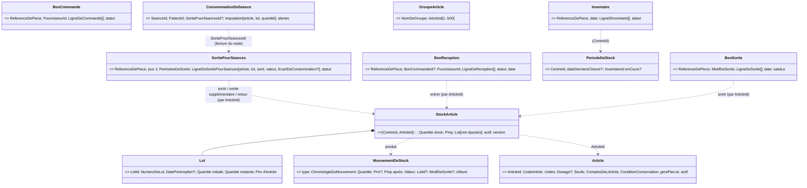

# Modèle tactique — Stock

> Contexte **supporting** : modèle volontairement léger pour le référentiel (fournisseurs, emplacements, groupes), riche
> seulement là où il y a
> de l'argent et de la traçabilité (lots, FEFO, PMP, inventaire). Refonte **sur place** (ADR 0024) : mêmes tables, mêmes
> URLs, slices successives.
> L'article est intégré au Stock (ADR 0006) et exposé en OHS (catalogue).
> **Décisions de l'utilisateur du 2026-10-23 intégrées** (ADR 0045) : nouvelle **sortie pour séances** avec
> consommations imputées et rapprochement,
> profil **directeur administratif**, verrou de ligne pour le PMP, bons atomiques, inventaire = clôture, notification
> des péremptions.

## 1. Process-level event storming (filtré Stock)

| #  | Commande                                                                                            | Acteur                                                | Agrégat                                                 | Événement                                                                             | Politique déclenchée                                                            |
|----|-----------------------------------------------------------------------------------------------------|-------------------------------------------------------|---------------------------------------------------------|---------------------------------------------------------------------------------------|---------------------------------------------------------------------------------|
| 1  | Créer / modifier / (dés)activer un article                                                          | Pharmacien, Admin                                     | `Article`                                               | `ArticleReference`, `ArticleModifie`, `ArticleDesactive`                              | —                                                                               |
| 2  | Créer, remplacer les lignes, valider un bon de commande                                             | Pharmacien                                            | `BonCommande`                                           | `BonCommandeValide`                                                                   | —                                                                               |
| 3  | Créer (libre ou depuis un BC), valider un bon de réception                                          | Pharmacien                                            | `BonReception` → `StockArticle` (n)                     | `ReceptionValidee` ; par article `LotEntre`                                           | → `BonCommande.marquerRecu` ; → rejeu du PMP de chaque article touché           |
| 4  | Corriger un bon de réception validé                                                                 | Pharmacien                                            | `BonReception` → `StockArticle`                         | `ReceptionCorrigee`                                                                   | → rejeu du PMP                                                                  |
| 5  | Sortir des lots (bon manuel, lots choisis)                                                          | Infirmier, Pharmacien                                 | `BonSortie` → `StockArticle` (n)                        | `SortieEnregistree`                                                                   | —                                                                               |
| 6  | Enregistrer une **sortie pour séances** (la veille, pour le lendemain, par salle ou demi-journée)   | Gestionnaire de stock (`PHARMACIEN`), Admin           | `SortiePourSeances` → `StockArticle` (n)                | `SortiePourSeancesEnregistree` (sorties réelles FEFO, datées de l'enregistrement)     | articles proposés en favoris aux infirmiers du périmètre                        |
| 6b | Imputer les consommables d'une séance sur la sortie pour séances (lots de la pièce, FEFO entre eux) | Infirmier, via Séance (port publié)                   | `ConsommationDeSeance`                                  | `ConsommationImputee` ; `DepassementDeLaSortie` (alerte)                              | **aucun mouvement de stock** ; dépassement accepté avec alerte                  |
| 6c | Justifier un écart (en plus / en moins)                                                             | Gestionnaire de stock                                 | `SortiePourSeances`                                     | `EcartJustifie`                                                                       | motif obligatoire                                                               |
| 6d | Valider le rapprochement                                                                            | Gestionnaire de stock, Admin, Directeur administratif | `SortiePourSeances` → `StockArticle` (n)                | `RapprochementValide` ; `SortieSupplementaireEnregistree` / `RetourEnStockEnregistre` | en plus ⇒ sortie supplémentaire ; en moins ⇒ retour en stock (valeur de sortie) |
| 7  | Annuler les consommations d'une séance (suppression de la séance)                                   | Séance (port publié)                                  | `ConsommationDeSeance`                                  | `ConsommationAnnulee`                                                                 | refus si séance facturée ou pièce rapprochée                                    |
| 8  | Recalculer le PMP d'articles (massif, asynchrone)                                                   | Pharmacien, Admin                                     | `StockArticle` (un par transaction)                     | `PmpRecalcule`                                                                        | → écriture comptable différentielle (Comptabilité C6)                           |
| 9  | Ouvrir un inventaire                                                                                | Pharmacien, Admin                                     | `PeriodeDeStock` + `Inventaire`                         | `InventaireOuvert`                                                                    | gèle les mouvements du centre                                                   |
| 10 | Compter, ajouter / retirer une ligne, importer une feuille, reporter le théorique                   | Infirmier, Pharmacien                                 | `Inventaire`                                            | (domaine) `LigneComptee`                                                              | —                                                                               |
| 11 | Clôturer l'inventaire                                                                               | Pharmacien, Admin                                     | `Inventaire` + `PeriodeDeStock` + `StockArticle` (tous) | `InventaireCloture`                                                                   | mouvements antérieurs figés ; stock de départ                                   |
| 12 | Annuler l'inventaire                                                                                | Pharmacien, Admin                                     | `Inventaire` + `PeriodeDeStock`                         | `InventaireAnnule`                                                                    | dégel                                                                           |
| 13 | Contrôle quotidien des péremptions (07:00)                                                          | Système                                               | lecture                                                 | `LotProcheExpiration` (aujourd'hui : journal technique, H10)                          | (cible à valider) notification                                                  |
| 14 | Gérer un groupe d'articles (kit)                                                                    | Admin                                                 | `GroupeArticle`                                         | `GroupeArticleModifie`                                                                | —                                                                               |

Read models : tableau de bord (RG-STK-044), alertes (RG-STK-060), valorisation de période (RG-STK-043), explication du
PMP (RG-STK-042),
traçabilité par lot (RG-STK-062), opérations de stock pour la Comptabilité (R17), valorisation des groupes pour la
direction (RG-STK-073).

## 2. Règles & invariants (classement)

| Règle                                                                                                                                                                                                                                                                                     | Type                                                   | Porteur                                                        | Source                              |
|-------------------------------------------------------------------------------------------------------------------------------------------------------------------------------------------------------------------------------------------------------------------------------------------|--------------------------------------------------------|----------------------------------------------------------------|-------------------------------------|
| Code article obligatoire, unique par centre sans casse                                                                                                                                                                                                                                    | validation + **unicité** (dépôt / contrainte)          | `CodeArticle`, dépôt                                           | RG-STK-001, 007                     |
| Coefficient d'achat > 0 ; prix, seuil, max ≥ 0 ; max ≥ seuil                                                                                                                                                                                                                              | invariant                                              | `Article` (VO `Unites`, `Seuils`)                              | RG-STK-001                          |
| Dosage et unité indissociables, dosage > 0 ; quantité = dose ÷ dosage (4 déc.) ; unité incompatible refusée                                                                                                                                                                               | invariant                                              | VO `Dosage`                                                    | RG-STK-006                          |
| Compte comptable 1 à 20 alphanumériques                                                                                                                                                                                                                                                   | validation                                             | VO `CompteComptable`                                           | RG-STK-008                          |
| Article inactif : aucune sortie                                                                                                                                                                                                                                                           | invariant                                              | `StockArticle` (reçoit l'état actif)                           | RG-STK-002                          |
| **Quantité restante d'un lot ≥ 0** ; sortie ≤ restant du lot                                                                                                                                                                                                                              | **invariant**                                          | `StockArticle` (lot)                                           | RG-STK-030                          |
| **Stock de l'article = Σ restants de ses lots**                                                                                                                                                                                                                                           | **invariant**                                          | `StockArticle`                                                 | RG-STK-021, 031                     |
| **FEFO** : sortie automatique par péremption croissante ; manque signalé                                                                                                                                                                                                                  | **invariant**                                          | `StockArticle`                                                 | RG-STK-031                          |
| Sortie valorisée au PMP courant ; PMP = valeur ÷ quantité (4 déc., demi-supérieur) ; stock ≤ 0 ⇒ valeur 0, dernier PMP gardé                                                                                                                                                              | invariant (calcul)                                     | VO `Pmp`, service `RejeuDuPmp`                                 | RG-STK-040                          |
| **Ordre chronologique** : date de pièce, heure réelle de saisie, entrées avant sorties ; sortie jamais revalorisée à 0                                                                                                                                                                    | invariant (calcul)                                     | VO `ChronologieDuMouvement`, `RejeuDuPmp`                      | RG-STK-041, KB-STK-01, ADR 0029     |
| Réception ou correction passée ⇒ rejeu du PMP de l'article                                                                                                                                                                                                                                | règle de processus (même transaction ou tâche)         | `RecevoirUnBon`, `RecalculerLePmp`                             | RG-STK-041                          |
| Article en recalcul : saisie refusée                                                                                                                                                                                                                                                      | invariant (concurrence)                                | verrou de ligne de `StockArticle` (cible, Q2)                  | RG-STK-024                          |
| Lot géré : numéro **et** péremption obligatoires ; sinon numéro `AUTO-<réf>-<rang>`                                                                                                                                                                                                       | invariant                                              | `StockArticle.entrer` / `BonReception`                         | RG-STK-022                          |
| BC : lignes remplaçables seulement en `BROUILLON` ; validation depuis `BROUILLON` avec ≥ 1 ligne ; total = Σ lignes ≥ 0                                                                                                                                                                   | invariant                                              | `BonCommande`                                                  | RG-STK-010, 011                     |
| BC `RECU` quand une réception issue de lui est validée                                                                                                                                                                                                                                    | règle de processus                                     | politique `BonCommandeRecuALaReception`                        | RG-STK-011                          |
| BR : validation depuis `BROUILLON` avec ≥ 1 ligne ; quantité > 0                                                                                                                                                                                                                          | invariant                                              | `BonReception`                                                 | RG-STK-020, 021                     |
| Correction d'un BR validé : même nombre de lignes, même article, quantité ≥ déjà consommé du lot ; date des entrées = date du bon                                                                                                                                                         | invariant (deux agrégats)                              | `BonReception` + `StockArticle`                                | RG-STK-023                          |
| BS : ≥ 1 ligne ; le lot appartient à l'article ; quantité disponible sur le lot                                                                                                                                                                                                           | invariant                                              | `BonSortie` + `StockArticle`                                   | RG-STK-030                          |
| Sorties d'une séance facturée : immuables, date non modifiable                                                                                                                                                                                                                            | invariant (lecture d'un autre contexte)                | `BonSortie` + port `SeancesFacturees`                          | RG-STK-032, RG-SEA-002              |
| Correction d'un BS : restitution aux lots d'origine puis nouvelles sorties à la date et à l'heure de création du bon                                                                                                                                                                      | invariant                                              | `BonSortie` + `StockArticle`                                   | RG-STK-032                          |
| **Sortie pour séances** : créée par le gestionnaire de stock pour un jour J et un périmètre (salle et/ou demi-journée) ; à l'enregistrement, les lots sortent **réellement** (FEFO, PMP courant), mouvements datés du **jour d'enregistrement**                                           | invariant + processus (une transaction, un bon entier) | `SortiePourSeances` + `StockArticle`                           | décision 2026-10-23 (ADR 0045)      |
| **Rapprochement obligatoire avant la prochaine pièce** du même périmètre                                                                                                                                                                                                                  | **invariant**                                          | `SortiePourSeances` (dépôt : dernière pièce du périmètre)      | ADR 0045                            |
| Consommation d'une séance : imputée sur la pièce du périmètre de la séance ; lots = ceux de la pièce, FEFO entre eux ; **aucun mouvement de stock** ; quantité au-delà du reste ou article hors pièce **acceptés avec alerte**                                                            | invariant                                              | `ConsommationDeSeance` (lit le reste de la pièce)              | ADR 0045                            |
| Écart par ligne = consommé − sorti ; tout écart ≠ 0 exige un **motif** ; validation (gestionnaire de stock, admin, directeur administratif) : en plus ⇒ **sortie supplémentaire** (PMP courant), en moins ⇒ **retour en stock** dans le lot d'origine, valorisé à la **valeur de sortie** | invariant + processus                                  | `SortiePourSeances` + `StockArticle`                           | ADR 0045                            |
| Consommation immuable si la séance est facturée ou la pièce rapprochée                                                                                                                                                                                                                    | invariant                                              | `ConsommationDeSeance` + `SeancesFacturees`                    | RG-SEA-002, ADR 0045                |
| **Un seul inventaire en cours par centre**                                                                                                                                                                                                                                                | **invariant**                                          | `PeriodeDeStock`                                               | RG-STK-050                          |
| Inventaire en cours ⇒ **aucun mouvement** du centre                                                                                                                                                                                                                                       | **invariant** (centre)                                 | `PeriodeDeStock` (lu sous verrou partagé par chaque mouvement) | RG-STK-052                          |
| **Période clôturée** : aucun mouvement daté ≤ dernière clôture ; mouvement clôturé immuable                                                                                                                                                                                               | **invariant** (centre)                                 | `PeriodeDeStock`, `MouvementDeStock`                           | RG-STK-056                          |
| Date d'inventaire : non future, > dernière clôture, ≥ dernier mouvement ; pas pendant un recalcul                                                                                                                                                                                         | invariant                                              | `PeriodeDeStock.ouvrirInventaire`                              | RG-STK-050                          |
| Ouverture : théorique figé (une ligne par lot non épuisé d'article actif, FEFO ; ligne sans lot pour un stock ancien)                                                                                                                                                                     | invariant                                              | fabrique `Inventaire.ouvrir`                                   | RG-STK-051                          |
| Comptage ≥ 0, 3 décimales ; lot trouvé ajouté (numéro requis si article géré) ; doublon refusé ; seule une ligne ajoutée se retire                                                                                                                                                        | invariant                                              | `Inventaire`                                                   | RG-STK-053                          |
| Clôture : toutes les lignes comptées ; tout écart motivé ; puis stock des lots = compté, mouvements ≤ date figés, mouvement `INVENTAIRE` par lot, PMP recalculé depuis ce départ                                                                                                          | invariant + processus atomique                         | `Inventaire`, `PeriodeDeStock`, `StockArticle` (tous)          | RG-STK-055                          |
| Annulation possible tant qu'en cours, sans effet sur le stock                                                                                                                                                                                                                             | invariant                                              | `Inventaire`                                                   | RG-STK-057                          |
| Import de feuille : rapprochement, anomalies listées sans bloquer, feuille d'un autre inventaire refusée                                                                                                                                                                                  | validation d'entrée (interface) + `Inventaire.compter` | RG-STK-054                                                     |
| Groupe : 1 à 500 articles du centre ; nom 1-100 normalisé, unique (casse, accents, espaces) ; description ≤ 500                                                                                                                                                                           | invariant + unicité                                    | `GroupeArticle`, VO `NomDeGroupe`                              | RG-STK-070 à 072                    |
| Fournisseur : raison sociale ; emplacement : libellé ; propres au centre                                                                                                                                                                                                                  | validation                                             | `Fournisseur`, `Emplacement`                                   | RG-STK-003                          |
| Références `BC`/`BR`/`BS`/`INV` par séquence de centre                                                                                                                                                                                                                                    | règle technique                                        | port `NumerotationDesPieces`                                   | RG-STK-005                          |
| Alertes : péremption ≤ 30 j ou dépassée, rupture (≤ 0), seuil (0 < stock ≤ seuil)                                                                                                                                                                                                         | requête                                                | read model `AlertesDeStock`                                    | RG-STK-060                          |
| Multi-centre strict ; droits par rôle                                                                                                                                                                                                                                                     | application / interface                                | cas d'usage, contrôleurs                                       | RG-STK-004, 012, 025, 033, 057, 072 |

## 3. Carte du modèle

## 4. Aggregate Design Canvas

### Article (root: `Article`) — contexte stock — type: supporting (catalogue publié, OHS)

- **Intention** : la fiche du produit référencé ; ne porte **ni stock ni PMP** (ils résultent des mouvements, voir
  `StockArticle`).
- **Invariants** : 1) code, libellé, unité de stock obligatoires ; 2) coefficient d'achat > 0 ; prix, seuil, max ≥ 0 ;
  max ≥ seuil ; 3) dosage
  complet ou absent ; 4) comptes 1-20 alphanumériques ; 5) unicité du code par centre (dépôt / contrainte `uk`
  insensible à la casse).
- **Identité** : `ArticleId` (UUID, domaine). **État** : VO `CodeArticle`, `Unites`, `Dosage?`, `Seuils`,
  `ComptesDeLArticle`, `ConditionConservation`,
  `TypeTraitementAnemie?`, `gereParLot`, `peremptionObligatoire`, `actif`.
- **Commandes → événements** : `referencer` → `ArticleReference` ; `modifierFiche` → `ArticleModifie` ; `desactiver`/
  `reactiver` → `ArticleDesactive`/`ArticleReactive`.
- **Rejets** : `CodeArticleRequis`, `CodeArticleExistant`, `ValeurNegative`, `StockMaxInferieurAuSeuil`,
  `DosageIncomplet`, `CompteInvalide`.
- **Cohérence** : éventuelle avec `StockArticle` (l'état `actif` y est recopié par la politique `ActiviteDeLArticle`,
  même transaction acceptée car même contexte et une seule ligne).
- **Concurrence** : dernière écriture gagne (comme le legacy, pas de colonne `version`).

### Stock d'un article (root: `StockArticle`) — type: supporting, **cœur monétaire du contexte**

- **Intention** : tout ce qui doit rester cohérent quand on entre ou sort une quantité d' **un** article dans **un**
  centre : lots, quantités, FEFO, PMP courant.
- **Invariants** : 1) restant de chaque lot ≥ 0 ; 2) stock = Σ restants ; 3) sortie FEFO (manuelle : lot imposé, qui
  doit appartenir à l'article) ;
    4) pas de sortie d'un article inactif ; 5) lot géré : numéro + péremption ; 6) PMP courant = PMP après le dernier
       mouvement du rejeu.
- **Identité** : (`CentreId`, `ArticleId`). **État** : `Quantite stock`, `Pmp`, entités `Lot` (**seulement les lots non
  épuisés** sont chargés :
  collection bornée en pratique, quelques dizaines), `actif`.
- **Commandes → mouvements / événements** : `entrer(lot, quantité, prix, chronologie)` → `MouvementDeStock(ENTREE)`,
  `LotEntre` ;
  `sortirFefo(quantité, motif, chronologie)` → n × `MouvementDeStock(SORTIE)` valorisés au PMP, `StockInsuffisant` si
  manque ;
  `sortirDuLot(lotId, quantité, motif, chronologie)` ; `restituer(lotId, quantité)` (correction / annulation de
  sortie) ;
  `corrigerEntree(lotId, nouvelleQuantité)` (≥ consommé) ; `poserStockInventorie(lots comptés, date)` →
  `MouvementDeStock(INVENTAIRE)` ;
  `rejouer(historique)` → `PmpRecalcule` (via `RejeuDuPmp`).
- **Rejets** : `ArticleInactif`, `StockInsuffisantSurLeLot`, `StockInsuffisant(manque)`, `LotDUnAutreArticle`,
  `NumeroDeLotRequis`, `QuantiteDejaConsommee`.
- **Cohérence** : le journal `MouvementDeStock` est écrit avec l'agrégat (même transaction) ; `PeriodeDeStock` est **lue
  sous verrou partagé**
  par chaque commande (inventaire en cours, période clôturée).
- **Concurrence** : verrou de ligne `SELECT … FOR UPDATE` sur la ligne de l'article (remplace le verrou mémoire de
  `PmpRecalculationCoordinator`, Q2) ;
  délai de verrou ADR 0043 ; plusieurs articles d'un même bon : verrous pris **par `ArticleId` croissant** (Q3).
- **Tests clés** : FEFO sur trois lots dont un périmé le plus tôt ; manque signalé ; restitution exacte ; rejeu
  KB-STK-01 (sortie avant entrée du même jour).

### Bon de commande (root: `BonCommande`) — type: supporting, léger

- **Invariants** : lignes remplaçables seulement en `BROUILLON` ; validation depuis `BROUILLON` avec ≥ 1 ligne ;
  montants ≥ 0, total = Σ.
- **Cycle** : `BROUILLON → VALIDE → RECU` (le legacy n'a **pas** d'`ANNULE`, contrairement au glossaire : à trancher,
  Q6).
- **Commandes → événements** : `creer`, `remplacerLesLignes`, `valider` → `BonCommandeValide` ; `marquerRecu`
  (politique) → `BonCommandeRecu`.

### Bon de réception (root: `BonReception`) — type: supporting

- **Invariants** : validation depuis `BROUILLON` avec ≥ 1 ligne, quantité > 0, article du centre ; correction d'un bon
  validé : même nombre de lignes,
  même article par ligne, date des entrées = date du bon.
- **Commandes → événements** : `creer` / `depuisBonCommande` ; `valider` → `ReceptionValidee` (et, par ligne,
  `StockArticle.entrer`) ;
  `corriger` → `ReceptionCorrigee` (et `StockArticle.corrigerEntree` + rejeu).
- **Cohérence** : **une transaction** valide le bon et entre les lots de tous ses articles (atomicité métier d'un bon,
  Q3) ; `BonCommande.marquerRecu`
  dans la même transaction (même contexte) ou par politique.

### Bon de sortie (root: `BonSortie`) — type: supporting

- **Intention** (ADR 0045) : les **sorties manuelles** (lots choisis) ; les consommations de séance ne sortent plus le
  stock une par une : elles
  s'imputent sur la **sortie pour séances** (ci-dessous). Les sorties de séance historiques (`BonSortie.seanceId`)
  restent lisibles et suivent RG-STK-032.
- **Invariants** : ≥ 1 ligne ; motif `MotifDeSortie` (manuel, ou séance + patient + poste pour l'historique) ; si séance
  **facturée** : immuable, date figée ;
  correction = restitution puis nouvelles sorties à la date et à l'heure de création du bon.
- **Commandes → événements** : `creer(lots imposés)` → `SortieEnregistree` ; `corriger` ; (historique)
  `annulerSortiesDeSeance` → `SortiesDeSeanceAnnulees`.
- **Rejets** : `SeanceFactureeNonModifiable`, `DateDeSortieDeSeanceImmuable`, `BonSansLigne`.

### Sortie pour séances (root: `SortiePourSeances`) — type: supporting, **nouvelle
fonctionnalité** (décision du 2026-10-23, ADR 0045)

- **Intention** : le gestionnaire de stock prépare **la veille** les consommables du lendemain pour un **périmètre**
  (salle et/ou demi-journée) ; le stock
  sort **à l'enregistrement** ; les infirmiers consomment ensuite sur cette pièce ; le rapprochement solde les écarts.
- **Invariants** : 1) ≥ 1 ligne, articles actifs du centre, quantités > 0 ; 2) à l'enregistrement, chaque ligne est
  servie en **FEFO** sur les lots du stock (une ligne de pièce par lot retenu), valorisée au **PMP courant** ; manque ⇒
  refus (stock insuffisant) ; 3) **la pièce précédente du même périmètre doit être
  rapprochée** ; 4) rapprochement : tout écart ≠ 0 a un **motif** ; validé par `PHARMACIEN`, `ADMIN` ou
  `DIRECTEUR_ADMINISTRATIF` ; 5) une pièce rapprochée est figée.
- **Identité** : `SortiePourSeancesId` ; `ReferenceDePiece` (préfixe proposé `SPS`). **État** : jour J (`LocalDate`),
  `PerimetreDeSortie` (salle?, demi-journée?),
  date d'enregistrement, `LigneDeSortiePourSeances` (article, lot, quantité sortie, valeur unitaire de sortie,
  `EcartDeConsommation?` = consommé, écart, motif),
  statut `ENREGISTREE → RAPPROCHEE`.
- **Commandes → événements** : `enregistrer` → `SortiePourSeancesEnregistree` (+ `StockArticle.sortirFefo` par article,
  motif `pour séances`, datés de
  l'enregistrement) ; `constaterLesConsommations(totaux par lot)` (lecture des `ConsommationDeSeance`) ;
  `justifierUnEcart(ligne, motif)` → `EcartJustifie` ;
  `valider(validateur)` → `RapprochementValide` + par ligne : écart > 0 ⇒ `StockArticle.sortirDuLot` (ou FEFO si le lot
  est épuisé) au PMP courant (`SortieSupplementaireEnregistree`), écart < 0 ⇒
  `StockArticle.restituer(lot, quantité, valeur de sortie)` (`RetourEnStockEnregistre`, mouvement `RETOUR`
  traité comme une entrée au prix de sortie, RG-STK-040).
- **Rejets** : `PieceSansLigne`, `StockInsuffisant`, `PiecePrecedenteNonRapprochee`, `EcartSansMotif`,
  `PieceDejaRapprochee`, `ValidateurNonAutorise`.
- **Cohérence** : une transaction pour l'enregistrement (bon entier, verrous par `ArticleId` croissant) ; une
  transaction pour la validation ; les consommations
  sont d'autres agrégats, lues au rapprochement (totaux par lot).
- **Concurrence** : verrou de ligne de la pièce pendant la validation ; une consommation imputée pendant la validation
  attend (ou est refusée si la pièce est rapprochée).
- **Tests clés** : FEFO à l'enregistrement ; pièce précédente non rapprochée ⇒ refus ; écart en plus ⇒ sortie
  supplémentaire au PMP courant ; en moins ⇒
  retour au lot d'origine à la valeur de sortie ; motif manquant ⇒ refus ; rôle non autorisé ⇒ refus.

### Consommation de séance (root: `ConsommationDeSeance`) — type: supporting, **nouvelle fonctionnalité** (ADR 0045)

- **Intention** : ce que l'infirmier a réellement consommé pour **une** séance, imputé sur la sortie pour séances de son
  périmètre ; un agrégat par séance (plusieurs infirmiers saisissent en même temps des séances différentes : pas de
  contention sur la pièce).
- **Invariants** : 1) imputation sur la pièce du **jour et du périmètre** de la séance (salle et demi-journée ; à défaut
  la pièce « journée » du centre) ;
    2) lots = lots de la pièce pour l'article, **FEFO entre eux** ; 3) **aucun mouvement de stock** ; 4) quantité
       au-delà du reste de la pièce, article absent
       de la pièce, ou aucune pièce : **accepté avec alerte** (`DepassementDeLaSortie`), l'excédent sera un écart « en
       plus » au rapprochement ; 5) immuable si la
       séance est facturée (RG-SEA-002) ou la pièce rapprochée.
- **Identité** : `SeanceId` (une consommation par séance). **État** : `PatientId`, `SortiePourSeancesId?`, imputations
  (article, lot?, quantité), alertes.
- **Commandes → événements** : `imputer(articles, quantités)` / `remplacer` → `ConsommationImputee` (+
  `DepassementDeLaSortie`) ; `annuler` → `ConsommationAnnulee`.
- **Rejets** : `SeanceFactureeNonModifiable`, `PieceDejaRapprochee`.
- **Traçabilité** : lot → patient conservée (RG-STK-062) par les imputations.
- **Favoris** : les articles de la pièce du périmètre sont proposés à l'infirmier (lecture
  `ArticlesFavorisDuPerimetre`).

### Période de stock (root: `PeriodeDeStock`) — type: supporting, **petit agrégat
centre** (nouveau nom, même données qu'aujourd'hui)

- **Intention** : porter les deux règles centre-entier : « un seul inventaire en cours » et « rien avant la dernière
  clôture ».
- **Invariants** : 1) au plus un inventaire en cours ; 2) un mouvement ne peut être daté ≤ `dateDerniereCloture` ; 3)
  aucun mouvement pendant
  un inventaire en cours ; 4) date d'un nouvel inventaire : non future, > dernière clôture, ≥ date du dernier
  mouvement ; 5) (ADR 0045) **toutes les sorties
  pour séances rapprochées** avant l'ouverture d'un inventaire (sinon les retours et sorties supplémentaires tomberaient
  pendant le gel).
- **Identité** : `CentreId` (une ligne par centre, créée au premier usage, comme `mois_absences`). **État** :
  `dateDerniereCloture?`, `inventaireEnCours?`.
- **Commandes** : `exigerOuverteA(date)` (garde des mouvements, verrou partagé) ;
  `ouvrirInventaire(inventaireId, date, dernierMouvement)` (verrou exclusif) ;
  `cloturer(inventaireId, date)` ; `annulerInventaire(inventaireId)`.
- **Rejets** : `InventaireDejaEnCours`, `InventaireEnCours`, `PeriodeCloturee`, `DateInventaireFuture`,
  `DateAvantDerniereCloture`, `MouvementsApresLaDate`.
- **Concurrence** : `FOR SHARE` par chaque mouvement, `FOR UPDATE` à l'ouverture/clôture/annulation : l'ouverture attend
  la fin des mouvements en cours
  et les bloque ensuite (le legacy contrôle par lecture, sans verrou : `InventoryGuardedMovementRepository`).
- Aujourd'hui : déduit des tables `inventaires` (statut `EN_COURS`, dernière `CLOTURE`) ; cible : vue matérialisée de
  ces tables **ou** petite table
  additive (décision d'implémentation de la slice S6).

### Inventaire (root: `Inventaire`) — type: supporting

- **Invariants** : comptage ≥ 0 à 3 décimales ; ligne ajoutée = lot trouvé (numéro requis si article géré, pas de
  doublon) ; seule une ligne ajoutée
  se retire ; clôture : toutes les lignes comptées et tout écart motivé ; annulation seulement en cours.
- **Cycle** : `EN_COURS → CLOTURE | ANNULE`. **Volumétrie** : une ligne par lot non épuisé du centre (centaines) —
  agrégat chargé en entier pour la
  clôture, lignes modifiées une à une pour le comptage (verrou optimiste par ligne acceptable, comptage à plusieurs).
- **Commandes → événements** : `ouvrir` (fabrique, théorique figé) → `InventaireOuvert` ; `compter`, `ajouterLigne`,
  `retirerLigne`, `reporterTheorique` ;
  `cloturer` → `InventaireCloture(écarts)` ; `annuler` → `InventaireAnnule`.
- **Cohérence** : la clôture est **une** transaction (comme le legacy) : `Inventaire.cloturer` +
  `PeriodeDeStock.cloturer` + `StockArticle.poserStockInventorie`
  pour chaque article (verrous par `ArticleId` croissant) + mouvements antérieurs marqués clôturés. Opération rare et
  réservée : assumé (Q3).

### Groupe d'articles (root: `GroupeArticle`) — type: supporting, léger

- **Invariants** : 1 à 500 articles du centre ; `NomDeGroupe` normalisé et unique par centre (dépôt) ; description ≤
  500.

### Fournisseur, Emplacement — référentiel simple (entités racines CRUD, sans événement), propres au centre.

## 5. Value Objects (immuables, validés à la construction)

| VO                                                                                                                                                                               | Règle                                                                                                                                                      |
|----------------------------------------------------------------------------------------------------------------------------------------------------------------------------------|------------------------------------------------------------------------------------------------------------------------------------------------------------|
| `ArticleId`, `LotId`, `BonCommandeId`, `BonReceptionId`, `BonSortieId`, `InventaireId`, `GroupeArticleId`, `FournisseurId`, `EmplacementId`, `CentreId`, `SeanceId`, `PatientId` | identifiants typés                                                                                                                                         |
| `CodeArticle`                                                                                                                                                                    | non vide ; comparaison insensible à la casse                                                                                                               |
| `Quantite`                                                                                                                                                                       | ≥ 0 ; échelle 4 (sorties converties d'une dose) ; `QuantiteComptee` : échelle ≤ 3 (RG-STK-053)                                                             |
| `PrixUnitaire`, `Montant`                                                                                                                                                        | ≥ 0, échelle 2 (montants) / 4 (prix)                                                                                                                       |
| `Pmp`                                                                                                                                                                            | ≥ 0, échelle 4, arrondi demi-supérieur ; `apresEntree(stock, valeur, q, prix)`, `apresSortie(…)` (RG-STK-040)                                              |
| `NumeroDeLot`, `DatePeremption`                                                                                                                                                  | numéro non vide ; `AUTO-<réf>-<rang>` généré si article non géré par lot                                                                                   |
| `Unites`                                                                                                                                                                         | unité de stock obligatoire ; unité d'achat + coefficient > 0 facultatifs                                                                                   |
| `Dosage`                                                                                                                                                                         | (valeur > 0, unité) indissociables ; `quantitePourDose(dose, unité)` → `Quantite` (4 déc.) ou refus (`UniteDeDoseIncompatible`, `DosageNonDefini`)         |
| `Seuils`                                                                                                                                                                         | alerte ≥ 0, max ≥ 0, max ≥ alerte                                                                                                                          |
| `ComptesDeLArticle`                                                                                                                                                              | compte de stock et de consommation, 1-20 alphanumériques, facultatifs                                                                                      |
| `MotifDeSortie`                                                                                                                                                                  | `manuel` ou `seance(SeanceId, PatientId, poste)` — la séance n'est qu'une référence (glossaire)                                                            |
| `ChronologieDuMouvement`                                                                                                                                                         | (date de pièce, `saisiLe`, rang de type : entrée < sortie) ; comparateur du rejeu (KB-STK-01, ADR 0029)                                                    |
| `ReferenceDePiece`                                                                                                                                                               | préfixe `BC`/`BR`/`BS`/`INV` + séquence de centre                                                                                                          |
| `MotifDEcart`                                                                                                                                                                    | non vide si quantité comptée ≠ théorique                                                                                                                   |
| `NomDeGroupe`                                                                                                                                                                    | 1-100 caractères, espaces réduits ; clé d'unicité sans casse ni accents                                                                                    |
| `ConditionConservation`                                                                                                                                                          | `AMBIANT`, `REFRIGERE`, `CONGELE`                                                                                                                          |
| `PerimetreDeSortie`                                                                                                                                                              | (salle?, demi-journée?) avec demi-journée ∈ `MATIN`, `APRES_MIDI` ; vide = journée du centre ; sert à trouver la pièce d'une séance et la pièce précédente |
| `EcartDeConsommation`                                                                                                                                                            | consommé, sorti ⇒ écart = consommé − sorti ; sens `EN_PLUS` / `EN_MOINS` / nul ; motif requis si non nul                                                   |
| `TypeDeMouvement`                                                                                                                                                                | `ENTREE`, `SORTIE`, `AJUSTEMENT`, `INVENTAIRE`, **`RETOUR`** (nouveau : entrée au prix de la sortie d'origine)                                             |

## 6. Services de domaine & politiques

| Élément                                                    | Type                         | Rôle                                                                                                                                                                                                                                                                    |
|------------------------------------------------------------|------------------------------|-------------------------------------------------------------------------------------------------------------------------------------------------------------------------------------------------------------------------------------------------------------------------|
| `RejeuDuPmp`                                               | service de domaine **pur**   | rejoue l'historique d'un article dans l'ordre `ChronologieDuMouvement` ; réécrit PMP après chaque mouvement et valeur des sorties ; ne revalorise jamais une sortie à 0 (KB-STK-01) ; produit l'**explication** (RG-STK-042). Équivalent : `PmpCalculator`, `PmpEngine` |
| `GardeDeLaPeriodeDeStock`                                  | service d'application        | prend `PeriodeDeStock` sous verrou partagé et exige la date ouverte (comme `GardeDesMoisClos` de F7)                                                                                                                                                                    |
| `BonCommandeRecuALaReception`                              | politique (même transaction) | réception validée issue d'un BC ⇒ BC `RECU`                                                                                                                                                                                                                             |
| `ActiviteDeLArticle`                                       | politique                    | (dés)activation de la fiche ⇒ état `actif` du `StockArticle`                                                                                                                                                                                                            |
| `ValorisationDePeriode`                                    | requête (read model)         | RG-STK-043 (cache invalidé à chaque écriture)                                                                                                                                                                                                                           |
| `AlertesDeStock`, `TableauDeBordStock`, `TracabiliteDuLot` | requêtes                     | RG-STK-044, 060, 062                                                                                                                                                                                                                                                    |
| `ControleDesPeremptions`                                   | tâche planifiée 07:00        | RG-STK-061 ; **ne parcourir que les centres actifs** (le legacy parcourt aussi les inactifs) ; publication `LotProcheExpiration` (Q5)                                                                                                                                   |

## 7. Catalogue d'événements

### 7.1 Événements de domaine (internes)

`ArticleReference`, `ArticleModifie`, `ArticleDesactive`/`Reactive`, `LotEntre`, `SortieEnregistree`,
`BonCommandeValide`, `BonCommandeRecu`,
`ReceptionCorrigee`, `LigneComptee`, `InventaireOuvert`, `InventaireAnnule`. Aujourd'hui relayés en WebSocket
(`/topic/center/{centerId}/events` :
mouvement de stock, verrous de recalcul `STOCK_RECALC_LOCKS_CHANGED`, changements d'inventaire) — à conserver tels quels
(contrat des écrans).

### 7.2 Événements d'intégration (Published Language, Outbox Spring Modulith, ADR 0013) — cible,
**après** les lectures publiées

| Événement                                               | Consommateurs                                                      | Contenu minimal                                                                                       | Version |
|---------------------------------------------------------|--------------------------------------------------------------------|-------------------------------------------------------------------------------------------------------|---------|
| `ReceptionValidee`                                      | Comptabilité (R17), Pilotage                                       | centre, bon, date, lignes (article, quantité, prix)                                                   | v1      |
| `SortieDeSeanceEnregistree` / `SortiesDeSeanceAnnulees` | Comptabilité, Pilotage                                             | centre, séance, date, lignes valorisées (article, quantité, valeur) — **historique** (avant ADR 0045) | v1      |
| `SortiePourSeancesEnregistree`                          | Comptabilité (sorties datées de l'enregistrement), Pilotage        | centre, pièce, date d'enregistrement, jour J, lignes valorisées                                       | v1      |
| `RapprochementValide`                                   | Comptabilité (sorties supplémentaires, retours), Pilotage (écarts) | centre, pièce, lignes : écart, sens, motif, valeur                                                    | v1      |
| `PmpRecalcule`                                          | Comptabilité (réécriture différentielle)                           | centre, article, depuis (date)                                                                        | v1      |
| `InventaireCloture`                                     | Comptabilité, Pilotage (clôtures ADR 0009)                         | centre, date, écarts valorisés par article                                                            | v1      |
| `LotProcheExpiration`                                   | Notifications (Q5)                                                 | centre, article, lot, péremption, quantité                                                            | v1      |

Consommateurs idempotents (clé : identifiant de pièce + version de la pièce).

### 7.3 Ce qui existe aujourd'hui → cible

- **Comptabilité C6** lit les tables du stock par `OperationsStockJdbcAdapter` (port `OperationsDeStock`) + cron 03:15,
  différentiel 35 j (RG-CPT-015).
  Cible 1 : le Stock **fournit** ce port en langage publié (`publishedlanguage/OperationsDeStock`), comme les Absences
  pour la Facturation (ADR 0041) —
  la Comptabilité ne lit plus les tables. Cible 2 (facultative) : événements 7.2.
- **Séance** appelle directement `BonSortieUseCase` (4 appelants : `SeanceDomainService:53`,
  `SeanceApplicationService:52`, `SuppressionSeanceService:33`,
  `AdministrationTraitementRestController:44`). Cible (ADR 0045) : port publié **synchrone** `ConsommationsDeSeance`
  fourni par le Stock (imputer, remplacer, annuler les consommations d'une séance ; articles favoris du périmètre) :
  **il ne sort plus le stock** et ne refuse jamais pour une
  quantité (alerte seulement) ; il refuse seulement une séance facturée ou une pièce rapprochée. La sortie d'une dose de
  traitement (EPO, fer) suit la même voie.
- **Facturation** : la règle « séance facturée » est lue en SQL (`SeanceBillingStatusJdbcAdapter`). Cible : port publié
  de la Facturation (`SeancesFacturees.estFacturee(seanceId)`), ACL côté Stock.
- **Catalogue** consommé par Séance (R14) et Dossier médical (types anémie, `listArticlesByTypeTraitementAnemie`) : port
  publié `CatalogueDArticles` (OHS).

## 8. Use cases ↔ agrégats ↔ ports (contrôleurs legacy conservés : mêmes URLs)

| Cas d'usage                                                                                                                                                                       | Agrégat(s)                                                                                             | Ports                                                                                                                                                                | Legacy                                                                                    |
|-----------------------------------------------------------------------------------------------------------------------------------------------------------------------------------|--------------------------------------------------------------------------------------------------------|----------------------------------------------------------------------------------------------------------------------------------------------------------------------|-------------------------------------------------------------------------------------------|
| `ReferencerUnArticle`, `ModifierLaFiche`, `ChangerLActiviteDeLArticle`, `ChercherDesArticles` (pages)                                                                             | `Article`                                                                                              | `Articles`, `CatalogueDArticles` (publié)                                                                                                                            | `StockReferentialUseCase`, `StockReferentialRestController`                               |
| `CreerUnFournisseur`, `CreerUnEmplacement`, listes                                                                                                                                | `Fournisseur`, `Emplacement`                                                                           | dépôts                                                                                                                                                               | idem                                                                                      |
| `GererUnGroupeDArticles` (créer, renommer, composer, supprimer), `ValoriserUnGroupe`                                                                                              | `GroupeArticle`                                                                                        | `GroupesDArticles`, `ValorisationDePeriode`                                                                                                                          | `GroupeArticleRestController`, `GroupeArticleApplicationService`                          |
| `CreerUnBonDeCommande`, `RemplacerLesLignes`, `ValiderLeBonDeCommande`                                                                                                            | `BonCommande`                                                                                          | `BonsDeCommande`, `NumerotationDesPieces`                                                                                                                            | `BonCommandeUseCase`, `BonCommandeRestController`                                         |
| `CreerUnBonDeReception`, `ReceptionnerUnBonDeCommande`, `ValiderLaReception`, `CorrigerLaReception`                                                                               | `BonReception` + `StockArticle`(n) + `BonCommande`                                                     | `BonsDeReception`, `StocksDArticles`, `MouvementsDeStock`, `GardeDeLaPeriodeDeStock`, `NumerotationDesPieces`, `NotificationsTempsReel`, `UniteDeTravail`, `Horloge` | `BonReceptionUseCase`, `BonReceptionService` (291 l.), `BonReceptionApplicationService`   |
| `SortirDesLots` (bon manuel), `CorrigerUnBonDeSortie`                                                                                                                             | `BonSortie` + `StockArticle`(n)                                                                        | `BonsDeSortie`, `StocksDArticles`, `MouvementsDeStock`, `SeancesFacturees`                                                                                           | `BonSortieUseCase.create/update`, `BonSortieService` (432 l.)                             |
| `ConsommerPourUneSeance`, `RemplacerLesConsommationsDUneSeance`, `AnnulerLesSortiesDUneSeance`, `SortirUneDoseDeTraitement`                                                       | **remplacés** (ADR 0045) par l'imputation ci-dessous ; l'historique `BonSortie.seanceId` reste lisible | —                                                                                                                                                                    | `addSeanceConsommation`, `setSeanceConsommation`, `annulerSortiesSeance`, `createViaFefo` |
| `EnregistrerUneSortiePourSeances`, `ConsulterLesSortiesPourSeances`                                                                                                               | `SortiePourSeances` + `StockArticle`(n)                                                                | `SortiesPourSeances`, `StocksDArticles`, `MouvementsDeStock`, `GardeDeLaPeriodeDeStock`, `NumerotationDesPieces`, `NotificationsTempsReel`                           | — (nouveau)                                                                               |
| `ImputerLesConsommationsDUneSeance`, `RemplacerLesConsommations`, `AnnulerLesConsommations`, `ListerLesArticlesFavoris`                                                           | `ConsommationDeSeance`                                                                                 | `ConsommationsDeSeances`, `SortiesPourSeances` (lecture du reste), `SeancesFacturees` ; port publié `ConsommationsDeSeance` (appelé par Séance)                      | — (nouveau ; remplace les 4 appels directs)                                               |
| `PreparerLeRapprochement`, `JustifierUnEcart`, `ValiderLeRapprochement`                                                                                                           | `SortiePourSeances` + `StockArticle`(n)                                                                | `SortiesPourSeances`, `ConsommationsDeSeances` (totaux par lot), `StocksDArticles`, `MouvementsDeStock`, `GardeDeLaPeriodeDeStock`                                   | — (nouveau) ; rôles `PHARMACIEN`, `ADMIN`, `DIRECTEUR_ADMINISTRATIF`                      |
| `RecalculerLePmp` (massif, asynchrone, une transaction par article), `ExpliquerLePmp`, `SuivreLesRecalculs`                                                                       | `StockArticle`                                                                                         | `MouvementsDeStock`, `TachesDeRecalcul`                                                                                                                              | `PmpRecalculationCoordinator`, `PmpEngine`                                                |
| `OuvrirUnInventaire`, `Compter`, `AjouterUneLigne`, `RetirerUneLigne`, `ImporterUneFeuille`, `ReporterLeTheorique`, `CloturerLInventaire`, `AnnulerLInventaire`, `ConsulterLEtat` | `Inventaire` + `PeriodeDeStock` (+ `StockArticle` à la clôture)                                        | `Inventaires`, `PeriodesDeStock`, `StocksDArticles`, `MouvementsDeStock`, `NumerotationDesPieces`, `ModelesDeDocuments` (PV)                                         | `InventaireUseCase`, `InventaireService` (362 l.), `InventaireRestController`             |
| `ConsulterLeTableauDeBord`, `ConsulterLesAlertes`, `ValoriserUnePeriode`, `TracerUnLot`                                                                                           | lecture                                                                                                | `LecturesDuStock`                                                                                                                                                    | `StockDashboardService`, `ValorisationStockCalculator`, `StockDashboardRestController`    |
| `ControlerLesPeremptions` (07:00)                                                                                                                                                 | lecture                                                                                                | `CentresActifs`, `PublicationDuStock`                                                                                                                                | `ExpirationAlertScheduler`                                                                |
| Lectures publiées : `OperationsDeStock` (Comptabilité), valorisation des groupes (Direction)                                                                                      | lecture                                                                                                | —                                                                                                                                                                    | `OperationsStockJdbcAdapter` (Comptabilité)                                               |

### Ports sortants

`Articles`, `StocksDArticles` (verrou de ligne, lots non épuisés), `MouvementsDeStock` (journal, clôture),
`BonsDeCommande`, `BonsDeReception`, `BonsDeSortie`,
`Inventaires`, `PeriodesDeStock`, `GroupesDArticles`, `Fournisseurs`, `Emplacements`, `NumerotationDesPieces`,
`SeancesFacturees` (ACL Facturation),
`SortiesPourSeances`, `ConsommationsDeSeances`, `PerimetresDesSeances` (ACL Séance/Planification : salle et demi-journée
d'une séance),
`NotificationsTempsReel` (WebSocket), `PublicationDuStock` (Outbox), `TachesDeRecalcul`, `UniteDeTravail` (délai ADR
0043), `Horloge`/`FuseauxDesCentres`.

## 9. Matrice invariant → test (pilote le TDD)

| #   | Invariant                                                                                                                                                 | Test (domaine sauf mention)                                                     |
|-----|-----------------------------------------------------------------------------------------------------------------------------------------------------------|---------------------------------------------------------------------------------|
| T1  | Code, libellé, unité obligatoires                                                                                                                         | `Article` refuse chaque champ manquant                                          |
| T2  | Coefficient > 0 ; valeurs ≥ 0 ; max ≥ seuil                                                                                                               | `Unites`, `Seuils`                                                              |
| T3  | Dosage complet ; conversion 8000 UI / 4000 UI = 2 ; unité incompatible refusée ; sans dosage 1:1 seulement                                                | `Dosage` (exemples RG-STK-006)                                                  |
| T4  | Code unique par centre sans casse                                                                                                                         | contrat dépôt (mémoire, H2, PG)                                                 |
| T5  | Restant d'un lot jamais < 0 ; sortie > restant refusée                                                                                                    | `StockArticle.sortirDuLot`                                                      |
| T6  | Stock = Σ restants après toute commande                                                                                                                   | propriété sur une suite aléatoire d'entrées/sorties                             |
| T7  | FEFO : péremption croissante, lots sans péremption en dernier, manque signalé sans rien sortir (ou sortie partielle ? → caractérisation)                  | `StockArticle.sortirFefo`                                                       |
| T8  | Article inactif : sortie refusée, entrée permise                                                                                                          | `StockArticle`                                                                  |
| T9  | Lot géré : numéro + péremption ; non géré : `AUTO-<réf>-<rang>`                                                                                           | `StockArticle.entrer`, `BonReception.valider`                                   |
| T10 | PMP après entrée = valeur ÷ quantité, 4 déc., demi-supérieur                                                                                              | `Pmp`                                                                           |
| T11 | Sortie au PMP courant, PMP inchangé ; stock ≤ 0 ⇒ valeur 0, dernier PMP gardé                                                                             | `Pmp`                                                                           |
| T12 | Ordre : date pièce, `saisiLe`, entrées avant sorties ; sortie jamais revalorisée à 0 (KB-STK-01)                                                          | `RejeuDuPmp` (reprendre `PmpCalculatorTest.same_day_movements_are_replay…`)     |
| T13 | Correction de réception passée ⇒ rejeu de tout l'historique                                                                                               | application + golden                                                            |
| T14 | Réception : seul un brouillon avec ≥ 1 ligne, quantités > 0                                                                                               | `BonReception`                                                                  |
| T15 | Correction : même nombre de lignes, même article, quantité ≥ consommé                                                                                     | `BonReception.corriger` + `StockArticle.corrigerEntree`                         |
| T16 | BC : lignes modifiables seulement en brouillon ; validation ≥ 1 ligne ; `RECU` à la réception                                                             | `BonCommande`, politique                                                        |
| T17 | Sortie : lot de l'article ; disponible ; ≥ 1 ligne                                                                                                        | `BonSortie` + `StockArticle`                                                    |
| T18 | Séance facturée : sorties immuables, date figée                                                                                                           | application (double `SeancesFacturees`)                                         |
| T19 | Correction de BS : restitution puis nouvelles sorties à la date et l'heure de création du bon                                                             | application                                                                     |
| T20 | Un seul inventaire en cours par centre                                                                                                                    | `PeriodeDeStock` + concurrence (deux ouvertures simultanées)                    |
| T21 | Inventaire en cours : tout mouvement refusé                                                                                                               | garde + concurrence (ouverture pendant une réception : l'une attend l'autre)    |
| T22 | Mouvement daté ≤ dernière clôture refusé ; mouvement clôturé immuable                                                                                     | `PeriodeDeStock`, `MouvementDeStock`                                            |
| T23 | Date d'inventaire : non future, > dernière clôture, ≥ dernier mouvement, pas pendant un recalcul                                                          | `PeriodeDeStock.ouvrirInventaire`                                               |
| T24 | Théorique figé : une ligne par lot non épuisé d'article actif, FEFO, ligne sans lot si stock ancien                                                       | fabrique `Inventaire.ouvrir`                                                    |
| T25 | Comptage ≥ 0, ≤ 3 décimales ; lot trouvé ; doublon ; seule une ligne ajoutée se retire                                                                    | `Inventaire`                                                                    |
| T26 | Clôture : toutes lignes comptées, écarts motivés                                                                                                          | `Inventaire.cloturer`                                                           |
| T27 | Clôture : stock des lots = compté, mouvement `INVENTAIRE` par lot, PMP recalculé depuis le départ, mouvements antérieurs figés                            | application + golden + PG                                                       |
| T28 | Annulation sans effet sur le stock                                                                                                                        | application                                                                     |
| T29 | Groupe : 1-500 articles du centre ; nom normalisé unique (« Kit CNAS » = « KIT CNAS »)                                                                    | `GroupeArticle`, `NomDeGroupe`, contrat dépôt                                   |
| T30 | Article en recalcul : saisie refusée (cible : la saisie attend le verrou de ligne, 409 après 5 s)                                                         | concurrence                                                                     |
| T31 | Plusieurs articles d'un bon : verrous par `ArticleId` croissant, pas d'interblocage                                                                       | concurrence (deux bons croisés)                                                 |
| T32 | Alertes : péremption ≤ 30 j ou dépassée ; rupture ≤ 0 ; seuil                                                                                             | lecture (contrat)                                                               |
| T33 | Contrôle des péremptions : centres actifs seulement                                                                                                       | application                                                                     |
| T34 | Multi-centre : aucun lot / bon / article d'un autre centre                                                                                                | HTTP (caractérisation)                                                          |
| T35 | Sortie pour séances : FEFO à l'enregistrement, une ligne par lot retenu, valorisée au PMP courant, mouvements datés de l'enregistrement                   | `SortiePourSeances.enregistrer` + `StockArticle`                                |
| T36 | Pièce précédente du même périmètre non rapprochée ⇒ enregistrement refusé ; autre périmètre libre                                                         | `SortiePourSeances` + contrat dépôt                                             |
| T37 | Consommation : pièce du jour et du périmètre ; à défaut pièce « journée » ; lots de la pièce en FEFO ; **aucun mouvement de stock**                       | `ConsommationDeSeance`                                                          |
| T38 | Dépassement (au-delà du reste, article hors pièce, pas de pièce) : accepté avec alerte                                                                    | `ConsommationDeSeance`                                                          |
| T39 | Consommation immuable si séance facturée ou pièce rapprochée                                                                                              | application                                                                     |
| T40 | Rapprochement : écart = consommé − sorti par lot ; écart non nul sans motif ⇒ validation refusée                                                          | `SortiePourSeances`                                                             |
| T41 | Validation : en plus ⇒ sortie supplémentaire au PMP courant ; en moins ⇒ retour au lot d'origine à la valeur de sortie (mouvement `RETOUR`) ; pièce figée | `SortiePourSeances` + `StockArticle` + `RejeuDuPmp` (`RETOUR` = entrée au prix) |
| T42 | Rôles : seuls `PHARMACIEN`, `ADMIN`, `DIRECTEUR_ADMINISTRATIF` valident ; le directeur administratif ne fait aucune autre écriture de stock               | HTTP                                                                            |
| T43 | Inventaire refusé tant qu'une sortie pour séances n'est pas rapprochée                                                                                    | `PeriodeDeStock.ouvrirInventaire`                                               |
| T44 | Concurrence : consommation imputée pendant la validation du rapprochement ⇒ attend puis refusée (pièce rapprochée)                                        | concurrence                                                                     |

## 10. Slices de migration proposées (refactoring sur place, ADR 0024)

| Ordre | Slice                                                                                       | Périmètre                                                                                                                                                                                                                                                                  | Risque                                 |
|-------|---------------------------------------------------------------------------------------------|----------------------------------------------------------------------------------------------------------------------------------------------------------------------------------------------------------------------------------------------------------------------------|----------------------------------------|
| S1    | **Référentiel et catalogue publié**                                                         | articles (fiche, dosage, comptes), fournisseurs, emplacements ; port publié `CatalogueDArticles` (Séance, Dossier médical)                                                                                                                                                 | faible                                 |
| S2    | **Groupes d'articles**                                                                      | `GroupeArticle`, valorisation de groupe (Direction)                                                                                                                                                                                                                        | faible                                 |
| S3    | **Bons de commande**                                                                        | `BonCommande`                                                                                                                                                                                                                                                              | faible                                 |
| S4    | **Lectures publiées**                                                                       | tableau de bord, alertes, valorisation de période, traçabilité, explication du PMP ; `OperationsDeStock` publié pour la Comptabilité (retrait de `OperationsStockJdbcAdapter`)                                                                                             | moyen (chiffres)                       |
| S5    | **Réceptions et PMP**                                                                       | `BonReception`, `StockArticle.entrer/corrigerEntree`, `RejeuDuPmp`, recalcul massif, **verrou de ligne** (Q2)                                                                                                                                                              | **élevé (argent)**                     |
| S6    | **Sorties manuelles**                                                                       | `BonSortie` (lots choisis, correction), ACL `SeancesFacturees` ; lecture des sorties de séance historiques                                                                                                                                                                 | moyen                                  |
| S6b   | **Sortie pour séances, consommations et rapprochement** (nouvelle fonctionnalité, ADR 0045) | `SortiePourSeances`, `ConsommationDeSeance`, port publié `ConsommationsDeSeance` (retrait des 4 appels directs de la Séance), favoris de l'infirmier, rapprochement, mouvement `RETOUR`, profil `DIRECTEUR_ADMINISTRATIF` (contexte Identité & accès) ; migration additive | **élevé (argent + nouveau processus)** |
| S7    | **Inventaire et période de stock**                                                          | `Inventaire`, `PeriodeDeStock` (verrou partagé), clôture atomique, PV                                                                                                                                                                                                      | **élevé**                              |
| S8    | **Péremptions, événements publiés et retrait**                                              | `ControleDesPeremptions` (centres actifs), Outbox 7.2 (Q5), retrait de `bc-stock` et `bc-article`                                                                                                                                                                          | moyen                                  |

Recette de chaque slice : `roadmap.md` § 3 (filet de caractérisation vert sur le legacy, domaine pur TDD, parité,
retrait du legacy, documentation RG-STK).

## 11. Points d'argent (à verrouiller par golden avant tout code)

1. Rejeu du PMP : ordre chronologique, arrondis, sortie jamais revalorisée à 0 (KB-STK-01), correction d'une pièce
   passée.
2. Valorisation des sorties au PMP courant (séance et manuelle), restitution exacte à la correction / annulation.
3. Clôture d'inventaire : écarts, mouvement `INVENTAIRE` au PMP, stock de départ et PMP recalculés.
4. Valorisation de période (début, entrées, sorties, autres variations, fin) et opérations publiées pour la Comptabilité
   (différentiel 35 j).
5. FEFO : choix exact des lots (mêmes lots, mêmes quantités) pour une consommation de séance.

## 12. Bugs et comportements suspects (à confirmer par caractérisation, `known-bugs.md` sous `KB-STK-xx`)

- **Verrou de recalcul en mémoire** (`PmpRecalculationCoordinator.java:25-26`, `ConcurrentHashMap`) : perdu au
  redémarrage, non partagé entre
  instances ; une saisie concurrente d'un autre nœud n'est pas bloquée (RG-STK-024 non garanti). → Q2.
- **Garde d'inventaire sans verrou** (`InventoryGuardedMovementRepository`) : une réception commencée juste avant
  l'ouverture d'un inventaire peut écrire
  après le gel. → `PeriodeDeStock` sous verrou partagé.
- **Contrôle des péremptions sur les centres inactifs** (RG-STK-061, point d'attention).
- **`ANNULE` du glossaire absent du code** (`BonStatut` : `BROUILLON`, `VALIDE`, `RECU`) : retiré du glossaire (décision
  Q6).
- **FEFO avec manque** : sortie partielle ou refus total ? (« manque » signalé, RG-STK-031) → à fixer par
  caractérisation.
- Lots **sans date de péremption** dans l'ordre FEFO (articles non gérés par lot) : position à caractériser.
- KB-STK-01 / 02 : corrigés (ADR 0029) ; garder leurs tests.

## Décisions de l'utilisateur (2026-10-23) — ADR 0045

| #  | Question                         | Décision                                                                                                                                                                                                                                                                                                                                                                                                                                                                                                                                                                                                                                                                                                                                                                                           |
|----|----------------------------------|----------------------------------------------------------------------------------------------------------------------------------------------------------------------------------------------------------------------------------------------------------------------------------------------------------------------------------------------------------------------------------------------------------------------------------------------------------------------------------------------------------------------------------------------------------------------------------------------------------------------------------------------------------------------------------------------------------------------------------------------------------------------------------------------------|
| Q1 | Séance → Stock                   | **Nouvelle pièce « sortie pour séances »** : le gestionnaire de stock la crée la veille pour le lendemain, **plusieurs par jour** (par salle ou demi-journée) ; le stock sort **à l'enregistrement** (mouvements datés de l'enregistrement) ; ses articles sont les **favoris** de l'infirmier ; l'infirmier impute ses consommations sur les lots de la pièce (FEFO entre eux) **sans sortie de stock** ; un dépassement est **accepté avec alerte** ; au **rapprochement**, tout écart est justifié par un motif ; la validation (gestionnaire de stock, admin, **nouveau profil directeur administratif**) fait une **sortie supplémentaire** (en plus) ou un **retour en stock** (en moins, à la valeur de sortie) ; rapprochement **obligatoire avant la prochaine pièce** du même périmètre. |
| Q2 | Verrou de recalcul du PMP        | Verrou de ligne de l'article ; rejeu synchrone par article à la réception ; recalcul massif asynchrone article par article.                                                                                                                                                                                                                                                                                                                                                                                                                                                                                                                                                                                                                                                                        |
| Q3 | Transactions multi-articles      | Un bon entier ou rien ; verrous par `ArticleId` croissant.                                                                                                                                                                                                                                                                                                                                                                                                                                                                                                                                                                                                                                                                                                                                         |
| Q4 | Clôture mensuelle du stock       | La clôture d'inventaire est la clôture ; pas de clôture de mois sans comptage.                                                                                                                                                                                                                                                                                                                                                                                                                                                                                                                                                                                                                                                                                                                     |
| Q5 | Lots proches de l'expiration     | Notification (pharmacien, admin), slice S8.                                                                                                                                                                                                                                                                                                                                                                                                                                                                                                                                                                                                                                                                                                                                                        |
| Q6 | `ANNULE`                         | Retiré du glossaire ; un brouillon se modifie.                                                                                                                                                                                                                                                                                                                                                                                                                                                                                                                                                                                                                                                                                                                                                     |
| —  | Profil `DIRECTEUR_ADMINISTRATIF` | Rapprochement des sorties pour séances + **lecture seule** du stock ; aucune autre écriture. Nouveau rôle de la plateforme (Identité & accès).                                                                                                                                                                                                                                                                                                                                                                                                                                                                                                                                                                                                                                                     |

## Questions ouvertes (restantes, à trancher au plus tard avec la slice S6b)

1. **Bascule** : la sortie pour séances remplace-t-elle partout la sortie de séance immédiate, ou faut-il un **paramètre
   par centre** le temps de la bascule ? *Recommandation : paramètre par centre, désactivé par défaut, puis activé
   centre par centre.*
2. **Qui saisit le motif d'un écart** : l'infirmier (au fil de l'eau) et/ou le gestionnaire au rapprochement ? *Décision
   du 2026-10-24 : le gestionnaire de stock (et l'administrateur) seuls ; l'infirmier ne justifie pas ;
   la validation reste réservée.*
3. **Sortie supplémentaire** : depuis le lot de la pièce s'il en reste, sinon FEFO ? *Hypothèse retenue : oui.*
4. **Valorisation et Facturation** : les consommations imputées restent-elles la base du coût par séance (pilotage), les
   sorties réelles étant celles de la
   pièce et du rapprochement ? *Hypothèse retenue : oui.*

