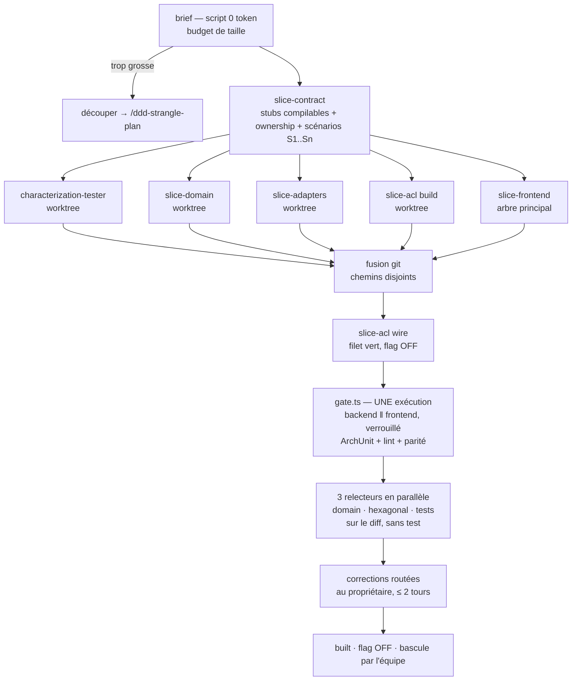

# Flux rapide — livrer une slice en parallèle

Objectif : passer d'une journée par slice à quelques dizaines de minutes de **temps réel**, sans perdre le filet de
sécurité. Principe : **contrat d'abord, travailleurs bornés en parallèle, tests exécutés une seule fois, revue sur le
diff.**

> Les gains annoncés ne sont **pas mesurés** sur votre projet. Utilisez `state.ts timings <slice>` après 2-3 slices pour
> voir où part le temps réel, puis ajustez `sliceBudget`, `locks` et les profondeurs de filet.

## Pourquoi c'était lent

1. Tout était séquentiel (filet → implémentation d'un seul agent → revue → corrections).
2. La revue relançait les tests (Maven + Angular) : plusieurs minutes, parfois en concurrence avec d'autres builds.
3. Les « lots » regroupaient plusieurs slices (PD1+PD4) en une seule unité de travail.
4. Le démarrage de contextes Spring dominait le filet de tests (un contexte par combinaison de mocks).
5. Le hook d'architecture re-parsait tout le dépôt à chaque édition.

## Le flux `/ddd-ship <slice>`

## Ce qui rend les agents « maîtrisés »

| Garde-fou                     | Mécanisme                                                                                       |
|-------------------------------|-------------------------------------------------------------------------------------------------|
| Périmètre d'écriture          | `ownership.json` + hook `guard-ownership.ts` (par type d'agent)                                 |
| Isolation des builds          | worktree git par travailleur backend ; Angular dans l'arbre principal                           |
| Pas de surcharge machine      | `locked.ts` / `gate.ts` : au plus N builds par ressource (`config.locks`)                       |
| Coût borné                    | `maxTurns` par agent, modèle adapté (sonnet pour exécuter, opus pour le contrat)                |
| Sortie contrôlable            | dernière ligne JSON ; l'orchestrateur ne lit ni code ni logs                                    |
| Pas de blocage                | aucun travailleur ne pose de question : `NEEDS_APPROVAL` / `BLOCKED`                            |
| Relecteurs sans effet de bord | pas de tests/build ; ils lisent `gate-<s>.json` et le diff                                      |
| Sécurité legacy               | `guard-legacy` inchangé ; l'ACL ne touche le legacy qu'à la passe `wire`, après fusion du filet |

## Gains attendus par poste (hypothèses)

| Poste                                | Avant                               | Après                                                           |
|--------------------------------------|-------------------------------------|-----------------------------------------------------------------|
| Filet + domaine + adapters + Angular | somme des durées                    | max des durées (parallèle)                                      |
| Revue                                | un agent opus qui relance les tests | 3 relecteurs sonnet sur le diff ; tests = 1 gate partagé        |
| Tests Spring du filet                | 1 contexte par classe               | 1-3 contextes (classe de base partagée, conteneur singleton)    |
| Hook d'architecture                  | scan complet à chaque édition       | un fichier + cache (≈ 0,15 s mesuré sur un petit dépôt de test) |
| Taille                               | lots                                | slices ≤ budget                                                 |

## Prérequis et limites

- Dépôt **git** (branche `ddd/<slice>`, worktrees). L'orchestrateur crée des commits **locaux** ; aucun push.
- `commands.gate` doit être renseigné dans `.ddd/config.json` (voir `/ddd-init`) : compilation ciblée, tests ciblés,
  ArchUnit, lint, parité.
- Le hook `guard-ownership` identifie l'agent via `agent_type` dans l'entrée du hook ; **si votre version de Claude Code
  ne le fournit pas, il ne bloque rien** (les prompts des agents restent la seule garde). À vérifier une fois : éditer
  un fichier hors périmètre depuis un agent et constater le blocage.
- Les worktrees backend n'ont pas `node_modules` : c'est pourquoi l'agent Angular travaille dans l'arbre principal.
- Le profil de tests Spring/Angular (`.claude/skills/spring-angular-testing`) a été écrit **sans vérification Context7**
  (clé API rejetée à ce moment-là) : lancer `/ddd-research` pour confirmer les annotations et versions de votre stack.
- Plus d'agents en parallèle ≠ plus vite si la machine sature : ajustez `locks` (`maven: 2` par défaut) selon CPU/RAM.
